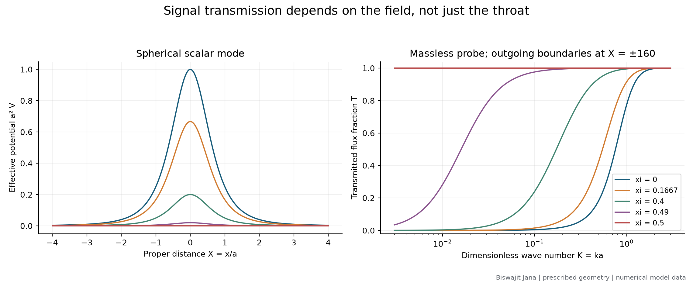

# Cosmic Unknowns

### Wormholes, quantum spacetime and cosmic origins

**Author: Biswajit Jana**
**Version 0.2.0 · 10 November 2026 · Private working research repository**

I investigate foundational questions through explicit mathematical models, literature review and reproducible computation. My first study asks how scalar waves propagate through a prescribed wormhole, when the added field becomes unstable, and what an observer can infer from one-sided reflection.

**[Read the research report](reports/003-transmission-stability-study.md)** · **[Read the derivation](notes/002-scalar-transmission-derivation.md)** · **[Inspect the literature audit](references/literature-audit-2026-11-10.md)**



## What I have calculated

- 525 spectral samples across five curvature couplings, with a published low-frequency benchmark.
- 176 additional samples testing a weak-barrier scaling approximation near transparency.
- Eight probe-instability growth rates, including a second-order analytical comparison, grid refinement and finite-box checks.
- An exact boundary-response equivalence tested at 32 frequencies.
- Finite-bandwidth energy fractions, with direct-quadrature checks on selected cases.
- Five new scientific figures in PNG and SVG, numerical CSV files, parameter records and artifact hashes.

The minimally coupled spherical mode transmits approximately **0.43%** of its flux at dimensionless wave number **ka = 0.1**, and **77.4%** at **ka = 1**. These are generated model results, not astronomical measurements. The main spectral sweep has a maximum flux imbalance of approximately **3.03 × 10⁻⁹**. Separate domain and resolution diagnostics are reported rather than inferred from that conservation check.

## What these results establish

This is a computational reproduction and analysis within a fixed Ellis geometry. I do not claim a new existence theorem, a stable material source, an observed wormhole, or a solution to the broader quantum-gravity questions. The phantom-supported background has a separate known instability that my additional probe-field calculation does not remove. Specialist review is pending.

## Project map

| Material | Link |
|---|---|
| Main study, results and limitations | [Research report](reports/003-transmission-stability-study.md) |
| Full radial derivation and analytical checks | [Mathematical note](notes/002-scalar-transmission-derivation.md) |
| Sources, errata, assumptions and reading depth | [Literature audit](references/literature-audit-2026-11-10.md) |
| Numerical files and column meanings | [Data guide](results/study-001/README.md) |
| Other foundational questions and mathematical targets | [Research agenda](reports/004-foundational-questions.md) |
| Original shortlist and initial proposal | [Landscape](reports/001-research-landscape.md), [brief](reports/002-wormhole-research-brief.md) |
| Geometry and required stress-energy | [Initial baseline](notes/001-wormhole-baseline.md) |
| Authorship and methodological provenance | [Author](AUTHORS.md), [standards](RESEARCH_STANDARDS.md) |

## Reproduce the work

I used Python 3.14.8; Python 3.11 or newer is the intended baseline. `requirements-lock.txt` records the tested environment, while `requirements.txt` gives minimum dependencies. From the repository root on Windows:

```powershell
py -m venv .venv
.venv\Scripts\python.exe -m pip install -r requirements.txt
.venv\Scripts\python.exe -m unittest discover -s tests -v
.venv\Scripts\python.exe scripts/wormhole_baseline.py
.venv\Scripts\python.exe scripts/run_wormhole_study.py
.venv\Scripts\python.exe scripts/audit_wormhole_study.py
```

On Linux or macOS, use `python3 -m venv .venv` and `.venv/bin/python` in the subsequent commands. No external observations or random seeds are needed: these are deterministic model calculations. Floating-point details and execution time may vary by platform. The main study took approximately 99 seconds in the recorded environment; the supplementary audit adds computation.

## Next research step

I plan to replace the unrestricted frequency-dependent load with explicitly specified physical alternatives and determine which additional measurements could distinguish them. This is a candidate research direction, not a novelty claim. A separate reproduction of the magnetically supported wormhole literature would require its actual background and supporting fields.

The repository remains private. No publication or submission is implied. Code and manuscript licensing has not yet been selected; source citations preserve credit for prior work. The local working directory is `gravity-frontiers`, while the GitHub repository is [Biswajit1999/cosmic-unknowns](https://github.com/Biswajit1999/cosmic-unknowns).
