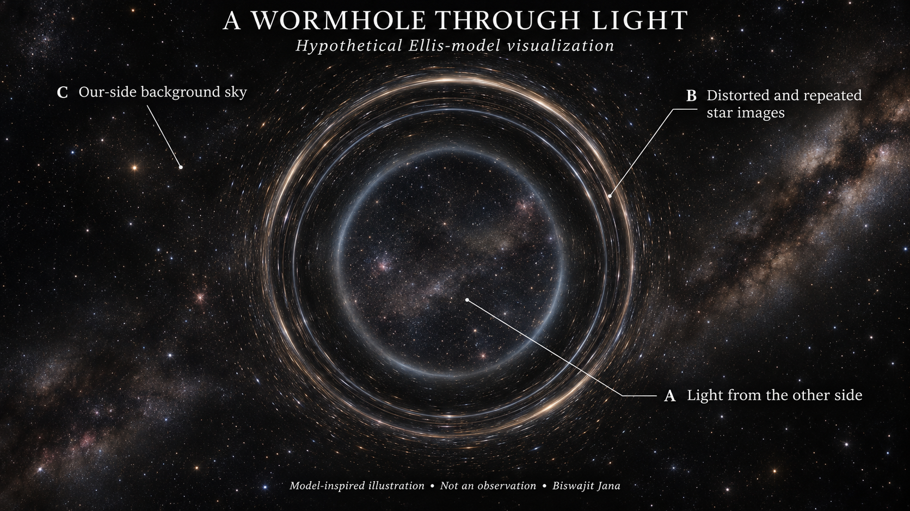
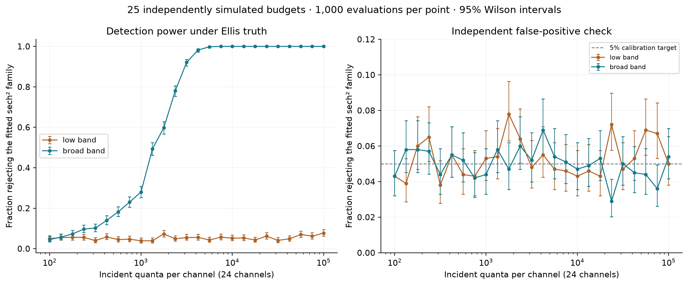

# Cosmic Unknowns

### Wormholes, quantum spacetime and cosmic origins

**Author: Biswajit Jana**
**Version 0.4.0 · 10 November 2026 · Public working research repository**



*Model-inspired photorealistic illustration, not an observation. [Calculated camera view and equations](reports/006-what-a-wormhole-could-look-like.md) · [Image provenance](figures/concept/README.md).*

## Formal scientific report

**[Read the PDF](output/pdf/calibration-limited-identification.pdf)** · **[Read the source manuscript](reports/007-calibration-limited-identification.md)** · **[Originality audit](references/novelty-audit-2026-11-10.md)**

My latest report develops a bounded detector-error criterion and constructs competing models with identical recorded probabilities. In the selected finite-channel benchmark, error allowances of about **0.01224% in the low band** and **3.0943% in the broad band** suffice for explicit matches. These are achievable numerical witnesses under a flexible classification-error model, not measured detector tolerances or certified global minima. They show why more counts alone cannot resolve an exact observation-model ambiguity.

The report contains an analytical proof, equations, likelihood histograms, error bars, calibration profiles, numerical audits and references. Known results are credited. I make no claim that the entire project is unprecedented or that physical wormhole existence is proved.

I investigate foundational questions through explicit mathematical models, literature review and reproducible computation. My first study asks how scalar waves propagate through a prescribed wormhole, when the added field becomes unstable, and what an observer can infer from one-sided reflection.

**[Read the research report](reports/003-transmission-stability-study.md)** · **[Read the derivation](notes/002-scalar-transmission-derivation.md)** · **[Inspect the literature audit](references/literature-audit-2026-11-10.md)**

## New: uncertainty and model distinguishability

I compare the Ellis transmission spectrum with a fitted positive sech-squared barrier. The dense extension uses **25 independently simulated budgets**, **150,000 synthetic experiments** and **3.6 million channel counts**. Each budget/design includes 1,000 calibration, 1,000 false-positive and 1,000 detection trials. The earlier four-budget study remains archived with its own data and report.

In the dense study, broad-band rejection rises from **28.0% at 1,000** incidents per channel to **92.1% at 3,162** and **98.2% at 4,217**. At 10,000, all 1,000 trials reject the comparator, with a conditional 95% Wilson interval of **99.62-100%**. These are ideal-detector model-discrimination results, not astronomical detections. Independent false-positive estimates and threshold sensitivity are reported alongside power.

**[Read study 002](reports/005-transmission-identifiability.md)** · **[Inference equations](notes/003-counting-inference-derivation.md)** · **[Data and uncertainty guide](results/study-002/README.md)** · **[Literature extension](references/study-002-literature.md)**



*Error bars are pointwise 95% Wilson intervals over repeated simulations, conditional on an independently estimated threshold. Additional threshold uncertainty is reported separately. All counting data are synthetic.*

**[Dense simulation data](results/study-005/README.md)** · **[Detector-error witnesses](results/study-004/README.md)**


## What I have calculated

**[What could a wormhole look like?](reports/006-what-a-wormhole-could-look-like.md)** — a calculated null-ray camera view, legends, finite-observer equations and synthetic-sky provenance.

- 525 spectral samples across five curvature couplings, with a published low-frequency benchmark.
- 176 additional samples testing a weak-barrier scaling approximation near transparency.
- Eight probe-instability growth rates, including a second-order analytical comparison, grid refinement and finite-box checks.
- An exact boundary-response equivalence tested at 32 frequencies.
- Finite-bandwidth energy fractions, with direct-quadrature checks on selected cases.
- Five new scientific figures in PNG and SVG, numerical CSV files, parameter records and artifact hashes.

The minimally coupled spherical mode transmits approximately **0.43%** of its flux at dimensionless wave number **ka = 0.1**, and **77.4%** at **ka = 1**. These are generated model results, not astronomical measurements. The main spectral sweep has a maximum flux imbalance of approximately **3.03 × 10⁻⁹**. Separate domain and resolution diagnostics are reported rather than inferred from that conservation check.

## What these results establish

This is a computational reproduction and analysis within a fixed Ellis geometry. I do not claim a new existence theorem, a stable material source, an observed wormhole, or a solution to the broader quantum-gravity questions. The phantom-supported background has a separate known instability that my additional probe-field calculation does not remove. Specialist review is pending.

## Project map

| Material | Link |
|---|---|
| Main study, results and limitations | [Research report](reports/003-transmission-stability-study.md) |
| Full radial derivation and analytical checks | [Mathematical note](notes/002-scalar-transmission-derivation.md) |
| Sources, errata, assumptions and reading depth | [Literature audit](references/literature-audit-2026-11-10.md) |
| Numerical files and column meanings | [Data guide](results/study-001/README.md) |
| Other foundational questions and mathematical targets | [Research agenda](reports/004-foundational-questions.md) |
| Original shortlist and initial proposal | [Landscape](reports/001-research-landscape.md), [brief](reports/002-wormhole-research-brief.md) |
| Geometry and required stress-energy | [Initial baseline](notes/001-wormhole-baseline.md) |
| Authorship and methodological provenance | [Author](AUTHORS.md), [standards](RESEARCH_STANDARDS.md) |

## Reproduce the work

I used Python 3.14.8; Python 3.11 or newer is the intended baseline. `requirements-lock.txt` records the tested environment, while `requirements.txt` gives minimum dependencies. From the repository root on Windows:

```powershell
py -m venv .venv
.venv\Scripts\python.exe -m pip install -r requirements.txt
.venv\Scripts\python.exe -m unittest discover -s tests -v
.venv\Scripts\python.exe scripts/wormhole_baseline.py
.venv\Scripts\python.exe scripts/run_wormhole_study.py
.venv\Scripts\python.exe scripts/audit_wormhole_study.py
.venv\Scripts\python.exe scripts/run_inference_study.py
.venv\Scripts\python.exe scripts/audit_inference_study.py
.venv\Scripts\python.exe scripts/render_wormhole_camera.py
.venv\Scripts\python.exe scripts/run_calibration_study.py
.venv\Scripts\python.exe scripts/run_dense_power_study.py
.venv\Scripts\python.exe scripts/verify_research_artifacts.py
.venv\Scripts\python.exe scripts/verify_extended_studies.py
```

On Linux or macOS, use `python3 -m venv .venv` and `.venv/bin/python` in the subsequent commands. Study 001 is deterministic; study 002 uses the saved seeds 20261110–20261112 and saves every count. Neither imports astronomical observations. Floating-point details and execution time may vary by platform. The first main study took approximately 99 seconds and the second approximately 80 seconds in the recorded environment; supplementary audits add computation.

## Next research step

PDF build instructions and optional dependencies are in [the report build guide](output/pdf/README.md). All manuscript narrative lists Biswajit Jana as its sole author; scientific sources retain their original attribution.

I have now tested one restricted conservative wave-barrier alternative. A physically stronger comparison still requires a competing object's actual matter model, geometry, multiple modes, source and detector response. The next questions concern nuisance parameters, calibration errors and phase information. A separate reproduction of the magnetically supported wormhole literature would require its actual background and supporting fields.

The repository became public on 10 November 2026. Public availability does not imply peer review or journal submission. Code and manuscript licensing has not yet been selected; source citations preserve credit for prior work. The local working directory is `gravity-frontiers`, while the GitHub repository is [Biswajit1999/cosmic-unknowns](https://github.com/Biswajit1999/cosmic-unknowns).
