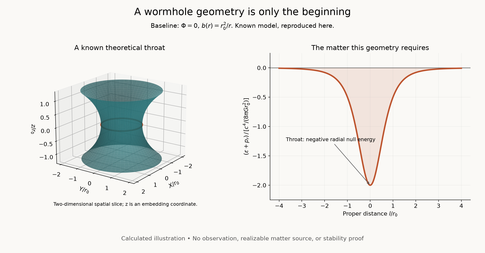

# Cosmic Unknowns

Foundational questions about wormholes, quantum spacetime, and cosmic origins.

**Status: exploratory research scaffold, 8 November 2026. No discovery or observational detection is claimed.**

The private GitHub repository is [Biswajit1999/cosmic-unknowns](https://github.com/Biswajit1999/cosmic-unknowns); the initial local directory is named `gravity-frontiers`. This project follows Biswajit Jana's interest in unanswered foundational questions beyond existing dark-matter, dark-energy, and galaxy-dynamics projects. General relativity enters where needed to define a spacetime, rather than being the proposed observational research target.

## Start here

- [Research landscape and shortlist](reports/001-research-landscape.md)
- [First research brief: wormhole viability and transmission](reports/002-wormhole-research-brief.md)
- [Worked baseline with equations](notes/001-wormhole-baseline.md)
- [Reading list and evidence boundaries](references/reading-list.md)
- [Research standards](RESEARCH_STANDARDS.md)



This image is a calculated illustration of a prescribed theoretical geometry. It is not an image of an observed wormhole, a new solution, or evidence that the required matter exists.

## Reproduce the baseline

Python 3.11 or newer is recommended. From the repository root:

```powershell
py -m venv .venv
.venv\Scripts\python.exe -m pip install -r requirements.txt
.venv\Scripts\python.exe scripts/wormhole_baseline.py
.venv\Scripts\python.exe -m unittest discover -s tests -v
```

The script writes PNG and SVG figures, a CSV of throat scales, and a JSON record of numerical assumptions. `requirements-lock.txt` records the environment used for the initial run; `requirements.txt` lists the minimal plotting dependencies.

## Next milestones

1. Read the foundational wormhole paper and reproduce the baseline independently.
2. Read the full quantum-energy and magnetic-wormhole papers; create an assumption table for each.
3. Reproduce one published transmission calculation with its original boundary conditions.
4. Search subsequent and citing papers before calling any extension novel.
5. Select one controlled extension, specify a falsifiable calculation, and record negative results.

The first brief proposes candidate extensions, not established research gaps. No astronomical data have been downloaded or analyzed. The repository is private. Authorship and licensing should be agreed before public release; no license grant is implied by this draft.

Initial validation: all five numerical consistency checks passed, and the generated PNG was visually inspected. These checks validate the stated baseline calculation only.
