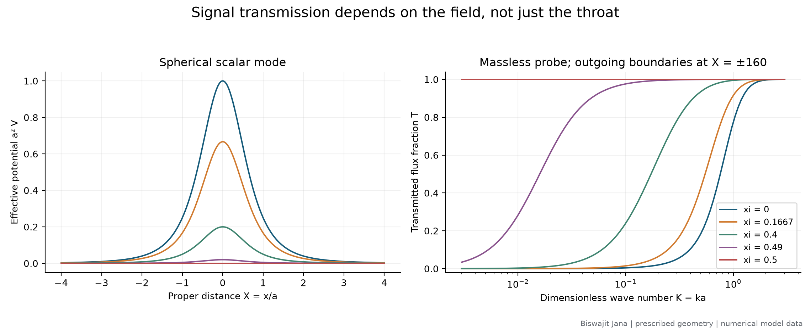
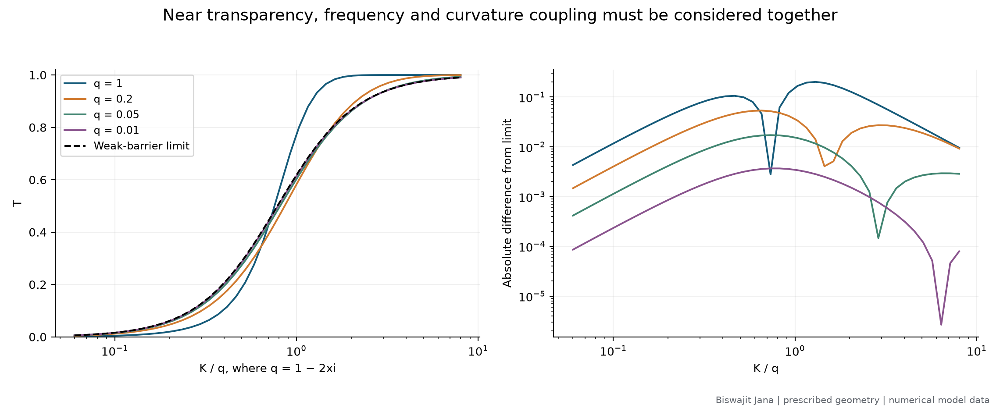
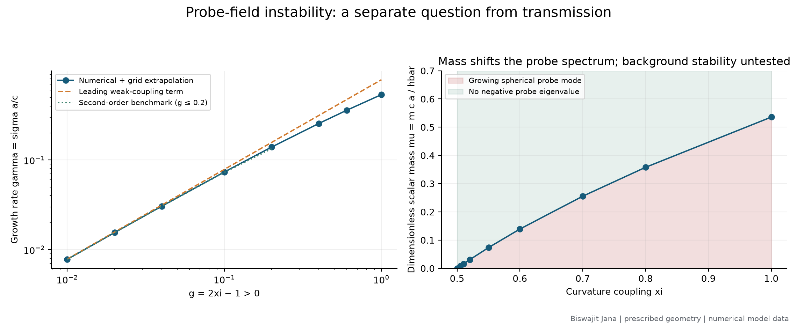
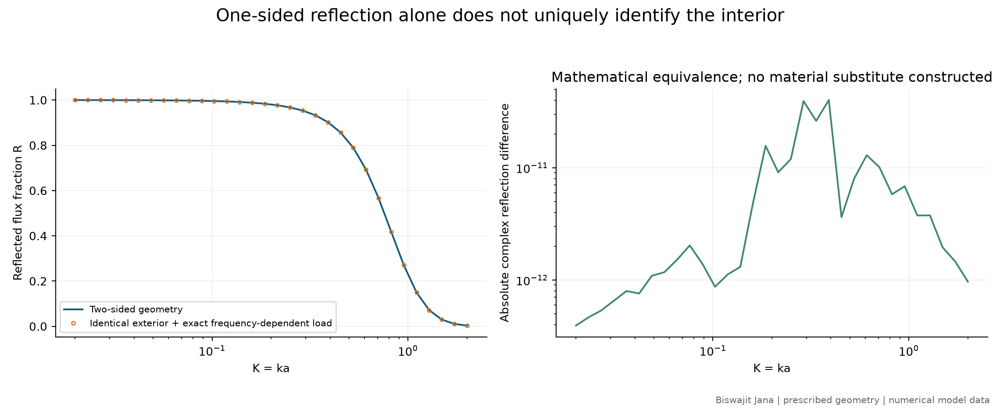
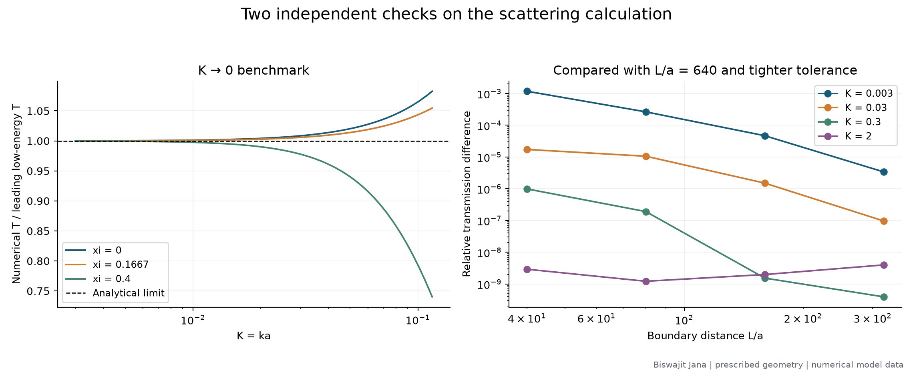

# Signal transmission, instability and observational ambiguity in a prescribed wormhole

**Biswajit Jana**
10 November 2026 · Working research report, version 0.2.0

## Abstract

I investigate scalar propagation on the fixed Ellis wormhole geometry using analytical reductions and reproducible numerical calculations. I compute 525 transmission samples across five curvature couplings, test the low-frequency limit, examine the approach to a transparent spherical channel, and calculate negative probe eigenvalues above the instability threshold. I also demonstrate an exact ambiguity in one-sided linear response using a frequency-dependent boundary load. The calculation reproduces known physics and connects its consequences in a checked computational study. It does not establish a new wormhole solution, a stable source of exotic matter, or an astronomical detection. All plotted data are generated numerical model data.

## 1. Questions and scope

My original question was whether a traversable wormhole can physically exist. I separate that question into four requirements: a geometry, a realizable stress-energy source, stability under the appropriate coupled dynamics, and observational identification. A calculation satisfying only one requirement cannot answer the full question.

In this first study I answer narrower mathematical questions:

1. What fraction of a spherical scalar wave crosses a specified throat?
2. How do frequency and curvature coupling change that fraction?
3. When does this additional scalar field develop a growing mode?
4. Can a one-sided reflection measurement uniquely reveal the hidden geometry?

The [literature audit](../references/literature-audit-2026-11-10.md) records 14 source entries, their relevance, corrections and inspection depth. The selected model is deliberately simple enough to admit analytical checks. It is not the magnetic wormhole in the recent transmission study, and I do not transfer that model's conclusions to mine.

## 2. Model and method

I take $ds^2=-c^2dt^2+dx^2+(x^2+a^2)d\Omega^2$ and an additional scalar satisfying $(\Box-\mu_s^2-\xi\mathcal R)\Phi=0$. Separation of variables and $X=x/a$ reduce the problem to

$$\left[-\frac{d^2}{dX^2}+\frac{\ell(\ell+1)}{1+X^2}
+\frac{1-2\xi}{(1+X^2)^2}\right]u=K^2u,$$

where $K^2=(\omega a/c)^2-(mca/\hbar)^2$. My numerical transmission study uses $\ell=0$. The complete [derivation](../notes/002-scalar-transmission-derivation.md) specifies signs, units, flux normalization and analytical limits.

I integrate a right-outgoing solution from $X=160$ to $X=-160$ using DOP853 with relative tolerance $2\times10^{-10}$ and absolute tolerance $2\times10^{-12}$. Matching to left-incident and reflected plane waves gives the amplitudes. I test larger domains and tighter tolerances separately. The potential tail is not exactly zero at a finite boundary.

For unstable modes I discretize the self-adjoint radial operator with a second-order centered finite difference and Dirichlet conditions at distant boundaries. I use spacings close to 0.04 and 0.02 and remove the leading spacing error by Richardson extrapolation. Domain sizes increase for weakly bound modes, reaching approximately 1783 throat radii. A separate three-spacing check confirms the expected convergence order.

These algorithms solve different numerical problems: flux conservation tests the scattering integration, while a negative eigenvalue establishes a growing mode of the probe equation. Neither algorithm evolves the supporting matter or metric.

## 3. Transmission results

**Figure 1.** The spherical effective potential and transmitted flux fraction for five chosen couplings. The geometry is fixed. Couplings are experimental inputs to the calculation, not inferred astronomical parameters. The conformal scalar value is $\xi=1/6$; the transparent spherical value is $\xi=1/2$.

Selected results, recomputed with boundaries at 320 throat radii, are:

| Coupling $\xi$ | $K=0.01$ | $K=0.1$ | $K=1$ |
|---|---:|---:|---:|
| 0 | 0.00004058 | 0.0043158 | 0.77444 |
| $1/6$ | 0.00014165 | 0.014767 | 0.91550 |
| 0.49 | 0.28238 | 0.97606 | 0.999958 |
| 0.50 | 1 exactly | 1 exactly | 1 exactly |

The entries are fractions, not percentages. Thus a minimally coupled wave at $K=0.1$ transmits about 0.43% of its incident flux. A traversable geometry can strongly suppress this particular wave even though a geometrical route through it exists. The numerical critical-coupling values differ from one by small integration errors; the table uses the exact analytical value and the raw CSV retains the numerical values without clipping.

For minimal coupling, the small-$K$ result is $\mathcal T\sim4K^2/\pi^2$. My log-log fit over $0.003\leq K<0.025$ gives an exponent of **2.00220**, approaching the analytical value of two. This is a numerical benchmark, not an observational fit or a statistical measurement with a confidence interval. The published minimal-coupling result is credited to [Azad, Loran and Mostafazadeh](https://doi.org/10.1140/epjc/s10052-020-08668-3).

## 4. A nonuniform low-frequency approximation

**Figure 2.** Transmission plotted against $K/q$ with $q=1-2\xi>0$. The dashed curve is the weak-barrier asymptotic prediction. The right panel shows approximation error, not numerical integration error. Lines connect 44 calculated samples for each of four values of $q$.

At any fixed $q>0$, the transmitted fraction tends to zero as $K\to0$. At $q=0$, however, the spherical potential is identically zero and transmission is unity. The limits do not commute. This is why a formula valid at a fixed coupling cannot be extrapolated indiscriminately to the critical coupling.

In the joint weak-barrier and long-wavelength limit, the potential area is $\lambda=\pi q/2$. The delta-barrier approximation then predicts

$$\mathcal T\simeq\frac{(K/q)^2}{(K/q)^2+(\pi/4)^2}.$$

The numerical curves approach this relation as $q$ decreases. The strong-barrier curve does not follow it over the entire plotted range. I regard the collapse as a controlled approximation check and a useful way to organize signal sensitivity, not a new physical law.

## 5. Higher-order instability analysis

**Figure 3.** Left: numerical growth rates compared with leading and second-order weak-attraction terms. Right: the mass threshold at which the lowest additional scalar mode stops having negative squared frequency. Shading between sampled points is an interpolated guide; it does not establish stability of the supporting matter or of spacetime.

The spherical potential becomes attractive for $\xi>1/2$. A variational argument proves that a negative eigenvalue exists for every positive attraction strength $g=2\xi-1$. This is consistent with the corrected earlier analysis; see [Taylor's erratum](https://doi.org/10.1103/PhysRevD.95.109904). I reproduce the argument explicitly in my derivation rather than inferring instability merely from a negative-looking plot.

With $E_0=-\gamma^2$, the growth time is $a/(c\gamma)$. Numerical examples are:

| $\xi$ | $g$ | Numerical $\gamma$ | Leading term | Second-order term |
|---|---:|---:|---:|---:|
| 0.505 | 0.01 | 0.00779617 | 0.00785398 | 0.00779508 |
| 0.510 | 0.02 | 0.01548080 | 0.01570796 | 0.01547234 |
| 0.550 | 0.10 | 0.07351846 | 0.07853982 | 0.07264933 |
| 0.600 | 0.20 | 0.13933326 | 0.15707963 | 0.13351769 |

The second-order approximation $\gamma\approx\pi g/4-3\pi g^2/16$ improves the weak-coupling comparison, but its accuracy deteriorates as $g$ grows. I do not use the truncated expression as an exact result. The recent [scalarization preprint](https://arxiv.org/abs/2611.00541) is an explicit comparator for this benchmark; the threshold and onset are not my discovery.

A mass adds $\mu^2=(mca/\hbar)^2$ to the dimensionless squared-frequency operator. The lowest probe mode therefore ceases to grow when $\mu\geq\gamma$. This says nothing about the independent instability of the standard phantom-supported Ellis background documented by [González, Guzmán and Sarbach](https://arxiv.org/abs/0806.0608).

## 6. What one-sided reflection can establish

**Figure 4.** Reflection from the two-sided model compared with reflection from the same left exterior terminated by its exact right-side response. Their complex amplitudes agree to within approximately $4.1\times10^{-11}$ in the sampled numerical calculation.

At the throat I construct the frequency-dependent logarithmic derivative $Z(K)=u_+'(0)/u_+(0)$ of the outgoing right-side solution. Using this as a boundary condition on the left reproduces the same exterior response. The equality follows from uniqueness of the radial ordinary differential equation and is not evidence for a second physical object.

The implication is narrow but useful: a single linear scattering channel cannot reveal a unique hidden completion when arbitrary frequency-dependent loads are allowed. I have not constructed a realizable surface with that response. Restricting alternatives to specific matter models, measuring additional channels, or detecting correlated signals at both mouths could change the inference problem. An unusual reflected waveform alone is insufficient to establish a wormhole.

## 7. Signals with a finite frequency width

I also calculate all-time transmitted energy fractions for Gaussian spectral power with width 20% of its central $K$. Energy weighting is proportional to $K^2|A(K)|^2$ for the massless probe. For minimal coupling and a central $K=0.1$, direct quadrature gives approximately **0.00524960**, compared with **0.00431579** for a monochromatic wave at the center. The difference comes from averaging a frequency-dependent transmission probability with the correct energy weight.

The supplementary packet table uses interpolation of the main spectra. Direct 41- and 81-point calculations on three selected cases expose interpolation differences up to 0.2442%, while the direct quadrature changes by less than $2.8\times10^{-8}$ relatively. This is a numerical precision qualification, not an astrophysical uncertainty budget. I do not compute arrival-time distributions, finite-time detection probabilities or instrument response.

## 8. Validation and reproducibility

**Figure 5.** The low-frequency analytical comparison and finite-boundary convergence. At high frequency, tighter integration tolerances rather than a longer domain can set the remaining numerical floor.

| Check | Result in the tested set | Interpretation |
|---|---:|---|
| Maximum $|\mathcal T+\mathcal R-1|$ over 525 spectral samples | $3.03\times10^{-9}$ | Flux balance of finite-domain integration |
| Largest relative transmission change, $L=160$ versus $L=640$, minimal-coupling check set | $4.69\times10^{-5}$ | Domain sensitivity at four selected frequencies |
| Largest corresponding change in six additional coupling/frequency cases | $3.13\times10^{-5}$ | Includes a near-critical low-frequency point |
| Largest relative eigenvalue change on halving the spacing | $5.08\times10^{-5}$ | Before Richardson removal |
| Largest relative eigenvalue change from the half-size to full-size box | $1.66\times10^{-5}$ | Tested across eight couplings |
| Successive eigenvalue-difference ratios under grid halving | 4.002 and 4.004 | Consistent with second-order discretization |
| Unit tests | 13 passed | Includes exact free propagation, low-energy, conservation and response checks |

These are sampled numerical diagnostics, not rigorous uniform error bounds over every possible parameter. I retain them separately because flux balance does not detect potential-tail truncation and a small grid error does not detect a domain that is too short for a weakly bound mode.

The [data directory](../results/study-001/README.md) documents CSV schemas. A JSON manifest records versions, settings and numerical summaries. SHA-256 hashes identify the saved data and figures. Scripts generate every plotted curve without manual adjustment. Instructions are in the repository README.

## 9. Conclusions and unresolved work

Within the selected linear probe problem, I have answered the transmission, threshold, weak-coupling and one-sided-response questions stated above. I have not answered whether physical wormholes exist. The most consequential unresolved step is to connect signal predictions to a self-consistent source and its coupled dynamics.

My next candidate project is a restricted comparison of physically motivated boundary responses, replacing the unrestricted load in Section 6. Before assigning novelty, I would need to survey prior work on compact-object response, specify admissible material models, and decide which independent observables constrain them. An alternative is to reproduce the magnetic construction's transmission calculation with its actual field content; that would require a different background and cannot be achieved by renaming the Ellis model.

The other foundational questions remain in the [mathematical research agenda](004-foundational-questions.md). This first report is a completed computational study within explicit assumptions, not a claim that those broader questions are solved.

## Authorship and provenance

I am the sole listed author of this working report. Prior results are credited through citations and the literature audit. I used computational and AI-assisted tools in preparing this draft, its code and figures; these tools are not coauthors. Specialist review and my final submission-level verification remain pending. The repository is private and this report has not been submitted for publication.
