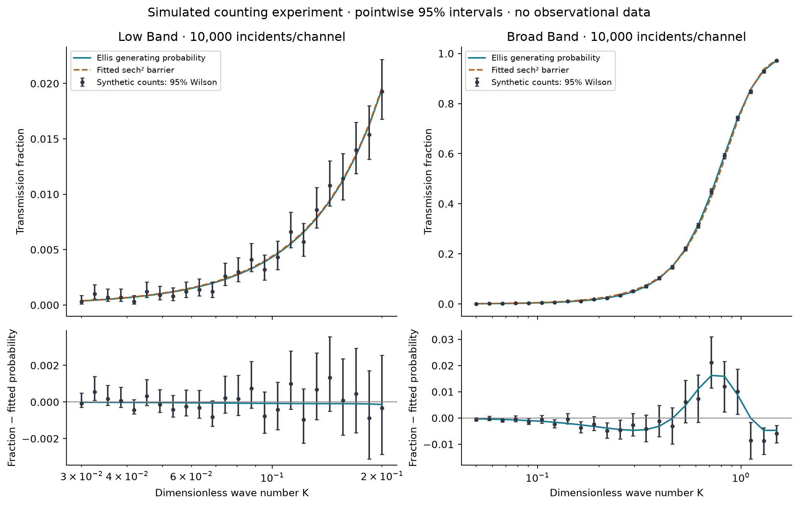
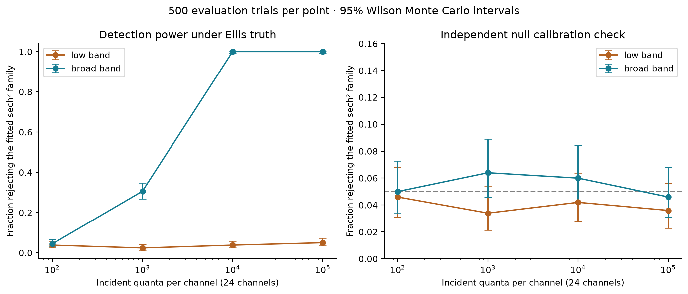
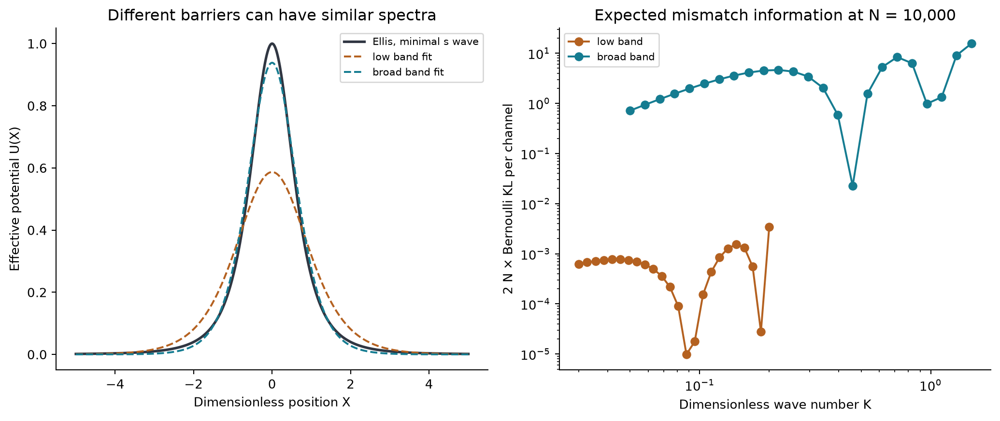
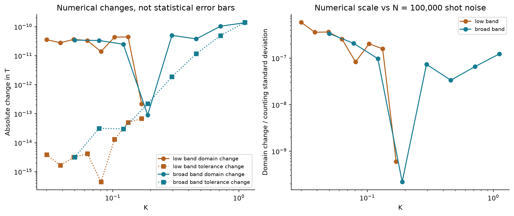

# Can a transmission spectrum distinguish a wormhole model from another barrier?

**Author: Biswajit Jana · Working research report · 10 November 2026**

## Abstract

I compare scalar transmission on a fixed Ellis geometry with an exact positive sech-squared wave barrier. Using 24 frequency channels per design, four incident-count budgets and 12,000 simulated experiments, I quantify how restricted model discrimination depends on frequency coverage. At 10,000 incident quanta per channel, a broad design rejects the comparator in 500/500 Ellis-generated trials; a low-frequency design rejects it in 19/500. Pointwise Wilson intervals, independently simulated false positives, calibration-threshold sensitivity and numerical checks accompany the result. The experiment demonstrates distinguishability of specified wave operators under ideal counting assumptions. It does not detect a wormhole or establish a viable physical source.

## 1. Question, scope and data

The [first study](003-transmission-stability-study.md) found an exact one-sided boundary-response ambiguity. I now ask a narrower question: can a frequency-dependent transmission probability reject one specified, two-parameter alternative barrier?

There is no observed wormhole dataset in this project. I use generated model probabilities and explicitly simulated incident/transmitted counts. Attaching an astronomical catalog to these calculations without a valid source-to-detector model would not make the inference observational. The current study is an ideal experimental-design calculation, with full [data provenance](../results/study-002/README.md).

I use a massless, minimally coupled spherical probe with the scale fixed at unity. A scalar wave obeys

$$[-\partial_X^2+U_E(X)]u=K^2u,\qquad U_E(X)=(1+X^2)^{-2}.$$

The comparator is $U_P(X)=H\operatorname{sech}^2(\alpha X)$ with positive height and inverse width. Its exact transmission probability provides a strong check independent of my Ellis solver. It is a conservative local wave operator; I have not constructed a material object or spacetime realizing it. The analytical formula and its conventions are documented in the [derivation](../notes/003-counting-inference-derivation.md), using [Boonserm & Visser, Section 3.8](https://arxiv.org/pdf/1005.4483).

## 2. Why the low band is difficult

Writing the comparator as $T_P=\sinh^2(bK)/[\sinh^2(bK)+C]$ gives $T_P\sim(b^2/C)K^2$. The minimal Ellis result is $T_E\sim4K^2/\pi^2$. Consequently a continuous family $C=\pi^2b^2/4$ reproduces the leading coefficient. Measuring that coefficient alone cannot recover the barrier shape.

The likelihood's Fisher matrix also becomes rank deficient at leading small frequency: the two log-parameter score directions become proportional. This analytical explanation is stronger than merely observing that two curves look similar. It also predicts that fitting the alternative independently at each count realization is necessary; holding its parameters fixed would exaggerate discrimination.

The selected designs are:

| Design | Dimensionless K range | Frequency channels | Incident quanta per channel |
|---|---:|---:|---|
| Low band | 0.03–0.20 | 24, logarithmic spacing | 100, 1,000, 10,000, 100,000 |
| Broad band | 0.05–1.50 | 24, logarithmic spacing | Same four budgets |

This comparison holds channel count and incident count fixed, not total incident energy. Broad-band particles have greater mean energy. Neither design is claimed to be optimal, and no physical length or observing time is inferred from dimensionless K.

## 3. Statistical procedure

At each channel I generate $Y_i\sim\mathrm{Binomial}(N,T_E(K_i))$. This assumes independent quanta, known incident counts and frequencies, perfect classification, and no absorption, background, calibration drift or detector inefficiency. These assumptions define a thought experiment rather than an available astronomical measurement.

I fit both comparator parameters to every experiment by binomial maximum likelihood. The goodness-of-fit statistic is the deviance relative to independently fitted probabilities in all 24 channels. I estimate a threshold from 500 comparator simulations at the noiseless best-fit projection of Ellis, then evaluate 500 independent comparator and 500 Ellis experiments. I repeat this for all eight design/budget combinations, giving 12,000 experiments and 288,000 channel counts.

This calibration is pointwise at the selected comparator parameters. It does not guarantee a 5% false-positive rate everywhere in the composite null family. I do not use a naive chi-square difference test for nonnested models, and I do not report a Bayes factor or an astronomical discovery significance.

**Figure 1.** Separate, unselected synthetic examples at N=10,000. Bars are pointwise 95% Wilson intervals on observed transmission fractions. Lower panels subtract the comparator fitted to that same example. The bars show count uncertainty; they do not include fitted-parameter uncertainty and are not simultaneous residual bands. Connecting the 24 model samples guides the eye; no extra measured channels are implied.

## 4. Measured power and false positives

| Incidents/channel | Total incidents | Low-band rejection rate, 95% interval | Broad-band rejection rate, 95% interval |
|---:|---:|---:|---:|
| 100 | 2,400 | 3.8% [2.45, 5.86]% | 4.4% [2.92, 6.57]% |
| 1,000 | 24,000 | 2.4% [1.38, 4.15]% | 30.6% [26.72, 34.77]% |
| 10,000 | 240,000 | 3.8% [2.45, 5.86]% | 100% [99.24, 100]% |
| 100,000 | 2,400,000 | 5.0% [3.41, 7.28]% | 100% [99.24, 100]% |

These are rejection probabilities under Ellis-generated truth, estimated from 500 experiments per row/design. An estimate of 100% means that all 500 trials rejected the comparator, not that future trials are guaranteed to succeed. The intervals quantify finite Monte Carlo sampling conditional on each estimated threshold.

**Figure 2.** Broad-band discrimination rises with the count budget. The low band remains close to the null false-positive scale over the tested budgets. Independent comparator checks yield false-positive rates between 3.4% and 6.4%, with every displayed 95% interval containing 5%. Lines connect tested budgets; no intermediate threshold has been established.

Finite calibration also matters. For example, at broad-band N=1,000, the rejection fraction is 30.6%, but bootstrapping the threshold-calibration sample yields a separate induced-rate sensitivity range of 25.6–36.0%. At broad-band N=10,000, all evaluation trials reject across the recorded 95% threshold-bootstrap range. The complete threshold sensitivities are saved in `rates.csv`; they are not merged into the conditional Wilson bars.

## 5. Information and the fitted barriers

The noiseless best-fit comparator parameters are:

| Design | Height H | Inverse width alpha | Maximum absolute probability mismatch | Sum of Bernoulli KL divergences |
|---|---:|---:|---:|---:|
| Low band | 0.586709 | 0.822231 | 0.0000807071 | 0.000000854059 |
| Broad band | 0.938453 | 1.221085 | 0.0143524 | 0.00438034 |

These are deterministic projections, not estimates from observed celestial data. The corresponding Fisher condition numbers in log C/log b coordinates are approximately 2,704 and 201. The small-band fit's poor conditioning is consistent with the leading-order degeneracy; those coordinate-dependent numbers are not universal measures of scientific identifiability.

**Figure 3.** Left: different real barrier shapes can reproduce similar low-band transmission. Right: per-channel $2N d_B(p\Vert q)$ at N=10,000, comparing fixed generating and projected comparator probabilities. The total is approximately 0.0171 for the low band and 87.61 for the broad band. This fixed-model expected log-likelihood ratio explains the different information budgets; it is not a p-value or the expectation of the refitted goodness-of-fit statistic.

## 6. Numerical and fitting audit

| Diagnostic | Recorded result | Meaning |
|---|---:|---|
| Comparator formula versus independent ODE | Maximum absolute difference 2.16 × 10⁻¹¹ | Sixteen checks spanning both analytic branches and their junction |
| Ellis domain 320 versus 640 | Maximum absolute difference 1.36 × 10⁻¹⁰ | Sixteen selected channels; the larger-domain calculation also tightens tolerance |
| Tightened tolerance at fixed domain 320 | Maximum absolute difference 1.40 × 10⁻¹⁰ | Independent integration-tolerance diagnostic |
| Domain difference / counting standard deviation at N=100,000 | Maximum 5.85 × 10⁻⁷ | Numerical changes are small relative to the modeled count uncertainty in the checked set |
| Initial optimizer non-success flags | 44 / 12,000 | Preserved in the raw results and independently audited |
| Original fits touching computational bounds | 891 / 12,000 | All occur in the low band; retained in calibration and power calculations |
| Independent derivative-free, wider-bound audit | 1,041 fits; all audit optimizations report success | Includes every original non-success and boundary fit, plus a fixed ordinary-fit subset |
| Largest audited deviance improvement | 0.00290 | Widening bounds and changing optimizer; maximum for originally non-success fits is 0.000108 |
| Changed evaluation decisions after audited refits and threshold recomputation | 0 | Supports robustness of the reported finite-sample rates in this audit |
| Automated mathematical tests | 18 passed | Includes exact limits, statistical edge cases, direct ODE checks and previous study checks |

I keep the original warning flags instead of converting them into successful fits. The independent audit is evidence that these flags and bounds do not alter the reported decisions in the tested sample. It is not a proof of global optimality or uniform calibration over arbitrary parameters.

**Figure 4.** Numerical changes are displayed separately from statistical error bars. Sampling only part of the frequency grid does not establish a rigorous uniform bound. Near a cancellation of truncation and integration errors, a small difference is not evidence of exceptional absolute accuracy.

## 7. What is solved, and what remains open

I have answered a concrete computational question: under the specified count model, broad frequency coverage can reject this fitted sech-squared alternative with high measured power, while the selected low-frequency range cannot do so at the tested budgets. I have also derived the leading-order degeneracy and verified that the numerical error scale and audited fitting issues do not explain this contrast.

This does not solve wormhole existence, stability, formation or unrestricted identification. The prescribed Ellis background still needs its own source and coupled dynamics. A good fit to its transmission would not uniquely identify its topology. Phase information, other angular modes, and restrictions from a self-consistent matter model remain outside this inference experiment. Earlier work on observational mimicry and mode matching motivates this caution; the [literature extension](../references/study-002-literature.md) records exactly what was inspected.

A useful next calculation would introduce an uncertain scale and efficiency into both forward models, then ask how much discrimination survives. A subsequent step would replace the generic comparator with an explicitly derived physical object and its detector response. Those extensions are distinct projects, not results of this report.

## Reproducibility and authorship

Run `scripts/run_inference_study.py`, then `scripts/audit_inference_study.py`. The [data guide](../results/study-002/README.md) specifies all columns, seeds, intervals and limitations. Machine-readable data, all plots, parameter records, environment versions and artifact hashes are included. The [mathematical note](../notes/003-counting-inference-derivation.md) contains the likelihood, gradients, Fisher matrix and calibration derivation.

I am the sole listed author. Prior formulas remain credited to their original sources. I used computational and AI-assisted tools to prepare this working analysis; they are not coauthors. Independent specialist review and my final submission-level verification remain pending. This private report has not been submitted for publication.
