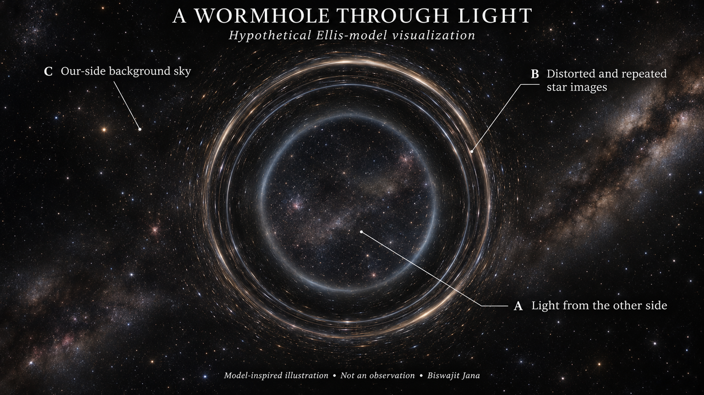
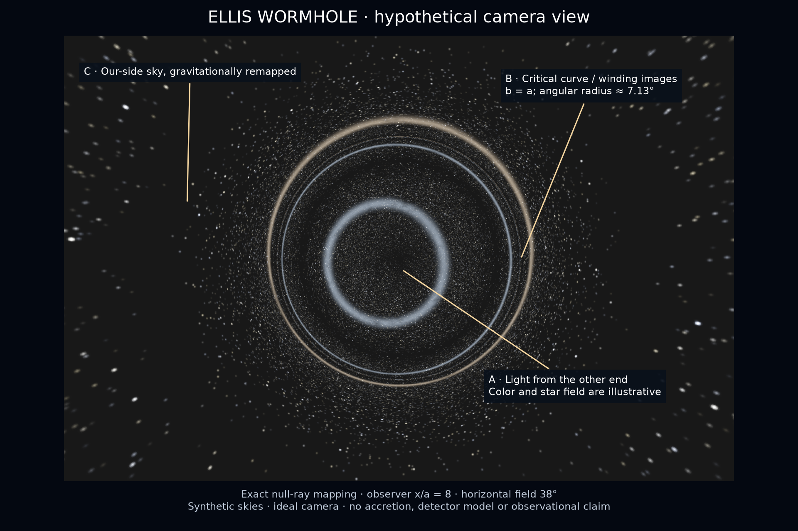

# What could a wormhole look like to a camera?

**Author: Biswajit Jana · 10 November 2026**

I can predict an image conditional on a spacetime, illumination and observer. I cannot determine a unique appearance for an unobserved physical wormhole or predict what technology will discover a century from now. Here I calculate null rays in the same symmetric, ultrastatic Ellis geometry used elsewhere in this project. This produces a more defensible visual than treating a spatial embedding funnel as a photograph.

*Model-inspired visual interpretation of the calculated view below. Image generation changes star positions, brightness and fine structure; this hero is not quantitative data. [Provenance](../figures/concept/README.md).*

**Figure 1.** Exact ray-direction mapping for this model, rendered against two procedural star fields. The observer is at proper radial coordinate $x_o=8a$, the horizontal field of view is 38°, and the image has 1,200 × 800 pixels with four rays per pixel. Star sizes, brightnesses, colors and diffuse bands are illustrative. This is an ideal camera near the throat, not an Earth-based telescope prediction, astronomical observation or measured sky catalog.

## What the legends mean

- **A — Light from the other end.** Backward-traced rays with impact parameter $b<a$ cross the throat. The camera can therefore show another background sky instead of a universally black center. Whether that region looks bright, dark or colorful depends on the sources there.
- **B — Critical curve and winding images.** Rays near $b=a$ accumulate large angular advances. Repeated, highly compressed sky images occur near the critical curve. Particular bright rings trace the chosen background illumination; the critical curve is not a glowing material rim.
- **C — Our-side sky.** Rays with $b>a$ turn around before crossing the throat and return to the observer's asymptotic region. They remap the sky around the central window.

No visible wireframe, tunnel wall or accretion disk is required by this calculation. A disk, surrounding gas or asymmetric geometry would change the appearance and requires a different radiation model. [Huang, Kunz, Yang & Zhang](https://arxiv.org/abs/2303.11885) study a broader Ellis–Bronnikov setting and illustrate the importance of the viewing side and illumination; I inspected that paper's abstract, not its full numerical implementation.

## Ray equations and camera geometry

The equatorial null condition and conserved energy/angular momentum give

$$
ds^2=-c^2dt^2+dx^2+(x^2+a^2)d\phi^2=0,
\qquad
\left(\frac{dx}{d\lambda}\right)^2
=E^2\left(1-\frac{b^2}{x^2+a^2}\right).
$$

Here the normalization of $E$ absorbs the affine-parameter convention and $b=L/E$. The unparameterized ray obeys

$$
\left|\frac{d\phi}{dx}\right|
=\frac{b}{\sqrt{x^2+a^2}\sqrt{x^2+a^2-b^2}}.
$$

At a static observer, with angle $\psi$ measured from the inward radial direction,

$$
b=\sqrt{x_o^2+a^2}\sin\psi,
\qquad
\psi_c=\arcsin\frac{a}{\sqrt{x_o^2+a^2}}.
$$

For $x_o=8a$, $\psi_c=7.12501635^\circ$. This angular size follows from my chosen nearby viewpoint, not a measured throat radius. For a distant observer at distance $D\gg a$, it approaches $a/D$ radians.

Set $q=b/a$, $X_o=x_o/a$ and let $\mathsf K(m)$ and $\mathsf F(\varphi|m)$ denote elliptic integrals using the **parameter** $m$, not the modulus. The accumulated polar advance to the source sky at infinity is

$$
\Phi_-(q)=q\left[2\mathsf K(q^2)-\mathsf F\!\left(\arctan(1/X_o)\mid q^2\right)\right],\qquad 0\leq q<1,
$$

$$
\Phi_+(q)=2\mathsf K(q^{-2})-
\mathsf F\!\left(\arcsin\frac{q}{\sqrt{1+X_o^2}}\mid q^{-2}\right),
\qquad1<q<\sqrt{1+X_o^2}.
$$

I obtain the crossing expression by substituting $x/a=\tan z$ in the ray integral. For returning rays, splitting the path at $x_t/a=\sqrt{q^2-1}$ and substituting $v=\arcsin(q\cos z)$ yields the second expression. Exactly critical rays are asymptotic to the throat light orbit and are excluded from the source-sky map. Finite pixels cannot resolve arbitrarily high winding images.

As the observer recedes to infinity, the returning ray has $\Phi_+\to2\mathsf K(q^{-2})$, giving deflection $2\mathsf K(q^{-2})-\pi$. This agrees with the complete-elliptic-integral result of [Nakajima & Asada, *Deflection angle of light in an Ellis wormhole geometry*](https://arxiv.org/pdf/1204.3710). I inspected the paper's metric, ray integral and exact deflection expression; the finite-observer formulas above are derived and checked locally.

## Brightness, sources and validation

I map each camera ray to a direction on one of two source spheres at asymptotic infinity. These spheres carry procedurally generated finite-size stars and diffuse bands. Their seeds are saved; they are not measured distributions or a prediction about a second universe. The textures determine the image colors, luminosities and detailed arcs. The geometry determines which sky is sampled and how its directions are remapped.

The static ultrastatic model has no gravitational frequency shift between these static source/observer frames. In transparent geometric optics, radiance along a ray is conserved. I therefore apply **no arbitrary magnification factor to pixel surface brightness**. Magnification changes apparent source area. A constant radiance on both source skies returns a constant image in my implementation: a wormhole is not guaranteed to show contrast against a perfectly uniform equal-radiance background under these assumptions.

I check nine ray angles against direct quadrature, spanning crossing and returning rays and both sides of the critical value. The maximum difference is $6.22\times10^{-15}$ radians in this tested set. The uniform-radiance check has maximum error $5.55\times10^{-17}$ in arbitrary radiance units. These checks establish agreement of the ray formulas with the numerical integrals and a brightness invariant; they do not certify photometric convergence of the image's finest rings.

Display brightness uses a stated exposure curve, $[1-\exp(-12I)]^{1/2.2}$, for arbitrary input radiance $I$. Four subpixel rays reduce aliasing but do not resolve the infinite image sequence near the critical curve. No detector point-spread function, photon noise, dust transport, source evolution or finite observation time is modeled. This image is geometric optics; it must not be confused with the long-wavelength scalar transmission in studies 001 and 002.

## What better technology would and would not reveal

An ideal instrument with adequate angular resolution and sensitivity might measure background remapping, repeated images, changes as a source moves, or time-delay correlations. Those are candidate observables, not unique signatures established here. A future comparison must include other lenses, source variability, instrumental response, and a dynamically viable source for the spacetime.

The rough diffraction relation $\theta\sim\lambda/B$ connects wavelength and aperture or interferometric baseline. Increasing $B$ can improve angular resolution, but cannot determine the unknown throat radius, distance, background luminosity, matter content or whether such an object exists. I therefore do not attach a speculative year or telescope capability to this image.

The linked [data guide](../results/study-003/README.md) and `scripts/render_wormhole_camera.py` reproduce the calculated view. Any separately generated photorealistic hero is a labeled model-inspired interpretation, not a replacement for the ray map or evidence of a physical object.
