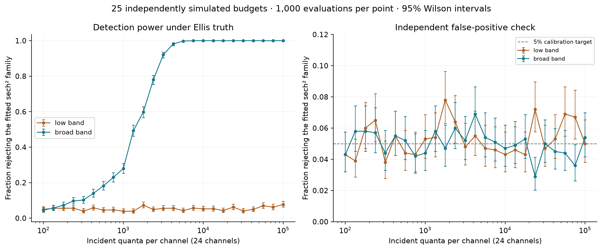
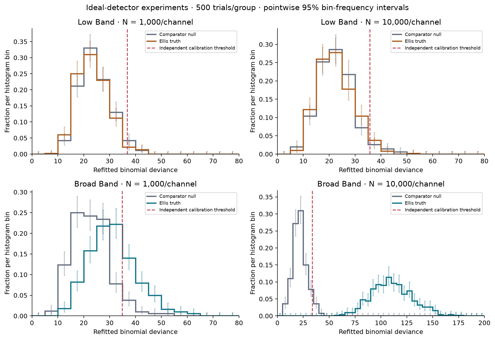
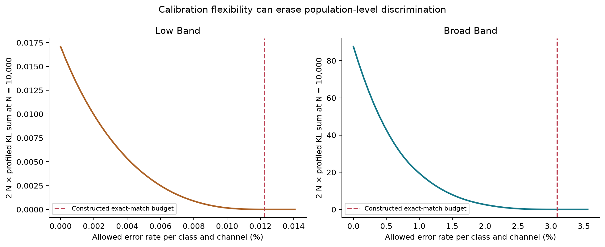
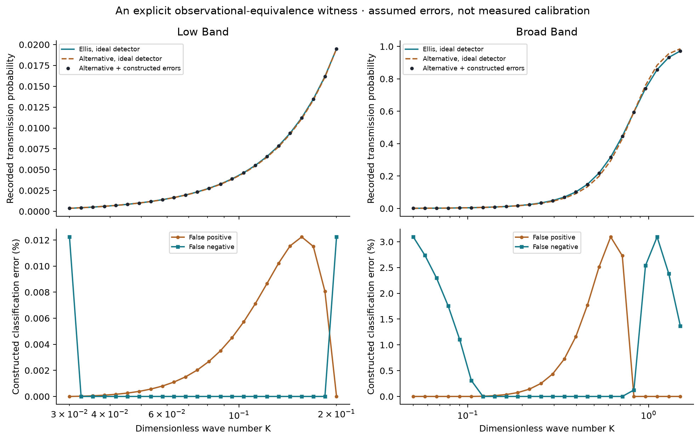
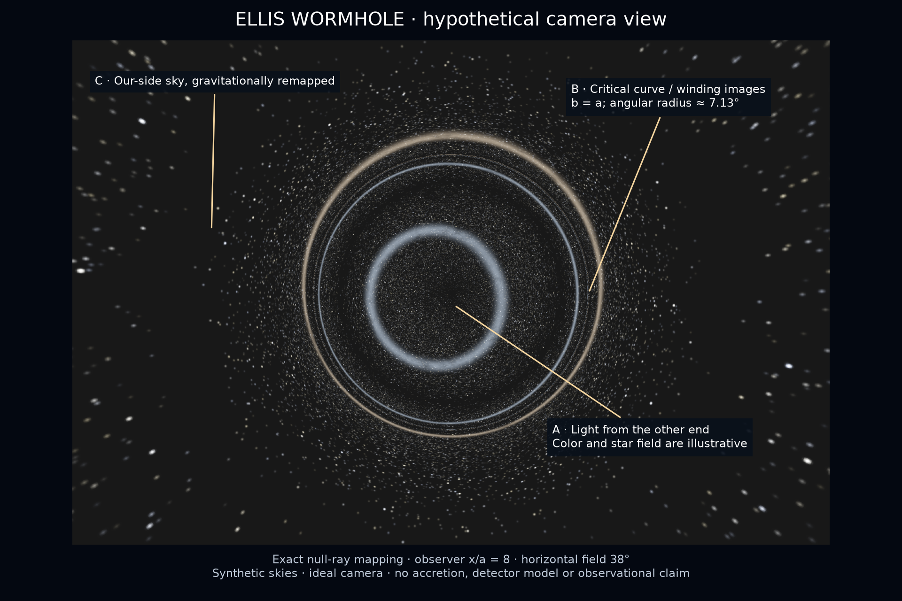

# Calibration-Limited Model Identification in Scalar Transmission

**An Ellis-wormhole benchmark**

**Biswajit Jana**

10 November 2026 | Version 0.4.0 | Public working research report

## Abstract

I investigate when scalar transmission can distinguish a prescribed Ellis wormhole from a positive sech-squared wave barrier, and how imperfect classification of transmitted and reflected quanta changes that inference. The study combines an analytic scattering benchmark, repeated binomial counting experiments, a constructive probability-equivalence criterion, and numerical optimization. Ideal-detector simulations distinguish the selected broad-band spectra at sufficiently large count budgets, while a low-frequency design remains poorly discriminating. However, freely varying bounded classification errors can make the competing barrier reproduce every selected Ellis probability exactly. Explicit numerical witnesses require maximum per-class error allowances of approximately 0.01224% and 3.0943% in the low and broad bands, respectively. These are achievable budgets for the specified finite-channel model, not certified global minima or measured detector properties. I prove the probability-equivalence criterion and its statistical consequence, then validate its numerical application with independent optimization and refined scattering calculations. Histograms, pointwise uncertainty intervals, source data and reproducible code accompany the analysis. The contribution is a documented benchmark and calibration-sensitivity study. It neither establishes physical wormhole existence nor claims that the underlying physics or general identifiability problem is unprecedented.

**Keywords:** scalar scattering; inverse problems; detector calibration; binomial inference; wormhole models; reproducibility.

## 1. Research question and contribution

A spectrum can distinguish two specified forward models without uniquely identifying the physical system that produced it. I study this distinction using a tractable wormhole example. The principal question is: how much freedom in a detector's classification response is sufficient to erase a difference that an ideal detector would resolve?

The project has three levels. First, it reproduces known scalar propagation on a prescribed Ellis background. Second, it measures discrimination against a specified alternative potential using synthetic counts. Third, it constructs alternative detector responses that produce exactly the same count probabilities. Only the third level supplies the new extension examined here; even there, the general mathematics of unknown error channels has substantial prior literature.

I make the following bounded claims. The numerical experiments are reproducible calculations for stated models. Proposition 1 is an elementary algebraic result with a proof. The finite-channel equivalence witnesses are verified numerical constructions. Their existence demonstrates a limit to identification under an explicitly enlarged nuisance family. No statement in this report constitutes evidence that a traversable wormhole exists in nature.

### 1.1 Prior work and originality

Azad, Loran and Mostafazadeh [1] already analyze low-energy scalar transmission through wormholes. Boonserm and Visser [2] collect exact transmission results, including the sech-squared comparator. Taylor's work and erratum [3,4] address scalar propagation and curvature coupling. These are foundations, not results first obtained here.

Völkel and Kokkotas [5] discuss reconstruction and nonuniqueness for wormhole and compact-star potentials using trapped modes, explicitly within a WKB framework. Liu, Cheng and Zhang [6] study identifiability of unknown instance-dependent label-noise transitions in a different statistical setting. These papers rule out a blanket claim that spectral ambiguity or unknown classification errors are new ideas. My application combines finite-channel scalar transmission, a particular bounded-error criterion, constructive nuisance profiles, and reproducible counting experiments.

A targeted search on 10 November 2026 did not establish an exact predecessor for this complete numerical configuration. That absence is not proof of priority. I therefore describe the combination as a candidate application-level contribution, pending a broader citation review and independent specialist assessment. The companion novelty audit records queries, inspected sources and reading depth.

## 2. Physical and mathematical models

The background is the symmetric ultrastatic Ellis geometry with throat scale a:

$$
ds^2=-c^2dt^2+dx^2+(x^2+a^2)d\Omega^2.
$$

For a massless, minimally coupled spherical scalar mode, define X = x/a and K = ka. Separation of the wave equation gives

$$
\left[-\frac{d^2}{dX^2}+U_E(X)\right]u=K^2u,\qquad U_E(X)=\frac{1}{(1+X^2)^2}.
$$

I impose unit incident amplitude at the left asymptotic end and outgoing transmission at the right. Equal asymptotic wave numbers imply transmission and reflection probabilities T = |t|² and R = |r|², with T + R = 1 for a real conservative potential. The numerical Jost solution is integrated with DOP853; finite boundaries and integration tolerances are checked independently.

The comparator is a positive local barrier, not a complete alternative compact-object spacetime:

$$
U_P(X)=H\operatorname{sech}^2(\alpha X),\qquad T_P(K)=\frac{\sinh^2(bK)}{\sinh^2(bK)+C},\qquad b=\frac{\pi}{\alpha}.
$$

For 4H/alpha² at most one, C is cos²[(pi/2)sqrt(1 - 4H/alpha²)]; above one, the continuation is cosh²[(pi/2)sqrt(4H/alpha² - 1)]. Equation (3) follows [2], with units translated to the operator in Equation (2). Independent numerical integration checks both branches and their junction.

The leading low-frequency coefficients are

$$
T_E(K)\sim\frac{4K^2}{\pi^2},\qquad T_P(K)\sim\frac{b^2}{C}K^2,\qquad C=\frac{\pi^2b^2}{4}.
$$

The last equality defines a continuous family that matches the Ellis leading coefficient. Thus a measurement of that coefficient alone cannot identify the shape of the barrier. I do not assume an unrestricted analytic Taylor expansion for the Ellis spectrum, whose potential has an algebraic tail.

The supporting phantom-matter Ellis solution has a known coupled instability [7]. A scalar-probe calculation on a fixed metric does not remove it. This study does not construct a source, formation history or stable traversable object.

## 3. Counting experiment and uncertainty model

I use two 24-channel designs with logarithmically spaced dimensionless frequencies. The low band spans K = 0.03 to 0.20; the broad band spans K = 0.05 to 1.50. Each channel receives N independent scalar quanta. With an ideal detector,

$$
Y_i\sim\operatorname{Binomial}(N,p_i),\qquad p_i=T_E(K_i).
$$

Incident counts, frequency calibration and the throat scale are treated as known. There is no source variability, absorption, background count rate, unresolved angular-mode mixture or finite wave-packet width. These are synthetic controlled experiments, not telescope data. Comparing the bands holds incident counts fixed, not total incident energy.

I fit the two comparator parameters separately to every realization. Writing theta = (log C, log b) gives a stable logistic likelihood, with logit(T_P) = 2 log sinh(bK) - log C. The fit bounds are -16 to 25 for log C and 0.1 to 30 for b. Boundary fits remain in the analysis.

The goodness-of-fit statistic is the binomial deviance relative to saturated channel probabilities:

$$
D=2\sum_i\left[Y_i\log\frac{Y_i}{N\widehat q_i}+(N-Y_i)\log\frac{N-Y_i}{N(1-\widehat q_i)}\right].
$$

Terms with zero counts use the continuous convention 0 log 0 = 0. No universal chi-square reference law is assumed. At each design and N, simulated comparator data at the noiseless best-fit projection define a 95th-percentile rejection threshold. Separate comparator trials assess false positives, and separate Ellis trials assess power. The calibration is pointwise at those parameters, not uniform over the entire composite null family.

The initial experiment used four budgets and 500 repetitions per group. The dense extension uses 25 budgets from 100 to 100,000, with 1,000 calibration, 1,000 false-positive and 1,000 power trials per design and budget. That is 150,000 experiments and 3.6 million individual channel counts. Each case uses a separately specified random seed; joining plotted points does not supply interpolated experiments.

Pointwise 95% Wilson score intervals [8] describe Monte Carlo rejection fractions and observed count fractions. They are not simultaneous confidence bands or posterior probabilities. Rejection-rate intervals condition on an estimated threshold; separate threshold bootstraps quantify additional sensitivity. Histogram bars use fixed common bin edges, and each bin's frequency interval is marginal. Bin frequencies are correlated because their sum is one.

**Figure 1.** Dense ideal-detector study. Each marker comes from independent simulations at the displayed budget. Error bars are conditional, pointwise Wilson intervals. Calibration-threshold uncertainty is provided separately in the data. The two panels distinguish power from false-positive behavior.

## 4. An exact detector-response ambiguity

Let q_i denote a comparator's physical transmission probability. Suppose a transmitted event can be classified as reflected with probability f_i, and a reflected event can be classified as transmitted with probability g_i. Each error is independently allowed to vary by channel within [0, delta]. This is a bounded nuisance model, not a claim about the performance of any real detector. Its recorded probability is

$$
\widetilde q_i=(1-f_i)q_i+g_i(1-q_i),\qquad 0\leq f_i,g_i\leq\delta.
$$

Here false positive means recording transmission when the physical outcome was reflection; false negative means the reverse. This confusion model does not merely discard undetected events. A detector that only misses particles requires a different observation model.

### Proposition 1: finite-channel probability matching

For fixed target probabilities p_i in [0,1] and comparator probabilities q_i strictly between zero and one, admissible errors reproduce all targets exactly if and only if delta is at least the following quantity:

$$
\Delta(p,q)=\max_i\left\{\frac{(p_i-q_i)_+}{1-q_i},\frac{(q_i-p_i)_+}{q_i}\right\},\qquad (z)_+=\max(z,0).
$$

**Proof.** For fixed q_i, the smallest attainable recorded probability is (1 - delta)q_i, attained at f_i = delta and g_i = 0. The largest is q_i + delta(1 - q_i), attained at f_i = 0 and g_i = delta. Since the response is affine on the allowed rectangle, every value between those endpoints is attainable. Requiring p_i to lie in that interval is equivalent to the two inequalities in Equation (8). Taking their maximum across channels proves necessity. For sufficiency, choose

$$
g_i=\frac{(p_i-q_i)_+}{1-q_i},\qquad f_i=\frac{(q_i-p_i)_+}{q_i}.
$$

These nonnegative choices are bounded by Delta, and substitution in Equation (7) gives p_i exactly. This completes the proof.

### Statistical consequence

When the recorded probabilities match and trials remain conditionally independent, the full joint binomial distributions are identical for every N. Any test based only on these counts then has the same rejection probability under the two matched descriptions. If a test has size at most alpha uniformly over the enlarged comparator-plus-error family, its power against an Ellis description that coincides with a member of that family cannot exceed alpha. More counts do not resolve this exact intersection of distributions.

This is a conditional impossibility result for a specified observation model. It does not prove that all instruments suffer the stated errors, that the error functions are physically smooth, or that other observables carry no information. An independent calibration measurement, constraints coupling channels, phases or additional field modes can change the inference problem.

## 5. Constructing and auditing numerical witnesses

I search over comparator parameters to reduce Delta while keeping the physical potential within the original fit bounds. SLSQP uses analytic constraint derivatives and four starting points. A separate differential-evolution search uses a fixed seed. Their agreement supports the located solutions, but neither method certifies a global minimum.

Every reported parameter pair and error vector is a constructive witness: the scalar probability table can be checked directly by substitution. I therefore report achievable error budgets, which provide upper bounds on the smallest matching budget. I do not interpret these numbers as proven lower bounds on the accuracy required of every possible detector.

For an intermediate allowed budget delta, the optimal recorded probability for a fixed physical comparator is obtained by clipping the target to its admissible interval:

$$
q_i^\delta=\operatorname{clip}\left(p_i,(1-\delta)q_i,q_i+\delta(1-q_i)\right).
$$

This minimizes the Bernoulli Kullback-Leibler divergence because that divergence decreases toward q = p and increases away from it. I then numerically profile over the two physical comparator parameters using independent starting points. The saved profile is

$$
J(\delta)=\inf_\theta\sum_i\left[p_i\log\frac{p_i}{q_i^\delta(\theta)}+(1-p_i)\log\frac{1-p_i}{1-q_i^\delta(\theta)}\right].
$$

The code approximates the infimum with numerical optimization, rather than certifying it. For two fixed distributions, 2N times their summed divergence is the expected twice-log likelihood ratio. It is not a p-value, a detection probability, or the expectation of the refitted deviance statistic. The plotted profile is an information diagnostic.

## 6. Results

### 6.1 Ideal-detector discrimination

The dense extension resolves the transition rather than inferring it from four isolated budgets:

| Incidents per channel | Broad-band power | Conditional 95% Wilson interval |
|---|---:|---:|
| 1,000 | 28.0% | 25.31-30.86% |
| 2,371 | 78.0% | 75.33-80.46% |
| 3,162 | 92.1% | 90.26-93.62% |
| 4,217 | 98.2% | 97.17-98.86% |
| 5,623 | 99.8% | 99.27-99.95% |
| 10,000 | 100% | 99.62-100% |

The first tested budget whose pointwise lower Wilson limit exceeds 90% is 3,162. This is a descriptive grid result, not an optimal-budget proof or a simultaneous guarantee after searching the grid. Independent null-check fractions range from 2.9% to 7.8% across the 50 cases. Some conditional intervals exclude 5%; finite calibration samples and multiple comparisons matter. Threshold-bootstrap sensitivities are retained, and no uniform size guarantee is asserted. The dense run reports zero unresolved optimizer warnings and 10,112 boundary fits, all retained in the data.

The initial 500-trial study provides a reference independent of the newly seeded dense extension. At N = 1,000, broad-band rejection is 30.6% with a conditional 95% interval of 26.72-34.77%. At N = 10,000 it is 500/500, corresponding to 100% with a Wilson interval of 99.24-100%. The low band produces 19/500 rejections at the latter budget, or 3.8% with interval 2.45-5.86%. All-success samples do not guarantee success in every future experiment.

**Figure 2.** Distributions from the initial, ideal-detector study, retained separately from the dense extension. Broad-band Ellis deviances separate from the comparator null as the count budget rises. Low-band distributions overlap. Each panel uses 500 independent trials per group; bin-frequency bars are pointwise Wilson intervals. The dashed line is calibrated from a separate comparator sample. The common bin edges are 0, 5, ..., 200; the display crops empty high-deviance regions where appropriate.

### 6.2 Probability-equivalence witnesses

| Quantity | Low band | Broad band |
|---|---:|---:|
| Located log C | 3.62664142 | 2.95940884 |
| Located log b | 1.36389313 | 1.05099772 |
| Achievable per-class error allowance | 0.0122399% | 3.0942999% |
| Allowance using refined Ellis probabilities at fixed comparator | 0.0122495% | 3.0943031% |
| Recorded-probability residual in saved baseline tables | 0 to stored precision | 0 to stored precision |

The error allowance is a maximum over both classes and all 24 channels. It is not the fraction of all incidents misclassified, a Gaussian calibration standard deviation, or a measured hardware tolerance. The error functions deliberately exploit the specified channel freedom. Requiring common, smooth or independently measured errors could remove the constructed equivalence.

At fixed ideal-likelihood projections, matching would require larger allowances: about 1.29% in the low band and 22.29% in the broad band. Refitting the physical barrier for the bounded-error objective is therefore consequential. Using the original best fit unchanged would misstate the nuisance family's ability to mimic the target.

**Figure 3.** Profiled mismatch information decreases as the allowed error family expands. At the constructed matching budget it reaches zero to numerical precision. The left and right vertical scales differ substantially. These are deterministic model profiles with optimization and discretization limitations; statistical error bars would not describe those uncertainties.

**Figure 4.** Upper panels show the target, the physical alternative and its recorded probability after applying the explicit errors. Lower panels show the assumed false-positive and false-negative probabilities that realize the match. These are population-level constructions from model probabilities, not fits to an accidentally favorable count realization.

### 6.3 Numerical reliability

The generating probabilities are directly integrated at every frequency. Recomputing all 48 channels with domain 640 and tighter tolerances changes probabilities by at most 1.97 × 10⁻¹⁰. The low-band matching allowance is more sensitive than the raw probability because Equation (8) divides by small transmission probabilities. The refined result shifts from 0.0122399% to 0.0122495%; reporting many digits as physical accuracy would be unjustified.

The independent differential-evolution search agrees with the located error allowance to approximately 1.4 × 10⁻¹³ in the low band and 3.7 × 10⁻¹² in the broad band. These are algorithm comparisons, not global optimality certificates. All 94 KL-profile optimizations report success. Algebraic tests check random probability pairs, endpoint targets, necessity below the required bound and exact reconstruction above it.

Earlier checks reproduce the minimal low-frequency coefficient, finite-domain convergence, the transparent scalar coupling, flux balance, probe eigenvalue behavior, and independent sech-squared ODE transmission. The baseline uncertainty study preserves 44 optimizer warning flags and audits them with a separate method; that audit changes none of its rejection decisions. The dense extension records its own warnings, boundary fits and fallback checks. Twenty-two mathematical and statistical unit tests pass in the recorded environment.

## 7. What an image can establish

The project also computes null-ray directions for an ideal camera in the same ultrastatic geometry. This is a separate geometric-optics calculation; it is not the low-frequency scalar-count experiment above. At observer coordinate x/a = 8, the critical angular radius is about 7.125 degrees. A distant observer instead sees an angular scale approaching a/D, so the nearby camera picture is not a prediction of an Earth-based telescope image.

**Figure 5.** Ray directions follow the Ellis metric; source stars, colors and diffuse backgrounds are procedural assumptions. The map is checked against direct quadrature and preserves constant radiance for a uniform source sky. Nakajima and Asada [9] provide the asymptotic elliptic-integral deflection benchmark. A separately generated photorealistic README hero is explanatory artwork and is excluded from the quantitative analysis.

The image illustrates what light could do under the chosen model. It does not establish a physical source for the metric, identify a detected object or predict the observational technology available in a future century.

## 8. Interpretation, limitations and research direction

Three different meanings of possibility must remain separate. Mathematical existence asks whether a model satisfies specified equations. Physical viability asks whether its matter, stability and formation are credible. Statistical identifiability asks whether selected measurements distinguish it from alternatives. This report addresses the third question under explicit assumptions; the constructed equivalent distributions are not an existence proof for traversable spacetime.

The principal limitation is deliberate detector flexibility: separate false-positive and false-negative probabilities may vary independently across channels, with no calibration sample or smoothness constraint. That makes Proposition 1 exact and interpretable, but it is not a realistic description of every instrument. The scalar probe, fixed scale, source control and generic comparator also limit astrophysical interpretation. Only two frequency designs and finite computational parameter bounds are explored.

The natural next study would add independent calibration counts, a smooth response model, uncertain source normalization and scale, and multiple observable modes. It should calibrate the composite null more broadly and evaluate designs under an energy or observing-time budget. A physical compact-object comparator requires its own metric and matter perturbations. These extensions must be executed before claiming a detector-ready astronomy result.

If the project pivots away from wormholes, the bounded-error criterion remains applicable to competing one-dimensional wave-barrier models. A laboratory scattering analogue is a plausible setting for testing the inference method, but no apparatus or experimental realization is supplied here. Changing topics would not itself establish originality or convert simulations into observations.

The defensible contribution is therefore a transparent, falsifiable benchmark: an explicit calibration-response ambiguity with numerical witnesses, uncertainty-aware simulations, and documented limits. I do not claim that no one has ever studied the component ideas or that this report solves an outstanding foundational physics problem.

## 9. Data, software and authorship

The public repository contains model probabilities, count records, histogram bins, witness error vectors, numerical diagnostics, random seeds, source versions and SHA-256 manifests. Dense experiments are stored as standard gzip-compressed CSV shards with explicit headers; compressed storage does not discard trials. Results from the initial and dense studies remain separate to avoid replacing historical evidence silently.

Scientific plots are generated from saved numerical data. The report source is Markdown; its PDF is built with a documented script and rendered for visual inspection. Versioned dependencies, parameter units and data guides are retained so later readers can reproduce the claims rather than rely on the appearance of a plot. Public availability is not journal acceptance or peer review.

I am the sole listed author. Prior scientific results remain credited to their original authors. I used computational and AI-assisted tools for literature exploration, drafting, algebra, code and figure preparation; those tools are not coauthors. Independent specialist review and my final submission-level verification remain pending. The repository was made public on 10 November 2026 at my request; no external journal submission has been made.

## References

[1] B. Azad, F. Loran and A. Mostafazadeh, Transmission of low-energy scalar waves through a traversable wormhole, European Physical Journal C 80, 1097 (2020). https://doi.org/10.1140/epjc/s10052-020-08668-3

[2] P. Boonserm and M. Visser, Quasi-normal frequencies: Key analytic results, Journal of High Energy Physics 03, 073 (2011), Section 3.8. https://doi.org/10.1007/JHEP03(2011)073

[3] P. Taylor, Propagation of Test Particles and Scalar Fields on a Class of Wormhole Space-Times, Physical Review D 90, 024057 (2014). https://doi.org/10.1103/PhysRevD.90.024057

[4] P. Taylor, Erratum, Physical Review D 95, 109904 (2017). https://doi.org/10.1103/PhysRevD.95.109904

[5] S. H. Völkel and K. D. Kokkotas, Wormhole Potentials and Throats from Quasi-Normal Modes, Classical and Quantum Gravity 35, 105018 (2018), Section VI. https://doi.org/10.1088/1361-6382/aabce6

[6] Y. Liu, H. Cheng and K. Zhang, Identifiability of Label Noise Transition Matrix, Proceedings of Machine Learning Research 202, 21475-21496 (2023). https://proceedings.mlr.press/v202/liu23g.html

[7] J. A. González, F. S. Guzmán and O. Sarbach, Instability of wormholes supported by a ghost scalar field. I. Linear stability analysis, Classical and Quantum Gravity 26, 015010 (2009). https://doi.org/10.1088/0264-9381/26/1/015010

[8] E. B. Wilson, Probable Inference, the Law of Succession, and Statistical Inference, Journal of the American Statistical Association 22, 209-212 (1927). https://doi.org/10.2307/2276774

[9] K. Nakajima and H. Asada, Deflection angle of light in an Ellis wormhole geometry (2012), Eqs. 5-9. https://arxiv.org/abs/1204.3710
