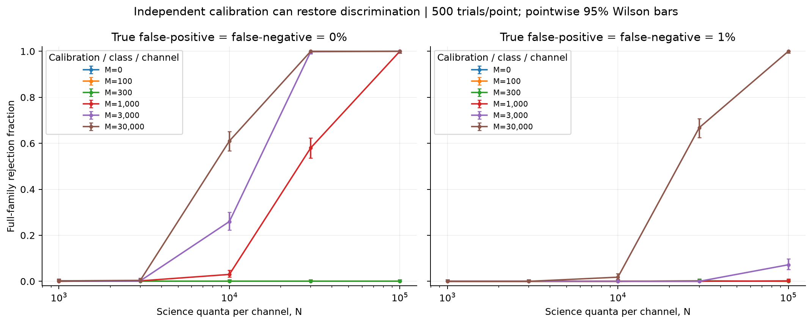
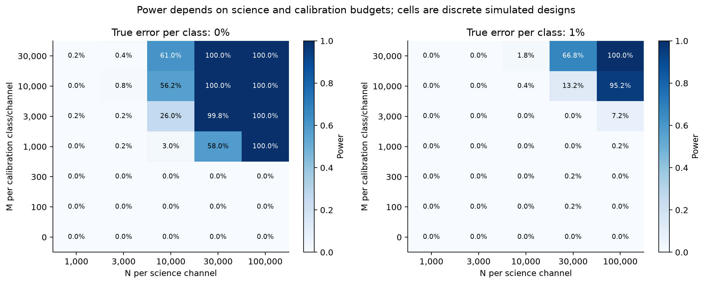
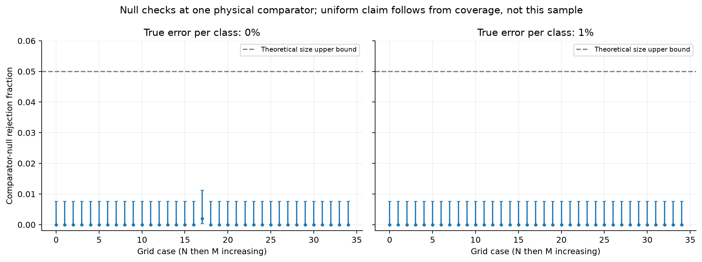

# Independent calibration and continuum exclusion in scalar-transmission inference

**Biswajit Jana**

**12 November 2026 | Study 006 | Public working research; specialist review pending**

## Abstract

I extend the scalar-transmission benchmark from an unknown bounded response to independently measured detector classification rates. I construct a joint confidence-region test whose ideal mathematical form controls false rejection across the entire specified comparator family, rather than at one fitted parameter point. A monotone interval search eliminates the continuous comparator parameters; unsuccessful searches never cause rejection. Repeated synthetic experiments quantify the cost of calibration uncertainty. With 1% true false-positive and false-negative rates and 100,000 incident quanta per science channel, raising calibration from 3,000 to 10,000 known-state injections per class per channel increases rejection from 7.2% to 95.2%. A separate interval calculation brackets the finite-channel population matching threshold. This resolves a restricted identification problem under explicit assumptions; it neither demonstrates physical wormholes nor claims a new general theory of confidence regions.

## 1. What is different from the previous study?

Studies 004 and 005 established two distinct results: ideal counting can discriminate the selected spectra, and freely varying classification errors can make those spectra observationally equivalent. The earlier likelihood thresholds were calibrated at one comparator projection per design. They did not provide a uniform false-positive bound over every comparator parameter and detector response.

Here I add an observable that was absent: calibration trials whose true transmitted/reflected class is known independently. I also replace local best-fit rejection with exclusion of the whole bounded comparator family. The price is a deliberately conservative test. Its power cannot be compared to the earlier ideal-detector power as though the tests and null models were identical.

The question is now precise: **when do finite science and calibration counts rule out every permitted comparator-plus-response model?**

## 2. Joint science and calibration model

Let q_i(theta) be the positive sech-squared barrier transmission, with theta = (log C, log b):

$$
q_i(\theta)=\frac{\sinh^2(bK_i)}{\sinh^2(bK_i)+C},\qquad
\log C\in[-16,25],\quad b\in[0.1,30].
$$

If f_i is the false-negative rate and g_i the false-positive rate, recorded science probability is

$$
r_i=g_i+(1-f_i-g_i)q_i.
$$

The independent data are

$$
Y_i\sim\mathrm{Bin}(N,r_i),\quad
A_i\sim\mathrm{Bin}(M,f_i),\quad
B_i\sim\mathrm{Bin}(M,g_i).
$$

A_i counts errors among known transmitted injections; B_i counts errors among known reflected injections. **M is per class per channel**, so 24 science channels cost 24N incidents and calibration costs 48M injections. These are count budgets, not equal-energy or telescope-time budgets.

I assume calibration and science share the same response, the reference labels are correct, trials are binomial, frequencies and the throat scale are known, and there is no unmodeled source variability, background or absorption. These conditions describe a controlled synthetic experiment. No physical calibration apparatus or telescope observation is supplied.

The Monte Carlo generating errors are either f_i = g_i = 0 or f_i = g_i = 0.01. **The fitted null does not assume shared or known errors**: each channel's two probabilities may range over its calibration confidence interval. With M = 0 they are unconstrained in [0,1], so the test cannot identify a physical spectrum.

## 3. Confidence-region exclusion and its false-positive bound

For m = 24 channels there are 3m = 72 unknown binomial probabilities. Construct a two-sided Clopper-Pearson interval for each, using tail probability

$$
\eta=\frac{\alpha}{6m}=\frac{0.05}{144}.
$$

For y successes in n trials, the nontrivial endpoints are beta quantiles Beta^{-1}(eta; y,n-y+1) and Beta^{-1}(1-eta; y+1,n-y); endpoints are 0 at y = 0 and 1 at y = n as appropriate. The union bound gives simultaneous coverage at least 1-alpha. Independence is not required for this union-bound step, although it is part of the data-generating experiment.

Write the resulting science interval as [L_i,U_i], false-negative interval as [f_i^-,f_i^+], and false-positive interval as [g_i^-,g_i^+]. For a physical probability q, its attainable recorded interval is

$$
\left[g_i^-+(1-f_i^+-g_i^-)q,
      g_i^++(1-f_i^--g_i^+)q\right].
$$

This interval overlaps [L_i,U_i] exactly when

$$
g_i^-+(1-f_i^+-g_i^-)q\le U_i,\qquad
g_i^++(1-f_i^--g_i^+)q\ge L_i.
$$

Intersect these linear half-intervals with [0,1] to obtain a physical-probability interval [q_i^-,q_i^+]. The implementation handles positive, negative and zero slopes; it does not silently assume that all classifiers perform better than random.

**Proposition: model-conditional size control.** Reject only if no allowed theta has q_i(theta) in every physical interval. Under any member of the specified null family, the true parameters belong to all confidence intervals with probability at least 1-alpha. On that event, the true theta is feasible and cannot be excluded. Therefore

$$
\sup_{\theta,f,g\ \mathrm{in\ the\ null}}P(\mathrm{reject})\le\alpha.
$$

This is an exact-arithmetic statistical argument using established confidence-interval machinery, not a novelty claim. It applies to each prespecified experiment. It is not a simultaneous 5% error guarantee across all 70 simulated designs, nor across arbitrary future searches or stopping rules.

**Numerical qualification.** The code uses SciPy beta quantiles, expanded outward by 10^-12, and response-projection bounds expanded by 10^-11. These guards and the subsequent interval calculations are not a formal end-to-end proof of inverse-beta numerical accuracy. The analytic coverage result and the checked implementation must remain distinguished. Fully validated binomial-tail inversion is a remaining engineering task.

## 4. Excluding a continuum, rather than checking a grid

Define S_i(b) = 2 log sinh(b K_i), which increases for b > 0. For fixed b, feasibility reduces to a scalar intersection:

$$
\max\{-16,\max_i[S_i(b)-\mathrm{logit}(q_i^+)]\}
\le
\min\{25,\min_i[S_i(b)-\mathrm{logit}(q_i^-)]\}.
$$

For a branch b in [l,u], replace S_i(b) by S_i(l) on the lower side and S_i(u) on the upper side. If the resulting lower bound exceeds the upper bound, **every b in that branch is impossible**. The search bisects unresolved branches, checking every exclusion with 35-digit interval arithmetic. Midpoint compatibility stops rejection; a node or resolution limit returns `undetermined`, also without rejection. A full-family rejection requires all branches covering [0.1,30] to be excluded.

This turns two-dimensional parameter fitting into one-dimensional interval feasibility. It avoids interpreting a local optimizer failure as evidence against the null. The interval guarantee is conditional on the supplied numerical probability bounds and library implementation; mpmath labels its interval context experimental.

### Population matching threshold

I apply the same exclusion to the fixed saved Ellis probabilities and compare against the existing constructive witness. The independent verifier rechecks all 1,056 saved exclusion leaves at 70 digits and checks a feasible witness with an additional 10^-10 allowance.

| Design | All allowances through this value excluded | Interval-checked feasible allowance |
|---|---:|---:|
| Low band | 0.01223926848% | 0.01223987613% |
| Broad band | 3.09414877357% | 3.09429987243% |

Within the bounded comparator domain, the smallest matching allowance for the **saved numerical target** lies above the first column and no higher than the second. These are bounds on a finite-channel problem, not universal physical detector requirements. Repeating exclusion with each target allowed to move by ±2 × 10^-10 retains the displayed lower bounds. That is a sensitivity check, not a validated enclosure of the ODE solution. In particular, the earlier refined low-band allowance shifts at digits finer than the physical numerical accuracy; the new bracket must not be attached to an exact continuum geometry without that qualification.

## 5. Simulation design and results

The broad-band grid uses N in {1,000; 3,000; 10,000; 30,000; 100,000} and M in {0; 100; 300; 1,000; 3,000; 10,000; 30,000}. Each of the 70 error/budget combinations has 500 Ellis trials and 500 comparator-null trials. Null data use the previously published broad-band comparator projection, with the same true detector errors as the Ellis experiment.

All 70,000 experiments are retained. Their records contain 1.68 million science-count entries and 3.36 million calibration-count entries, including structural zeros when M = 0. These are aggregated binomial count values, not 5.04 million individual incident quanta. There are zero undetermined decisions in this grid. All random draws are replayed, all aggregate rates and Wilson intervals recalculated, and 1,400 solver decisions independently rerun in the verifier. Every production exclusion was already interval-checked when generated.

| True error per class | N per channel | M per class/channel | Rejection power | Pointwise 95% Wilson interval |
|---|---:|---:|---:|---:|
| 0% | 10,000 | 30,000 | 61.0% | 56.66-65.18% |
| 0% | 30,000 | 3,000 | 99.8% | 98.88-99.96% |
| 1% | 30,000 | 30,000 | 66.8% | 62.56-70.79% |
| 1% | 100,000 | 3,000 | 7.2% | 5.25-9.81% |
| 1% | 100,000 | 10,000 | 95.2% | 92.96-96.75% |
| 1% | 100,000 | 30,000 | 100% | 99.24-100% |

The change from M = 3,000 to 10,000 at fixed N = 100,000 is the clearest example of a calibration bottleneck. The latter design uses 2.4 million science incidents plus 480,000 calibration injections. Increasing science exposure while calibration remains weak is not interchangeable with improving calibration.

**Figure 1.** Selected calibration budgets, 500 trials per plotted point. Error bars are pointwise Monte Carlo Wilson intervals; they are not simultaneous bands or the confidence intervals used inside the exclusion test. Lines join tested designs, not additional simulations. The M = 10,000 results are included in Figure 2 and the complete rate table.

**Figure 2.** Every grid cell is independently simulated. M counts injections per known class per channel. The axes are discrete categories; distances between cells do not imply equal physical increments. Cell uncertainties are in the rate table. Finite Monte Carlo sampling can produce nonmonotone small rates.

**Figure 3.** There is one rejection among 35,000 comparator-null experiments. This demonstrates how conservative the procedure is in the tested configurations; it neither measures nor proves the worst-case rejection rate. The uniform bound comes from the confidence-region argument, subject to the implementation qualification above. A 100% power estimate from 500 trials is likewise not a guarantee about every future realization.

## 6. Exactly what independent calibration can and cannot identify

At the population level, calibration identifies f_i and g_i. If s_i = 1-f_i-g_i is nonzero,

$$
q_i=\frac{r_i-g_i}{1-f_i-g_i}.
$$

Thus the previously free physical probability becomes identifiable. If f_i+g_i = 1, however, r_i = g_i for every q_i: even perfect knowledge of that detector cannot recover the physical probability from this channel. Near this blind-response surface, inversion is ill-conditioned. This is a basic response-matrix fact, not a newly discovered property of wormholes.

For independent large samples away from boundaries, the delta method gives

$$
\operatorname{Var}(\widehat q_i)\approx
\frac{r_i(1-r_i)/N+q_i^2f_i(1-f_i)/M_f+(1-q_i)^2g_i(1-g_i)/M_g}
{(1-f_i-g_i)^2}.
$$

This explains both the calibration floor at fixed M and the divergence near a blind response. It is an asymptotic design approximation, not the exact finite-sample test above.

With known pilot values and equal unit costs, minimizing A/N+B/M_f+C/M_g for a fixed total budget gives

$$
N:M_f:M_g=\sqrt A:\sqrt B:\sqrt C,
\quad A=r_i(1-r_i),\ B=q_i^2f_i(1-f_i),\ C=(1-q_i)^2g_i(1-g_i).
$$

Lagrange multipliers give each allocation proportional to the square root of its variance coefficient. This is a local allocation rule, not an optimized multi-channel experiment or a valid boundary formula at f = g = 0. A prospective pilot-and-allocation study is needed before claiming measured savings.

## 7. Recent literature and the next physical extensions

The [12 November frontier review](../references/research-frontier-2026-11-12.md) records versions, reading depth and decision consequences. Two 2026 revisions are especially consequential. The MMP echo analysis distinguishes mouth ringdown from cavity echoes with enormous return times; attractive resonance diagrams do not establish accessible observations. The October revision of the GW231123 study finds no robust wormhole-echo evidence after null and model-sensitivity checks. Neither paper supplies validation for an Ellis existence claim.

The priority order is:

1. **Calibration transfer and drift.** Model mismatch between laboratory reference probes and science events. A test is only as valid as that shared-response assumption. Add independent validation data and simultaneous time-dependent bounds.
2. **Efficiency without sacrificing null control.** Compare this conservative benchmark with a properly calibrated joint likelihood or confidence-set nuisance method. Validate over a prespecified parameter design, including boundaries and near-blind detectors. Replace inverse-beta numerics with verified binomial-tail inversion.
3. **More informative measurements.** Add complex reflection/transmission phase and multiple modes, with explicit clock, phase-reference and source nuisance parameters. A new observable is useful only if the enlarged observation models no longer intersect.
4. **Finite-time, finite-bandwidth MMP probes.** Reproduce current-version scattering formulae before adding detector response. Compare resonance linewidth with frequency resolution and observation time, and enforce the model's backreaction/energy assumptions. Keep this as a separate geometry and study.
5. **Physical comparator and public observations.** A generic local barrier is not an astrophysical alternative. Build the competing metric/matter response before testing observational data, calibrate model selection on null ensembles, and separate exploratory candidate selection from confirmation.

## 8. What has been solved here?

I have supplied a constructive answer to a restricted question: independent known-class calibration can remove the previous arbitrary-response degeneracy, except at blind response, and a joint confidence-region procedure can test the specified alternative with model-conditional uniform size control in exact arithmetic. The simulations show when this procedure has useful power. Interval feasibility also narrows the minimum matching allowance for the saved finite-channel benchmark.

I have not solved physical wormhole existence, stability, formation or observational identification. The exact confidence construction is intentionally conservative, the beta-quantile calculation is not fully validated arithmetic, and the empirical null trials cover one physical comparator rather than an exhaustive empirical null scan. These are specific remaining tasks, not grounds for replacing evidence with certainty.

## Reproduction, provenance and references

Run `scripts/run_joint_calibration_study.py --repetitions 500 --workers 4`, then `scripts/verify_joint_calibration_study.py`. See [data guide](../results/study-006/README.md), [rates](../results/study-006/rates.csv), [population bounds](../results/study-006/population-brackets.csv), and [verification](../results/study-006/verification.json). The earlier spectra and matching witnesses are preserved unchanged. I remain the sole listed author; prior results and computational assistance retain the project's methodological provenance.

- Clopper & Pearson (1934), *Biometrika* 26(4), 404-413. [Publisher record](https://doi.org/10.1093/biomet/26.4.404). Established binomial confidence intervals.
- Berger & Boos (1994), *JASA*, “P Values Maximized Over a Confidence Set for the Nuisance Parameter.” [Publisher record](https://doi.org/10.1080/01621459.1994.10476836). Related nuisance-control literature; the present interval-intersection test is not their p-value algorithm.
- [mpmath interval-context documentation](https://mpmath.org/doc/current/contexts.html). Interval containment and its experimental implementation status.
- Freivogel, Fumagalli & Tomašević, [arXiv:2606.12528v2](https://arxiv.org/abs/2606.12528v2), revised 14 September 2026.
- Mondal & Sadhukhan, [arXiv:2511.22671v2](https://arxiv.org/abs/2511.22671v2), revised 16 September 2026.
- Lai, Lan, Wang & Piao, [arXiv:2602.01615v2](https://arxiv.org/abs/2602.01615v2), revised 1 October 2026.
