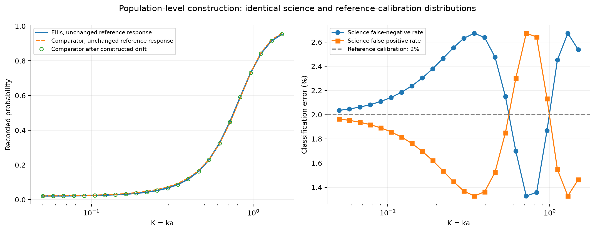
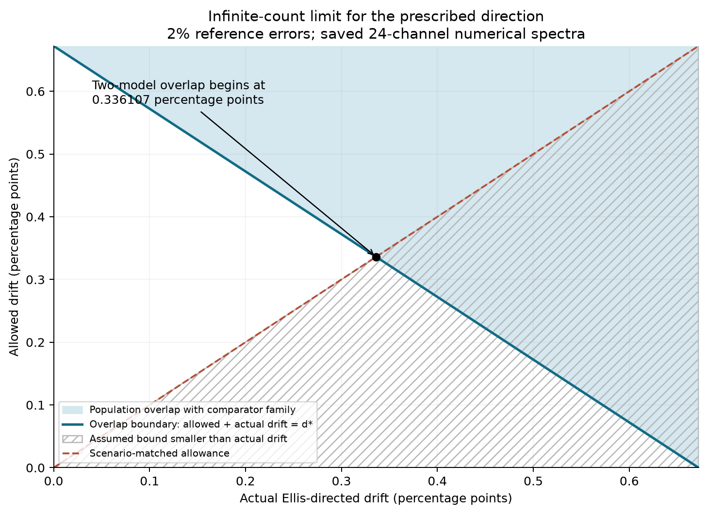
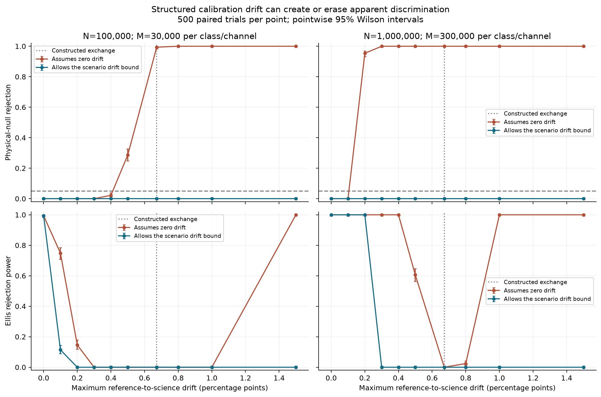
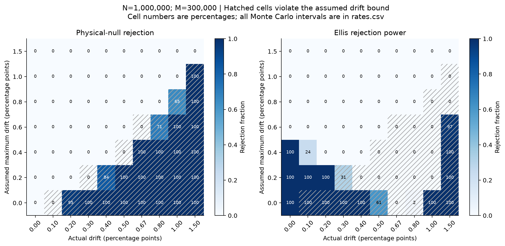

# When calibration drift defeats spectral discrimination

**Biswajit Jana · Study 007 · 12 November 2026**

## Abstract

I test whether independent calibration still permits spectral discrimination when detector response changes before science acquisition. A prespecified drift bound gives a conservative extension of the confidence-region test. In 20,000 synthetic experiments, ignoring drift can reject the true physical comparator in 500/500 trials, whereas the scenario-matched drift test has 0/500 false rejections in every tested case. Protection can eliminate power. A population construction explains why: around a 2% reference error rate, allowing both physical models to drift by approximately **0.336107 percentage points** makes some joint science/reference distributions identical. The result concerns saved 24-channel numerical spectra and a stated comparator domain. It establishes an identification limit, not physical wormhole existence or absence.

## 1. Purpose and experiment

Study 006 assumed that reference probes and science events shared their response. More reference counts reduce statistical error but do not establish that transfer assumption. The [current calibration literature audit](../references/calibration-transfer-2026-11-12.md) motivates tracking response changes while distinguishing real interferometer observables from this hypothetical counting experiment.

The physical probability is the fixed Ellis geometry's minimal massless spherical scalar transmission p_i, or the generic local-barrier comparator

$$q_i(\theta)=\frac{\sinh^2(bK_i)}{\sinh^2(bK_i)+C},\qquad \theta=(\log C,\log b),$$

with log C in [-16,25], b in [0.1,30], and K=ka. All 24 broad-band channels are inherited unchanged from Study 002. The comparator is not an alternative astrophysical spacetime. Fixed-probe scattering does not establish stability of the Ellis metric and supporting matter.

For physical transmission t_i, the recorded science probability is

$$r_i=g_i^S+(1-f_i^S-g_i^S)t_i,$$

where f and g are false-negative and false-positive probabilities. Superscripts R and S denote reference and science response. Independent aggregate counts follow

$$Y_i\sim\mathrm{Bin}(N,r_i),\quad F_i\sim\mathrm{Bin}(M,f_i^R),\quad G_i\sim\mathrm{Bin}(M,g_i^R).$$

N is per science channel and M per known class per channel: total incident cost is 24N+48M. These are synthetic binomial counts, not telescope observations, detected gravitational waves or a demonstrated feasible wormhole illumination experiment.

## 2. Confidence regions under bounded drift

Prespecify epsilon satisfying, simultaneously in all channels,

$$|f_i^S-f_i^R|\le\epsilon,\qquad |g_i^S-g_i^R|\le\epsilon.$$

Construct 72 Clopper-Pearson intervals with per-tail failure probability 0.05/144. Enlarge reference intervals by epsilon and clip to [0,1]. If expanded intervals are [f_L,f_U] and [g_L,g_U], feasible transmissions satisfy

$$g_L+(1-f_U-g_L)t_i\le r_{U,i},\qquad g_U+(1-f_L-g_U)t_i\ge r_{L,i}.$$

The code solves these linear inequalities even when coefficients change sign. Reject only if no comparator parameter satisfies all channels. An interval-checked branch search covers the entire stated domain; unresolved computation gives non-rejection.

**Coverage argument.** All 72 confidence intervals simultaneously cover with probability at least 0.95 by the union bound. On that event, a valid drift bound ensures that expanded reference rectangles contain the true science response. A true comparator within the stated domain must therefore remain feasible. Its rejection probability is at most 0.05 in exact arithmetic. The argument requires correctly specified binomial marginals and a valid simultaneous transfer bound, but does not require independence among the interval-coverage events.

SciPy beta quantiles are padded numerically, not computed by a formally validated inverse-beta algorithm. Exclusion inequalities use 35-digit interval arithmetic. The statistical theorem and the numerical implementation remain separate claims.

## 3. Constructed exchange and an identification limit

Set f_i^R=g_i^R=e=0.02 and s=1-2e=0.96. Define

$$D=\min_\theta\max_i|p_i-q_i(\theta)|.$$

Multistart constrained optimization and differential evolution locate a candidate q*. Optimization alone does not prove global optimality. Full-domain interval exclusion and a feasible fixed-parameter witness bracket the minimum for the exact saved numerical inputs:

$$0.0070021647903165275 < D\le0.0070022349126646535.$$

The 82 contiguous exclusion leaves and upper witness were checked at 70 digits. The upper bound includes 10^-10 explicit slack. This brackets the finite-channel numerical optimization, not ODE discretization uncertainty or the continuous frequency spectrum.

Let D*=max|p-q*|, u_i=(p_i-q_i*)/D*, and d*=sD*=0.006722145420158068. The constructed science response

$$f_i^S=e-d u_i,\qquad g_i^S=e+d u_i$$

records a comparator as e+s q_i*+d u_i. At d=d*, this equals the unchanged Ellis prediction e+s p_i. Reversing the signs for Ellis gives e+s p_i-d u_i, which at d=d* equals the unchanged comparator. The population-derived direction is fixed before random sampling. It is an adversarial benchmark, not typical instrument drift.

*Figure 1. Deterministic population probabilities and the classification errors that exchange them. Model curves have no sampling error bars; numerical and physical assumptions remain separate uncertainties.*

### Both models can move toward the same distribution

For epsilon <= e, independent f and g allowances e +/- epsilon generate the complete interval

$$\mathcal R_i(t;\epsilon)=[e+st-\epsilon,e+st+\epsilon].$$

Every shift h within the allowance is attained by f=e-h and g=e+h; maximizing the affine response over the rectangle proves necessity. The Ellis and comparator response boxes thus intersect exactly when

$$s\|p-q(\theta)\|_\infty\le2\epsilon.$$

Minimizing over the compact comparator domain gives

$$\epsilon_{\mathrm{overlap}}=sD/2\approx0.00336107.$$

This is **0.336107 percentage points** of absolute classification probability. The verified gap bracket implies approximately 0.33610391 to 0.33610728 percentage points. It is half the one-sided exchange near 0.67221454 percentage points because both models may move toward a midpoint. It is distinct from Study 004's 3.0943% absolute-error allowance, which used a different reference-response problem.

At overlap, science probabilities coincide channel by channel and reference probabilities are identical. The full joint count distributions are then identical for every N and M. Any test controlling rejection at 5% for that comparator distribution has at most 5% power for the identical Ellis distribution. This establishes the existence of indistinguishable configurations, not that every signal or drift pattern is indistinguishable.

For actual Ellis-directed drift d in [0,d*], the saved comparator is compatible whenever d+epsilon >= d*. A reverse triangle inequality excludes the whole family if d+epsilon < sD. The verified gap bracket bounds the tiny numerical uncertainty between these statements.

*Figure 2. Infinite-count geometry along the prescribed direction. The plotted feasible-candidate boundary differs from the certified whole-family boundary by less than 0.000007 percentage points vertically. Hatching marks an assumed bound smaller than actual drift. The diagonal assumes knowledge of the scenario bound; it does not estimate it from science counts.*

## 4. Simulation design

Two budgets, (N,M)=(100,000,30,000) and (1,000,000,300,000), are combined with ten drift values from 0 to 0.015, including d*. Each of 20 cases contains 500 comparator and 500 Ellis trials. Reference errors are 2%. The comparator drifts toward Ellis; Ellis drifts toward the comparator. At maximum drift, science classification probabilities remain between 0.5% and 3.5%.

Seven fixed allowances (0,0.002,0.004,0.006,0.008,0.01,0.015) and the scenario-matched allowance epsilon=d use each same count record. There are 20,000 experiments, 1,440,000 aggregate count entries and 160,000 paired decision records. The matched allowance is an oracle diagnostic requiring external justification in an application.

Rejection-fraction error bars are pointwise 95% Wilson intervals over 500 trials. They are not simultaneous bands or confidence intervals for differences between paired methods. Larger allowances give nested feasible regions; after non-rejection the implementation conservatively retains larger allowances as `retained_by_nesting`, rather than claiming fresh solver decisions. There were no undetermined records.

*Figure 3. Pointwise Wilson error bars and a 5% reference line. Physical-null rejection counts rejection of the comparator that generated the spectrum, including cases where a zero-drift response assumption is false. Connecting segments are visual guides.*

## 5. Results

Selected cases at N=1,000,000 and M=300,000:

| Actual drift (percentage points) | Physical truth | Ignores drift: rejections / 500 | Allows actual bound: rejections / 500 |
|---|---|---:|---:|
| 0 | Comparator | 0 | 0 |
| 0 | Ellis | 500 | 500 |
| 0.3 | Comparator | 500 | 0 |
| 0.3 | Ellis | 500 | 0 |
| 0.5 | Ellis | 303 | 0 |
| 0.67221454 | Comparator | 500 | 0 |
| 0.67221454 | Ellis | 0 | 0 |

For 0/500 the Wilson interval is [0,0.00762434]; for 500/500 it is [0.99237566,1]; for 303/500 it is [0.56251781,0.64786583]. Zero observed false positives does not prove a zero rate.

At the lower budget and 0.5 percentage points of drift, the misspecified test rejects the physical comparator in 143/500 trials (0.286; interval [0.24814005,0.32712316]); at the higher budget it does so in 500/500. More counts can strengthen a conclusion driven by a wrong response assumption. This does not contradict the theorem: the transfer premise is violated.

The matched test has zero physical-null rejections in all 20 cases. Across valid fixed and matched allowances, there are zero rejections in 52,000 paired null decision records. These are not independent experiments and must not be pooled into an independence-based confidence interval. The simulation samples one comparator and one direction; uniform theoretical control comes from coverage, not exhaustive empirical testing.

Finite confidence regions cost power before population overlap. At 0.3 percentage points and the larger budget, matched-bound power is already 0/500 despite positive population separation. Improving finite-count efficiency could help there, but cannot remove genuine overlap. Beyond the exchange, zero-drift power rises again because the constructed spectrum moves past the comparator; that does not restore the response assumption.

*Figure 4. Empirical percentages; full intervals are saved in rates.csv. Hatching identifies invalid assumed bounds. Equally spaced cells represent the listed discrete scenarios, not uniformly spaced drift values.*

## 6. Verification and next experiments

All 20,000 count records were exactly regenerated from seeds. All 320 rate rows, Wilson intervals and node totals were reconstructed. Stratified deterministic replay checked 3,200 paired decision records and 400 additional matched-bound decisions without nesting. Source/artifact hashes passed. The 82 population leaves and upper witness were checked at 70 digits. The floating-point exchange residual is 1.11e-16. Existing physics and statistical regression tests pass.

This solves a restricted identification question. It does not solve wormhole topology, formation, stability or observational discovery. The bound depends on a finite sampled band, unrestricted channel-dependent classification errors, a symmetric 2% reference and a bounded generic-barrier family. It is not a real instrument specification or proof of unique novelty.

1. **Measure transfer.** Add independent contemporaneous known-class validation counts and a separate simultaneous confidence budget. For time-separated validation, specify a justified rate-of-change bound or response process. Do not choose epsilon after seeing science results.
2. **Constrain response structure.** Repeat overlap optimization for independently supported smooth or low-dimensional drift. Smoothness needs instrument evidence, not convenience.
3. **Add an independent observable.** Test phase or another scattering mode after including clock, source and calibration nuisance parameters. More channels of the same degenerate observable need not help.
4. **Improve finite-count efficiency.** Compare allocations at fixed incident cost and externally fixed drift, with separate pilot data for adaptation. This study scales both budgets by ten; it does not optimize allocation.
5. **Use physical alternatives.** Reproduce current finite-time MMP responses and an explicit alternative metric/matter model before analyzing public observations. Enforce observation-time, energy/backreaction and stability constraints.

## Reproduction and provenance

Run `scripts/run_calibration_drift_study.py --repetitions 500 --workers 4`, then `scripts/verify_calibration_drift_study.py` and `python -m unittest discover -s tests -v`. See the [data guide](../results/study-007/README.md), [design](../results/study-007/design.json), [rates](../results/study-007/rates.csv), [verification](../results/study-007/verification.json), and [previous confidence construction](008-joint-calibration-identification.md).

Biswajit Jana is the sole listed author. Computational assistance supported drafting, implementation, derivation development and checking. Automated checks do not substitute for independent specialist review. Clopper-Pearson intervals, simultaneous-coverage reasoning and observation-model overlap are established ingredients; Study 006 records statistical references and numerical-library limitations. External-source claims and reading depth are in the linked literature audit. No unprecedented-novelty claim is made.
