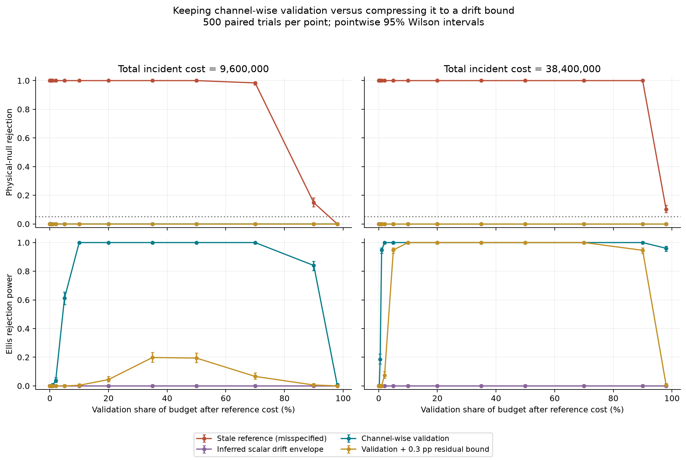
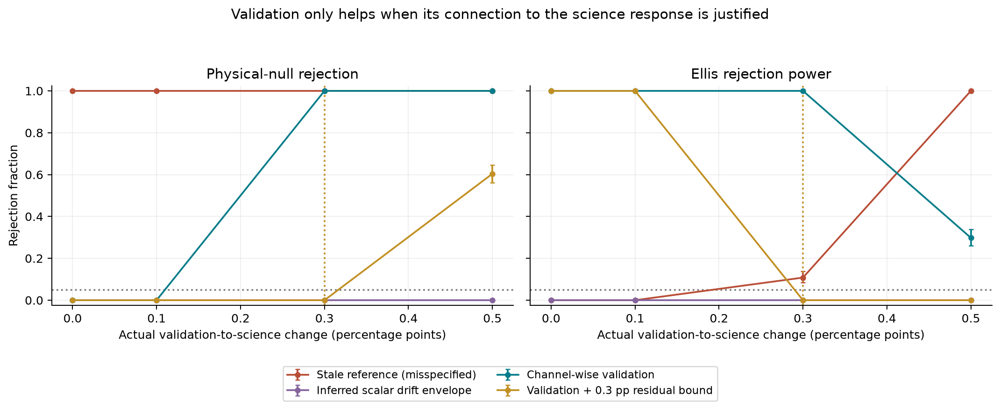
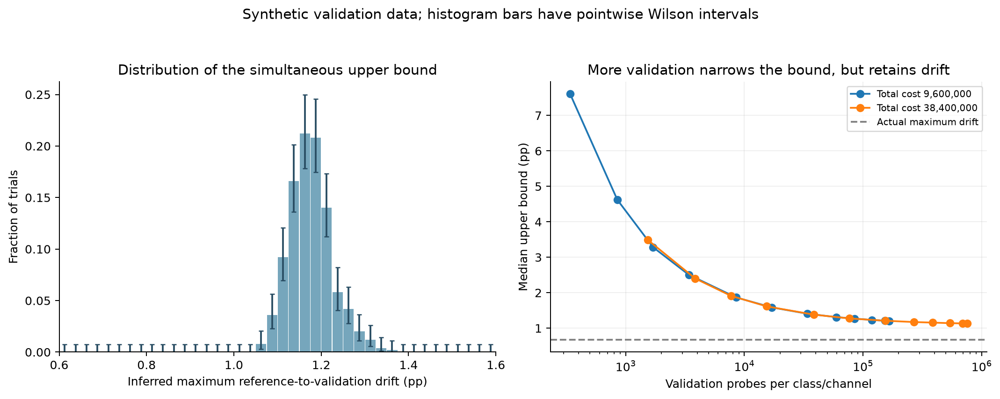

# Independent validation can restore spectral identification

**Biswajit Jana · Study 008 · 22 November 2026**

## Abstract

Independent known-class validation measurements can recover information lost to an unknown detector-response change, provided their response transfers to the science experiment. I compare keeping the measured response in each channel with reducing validation to one inferred maximum-drift bound. In a prespecified benchmark at fixed total incident cost, direct validation rejects the generic barrier family in 500/500 Ellis trials and in 0/500 corresponding comparator trials, while the scalar-envelope method rejects neither. Across 29,000 synthetic experiments, the study quantifies allocation costs and failures when validation does not transfer. It resolves a statistical obstruction within the existing 24-channel scattering model; it does not identify a physical wormhole.

## 1. Question and physical scope

[Study 007](009-calibration-transfer-drift.md) constructed indistinguishable science/reference distributions when the response could change without being measured. Here I add information about that changed response. This changes the observation model rather than contradicting the earlier impossibility result.

The fixed Ellis scalar transmission p_i and comparator

$$q_i(C,b)=\frac{\sinh^2(bK_i)}{\sinh^2(bK_i)+C}$$

are inherited unchanged, with 24 broad-band channels, log C in [-16,25] and b in [0.1,30]. The latter is a generic local barrier, not a competing astrophysical spacetime. Probe scattering does not establish stability of the supporting Ellis metric/matter system.

Reference, validation and science error probabilities are distinguished explicitly. Each known-class injection has a correct class label; false negatives and false positives are measured independently. For physical transmission t_i,

$$r_i=g_i^S+(1-f_i^S-g_i^S)t_i,$$

$$Y_i\sim\mathrm{Bin}(N,r_i),\quad R_{f,i}\sim\mathrm{Bin}(M,f_i^R),\quad R_{g,i}\sim\mathrm{Bin}(M,g_i^R),$$

$$V_{f,i}\sim\mathrm{Bin}(V,f_i^V),\quad V_{g,i}\sim\mathrm{Bin}(V,g_i^V).$$

The counts are synthetic. A physical application would have to show that known-class injections sample the response applicable to science events, including relevant frequency, intensity, timing and selection effects. Being contemporaneous alone is insufficient. The new [literature review](../references/validation-and-observability-2026-11-22.md) distinguishes this idealized experiment from real strain-calibration products.

## 2. Learning a drift bound without spending confidence twice

There are five binomial probabilities in each of 24 channels. Use Clopper-Pearson intervals with per-tail failure probability

$$\tau=\frac{\alpha}{2\cdot120}=\frac{0.05}{240}.$$

Their joint coverage is at least 0.95 in exact arithmetic. Write reference and validation intervals for each of the 48 class-error rates as [a_j,b_j] and [c_j,d_j]. For the maximum reference-to-validation change, define

$$L=\max_j\max(0,c_j-b_j,a_j-d_j),\qquad U=\max_j\max(d_j-a_j,b_j-c_j).$$

On the same coverage event,

$$L\le\max_j|e_j^V-e_j^R|\le U.$$

The random bound U can therefore enter the science test without a second independent confidence claim: all steps are implications of the original simultaneous event. A plug-in maximum difference between point estimates would not supply this guarantee. With V=0, validation intervals are [0,1] and the new methods intentionally give no discrimination.

Four paired procedures use each same experiment and the same confidence budget:

| Procedure | Science response region | Required transfer premise |
|---|---|---|
| Stale reference | Original reference intervals | Science equals reference; deliberately false here |
| Scalar transfer | Reference intervals expanded by U, clipped to [0,1] | Science equals validation |
| Direct validation | Validation intervals in each channel | Science equals validation |
| Guarded validation | Validation intervals expanded by eta=0.003 | Each science/validation class-rate difference is at most eta |

For any science response rectangle, transmission feasibility follows from

$$g_L+(1-f_U-g_L)t_i\le r_{U,i},\qquad g_U+(1-f_L-g_U)t_i\ge r_{L,i}.$$

The entire bounded comparator domain is excluded only when all parameter values are infeasible. Under the corresponding valid transfer premise, simultaneous coverage contains a true comparator and its response, so rejection probability is at most alpha. This is a conditional theorem, not evidence that the transfer premise holds in an instrument.

The common 120-interval budget makes the comparison conservative. Direct validation alone could allocate its error budget across 72 intervals and ignore reference counts. I retain the same budget here to isolate information loss from changing the confidence construction. Dependence among interval-coverage events does not invalidate the union bound; correctly specified binomial marginals remain required.

### Why retaining channels helps

By construction, the reference interval enlarged by U contains the entire corresponding validation interval. Thus the direct-validation response rectangle is contained in the scalar-transfer rectangle. Projection into physical transmission preserves that inclusion. In exact arithmetic, retaining the validation vector cannot lose exclusion power relative to this particular scalar-envelope procedure at the same counts and confidence budget. This is a set-inclusion statement, not a claim that direct validation is statistically optimal among all possible methods.

In the population limit, known validation rates with f_i^V+g_i^V != 1 allow

$$t_i=\frac{r_i-g_i^V}{1-f_i^V-g_i^V}$$

when science and validation responses agree. The test patterns have f_i^V+g_i^V=0.04 in every channel, so the denominator is 0.96. A single maximum drift discards sign and channel information needed for this correction. Even infinitely precise scalar drift estimation would retain a wide nuisance region in this benchmark.

## 3. Fixed-cost experiment

Reference errors are both 2%, with M=30,000 probes per class per channel. Let q* and u_i=(p_i-q_i*)/max|p-q*| be the saved Study 007 comparator and direction. The maximum reference-to-validation change is fixed at

$$d_*=0.006722145420158068,$$

or 0.672214542 percentage points. Comparator validation rates are f^V=0.02-d*u and g^V=0.02+d*u. Ellis validation rates reverse those signs. In the main experiment science shares that validation response. These prespecified adversarial patterns were constructed before this study's random draws, not fitted to the trials.

Each channel has fixed incident budget

$$N+2M+2V=B,$$

with B=400,000 or 1,600,000. Across all channels the costs are 9.6 million and 38.4 million incident quanta. Thirteen prespecified validation fractions rho=2V/(B-2M), from zero to 0.98, give 26 allocation cases. Increasing V therefore reduces N. M is held fixed; this is not an optimization over all three resources.

Three additional cases at the larger budget and rho=0.35 add validation-to-science changes h=0.001, 0.003 and 0.005 in the same direction. Together with h=0 in the allocation grid, they test correct transfer, the boundary of the guarded allowance, and its violation. All class-error probabilities stay in [0,1].

Each case has 500 comparator and 500 Ellis experiments. Totals are 29,000 experiments and 116,000 paired procedure decisions. The 3,480,000 stored count slots include 96,000 structural zeros in V=0 cases; the remaining 3,384,000 slots represent positive-budget aggregate binomial observations. They are not counts of individual events or observational telescope records.

## 4. Allocation results

*Figure 1. Pointwise 95% Wilson intervals over 500 trials per point. Methods share each experiment. Connecting segments are guides, not fitted curves. The zero-drift stale-reference premise is false throughout the allocation benchmark.*

At total cost 9.6 million, the direct-validation power changes as follows:

| Validation share rho | Science N per channel | Validation V per class/channel | Ellis rejections / 500 | Power, with pointwise 95% interval |
|---:|---:|---:|---:|---|
| 0 | 340,000 | 0 | 0 | 0 [0, 0.007624] |
| 0.05 | 323,000 | 8,500 | 306 | 0.612 [0.568588, 0.653704] |
| 0.10 | 306,000 | 17,000 | 500 | 1 [0.992376, 1] |
| 0.35 | 221,000 | 59,500 | 500 | 1 [0.992376, 1] |
| 0.90 | 34,000 | 153,000 | 420 | 0.840 [0.805292, 0.869524] |
| 0.98 | 6,800 | 166,600 | 3 | 0.006 [0.002043, 0.017490] |

At rho=0.35, direct validation gives 500/500 Ellis rejections and 0/500 comparator rejections. Scalar transfer gives 0/500 for both groups. Guarding against an additional 0.3-percentage-point residual change reduces power to 99/500, or 0.198 [0.165431,0.235174]. At total cost 38.4 million and the same fraction, both direct and guarded procedures achieve 500/500 Ellis rejections with 0/500 comparator rejections.

The largest valid-null rejection rate in any tested case is 1/500, or 0.002 [0.000353,0.011241], for direct validation with V=340. There is one rejection across 40,000 paired valid-null decision records. Those records are not independent experiments and must not be pooled into a binomial confidence interval. Empirical tests sample one comparator and one direction; the uniform conditional statement comes from the confidence argument.

The grid shows a broad useful allocation range, not a uniquely optimized design. Reporting the largest observed power as a confirmed optimum would ignore selection across allocations. An adaptive design needs separate pilot data and independent evaluation.

### A local allocation calculation

For one nonblind channel with shared validation/science response, the delta method gives

$$\operatorname{Var}(\widehat t)\simeq\frac{A/N+D_v/V}{(1-f-g)^2},$$

$$A=r(1-r),\qquad D_v=t^2f(1-f)+(1-t)^2g(1-g).$$

At fixed N+2V=S, differentiation gives

$$\frac{2V}{S}=\frac{\sqrt{2D_v}}{\sqrt A+\sqrt{2D_v}}.$$

This explains why neither zero validation nor nearly zero science counts is generally efficient. It is a local variance rule with unknown coefficients, not the optimizer of this 24-channel family-exclusion problem. It does not include unknown residual drift or justify tuning from the final science data.

## 5. Validation mismatch remains decisive

*Figure 2. Actual validation-to-science changes at N=1,001,000, M=30,000 and V=269,500. Error bars are pointwise Wilson intervals. Direct validation assumes h=0; guarded validation allows up to 0.3 percentage points. Zero observed rejection outside a method's assumptions does not establish validity.*

| Actual mismatch (percentage points) | Direct: null rejections / 500 | Guarded: null rejections / 500 | Direct: Ellis rejections / 500 | Guarded: Ellis rejections / 500 |
|---:|---:|---:|---:|---:|
| 0 | 0 | 0 | 500 | 500 |
| 0.1 | 0 | 0 | 500 | 500 |
| 0.3 | 500 | 0 | 500 | 0 |
| 0.5 | 500 | 302 | 149 | 0 |

At the guarded bound's valid edge, the unguarded test falsely excludes the physical comparator in every trial. The guarded test preserves null control but has no observed power. Once actual mismatch exceeds the guarded allowance, its physical-null rejection rises to 302/500, or 0.604 [0.560496,0.645918]. Direct power at that last point is 149/500, or 0.298 [0.259573,0.339507], but its null behavior is invalid. Favorable power alone is not sufficient.

### The earlier population limit moves to residual uncertainty

If validation were infinitely precise but science could still differ by eta in both class rates, the allowed response interval would be

$$[g_i^V+(1-f_i^V-g_i^V)t_i-\eta,\ g_i^V+(1-f_i^V-g_i^V)t_i+\eta],$$

provided clipping of the class-error bounds is inactive. Here the validation rates are interior and sum to 0.04, so two physical models can share a joint science/validation distribution if

$$0.96\|p-q(\theta)\|_\infty\le2\eta.$$

The Study 007 overlap near 0.336107 percentage points therefore remains relevant to **unmeasured validation-to-science residuals**, even after a larger reference-to-validation change is learned. Additional validation can identify the current response; it cannot prove an arbitrary future or different-input response matches it. This is why the new result does not overturn the prior impossibility construction.

## 6. Inferred bounds and uncertainty interpretation

*Figure 3. Left: 500 Ellis trials at the larger budget and rho=0.35. Fixed histogram bins, including an overflow bin in the CSV, have pointwise Wilson intervals for bin probabilities; the displayed axis is restricted to 0.6–1.6 percentage points. Right: descriptive medians of the upper drift bound. The actual drift is 0.672214542 percentage points. Reference M remains fixed, so more validation cannot remove reference statistical uncertainty.*

The interval [L,U] covered the true reference-to-validation maximum in at least 499/500 trials in every case/group (minimum empirical coverage 0.998, interval [0.988759,0.999647]). This measures coverage of reference-to-validation drift, not the additional residual h. In the simultaneous construction, the 96 reference/validation intervals alone have a union-bound failure probability at most 0.04; adding science intervals gives the overall 0.05 budget.

All reported Monte Carlo intervals are pointwise. They are not simultaneous confidence bands across budgets, error bars on the underlying physical model, or confidence intervals for paired differences. Histogram bins share a multinomial total. The CSV preserves all bins, including those outside the display range.

## 7. Verification and remaining work

The verifier regenerated all 29,000 experiments exactly from their seeds, reconstructed 232 rate rows and 58 drift-coverage rows, replayed 2,320 solver decisions, and checked 1,160 numerical region-inclusion relations. It also reconstructed all 81 histogram bins and verified data, source and figure hashes. There were no undetermined solver records. All 43 tests pass, including earlier physics checks and six new validation tests.

The implementation retains Study 006's limitations: inverse-beta quantiles use numerical padding rather than validated inversion; branch exclusion uses interval arithmetic but does not enclose the original ODE solution uncertainty. Replay tests consistency and does not replace independent methodological review.

The established advance is specific: a measured channel-wise response can remove this constructed ambiguity, while an inferred scalar drift bound needlessly retains it. The useful experiment must balance validation and science counts and justify residual transfer. Neither comparator rejection nor its recovery proves topology. More flexible barriers could reproduce a single mode's effective potential, and a physical model comparison remains necessary.

The next physical question is whether multiple modes or complex scattering phase impose cross-observable relations that a credible alternative geometry cannot match. That requires a joint nuisance model and physical comparator before further detection forecasts. A complementary instrument study would model validation cadence with a justified response-dynamics bound. Repeating larger ideal counting runs alone cannot settle either question.

## Reproduction and provenance

Run `scripts/run_validation_study.py --repetitions 500 --workers 4`, `scripts/verify_validation_study.py`, then `python -m unittest discover -s tests`. See the [data guide](../results/study-008/README.md), [design](../results/study-008/design.json), [rates](../results/study-008/rates.csv) and [verification](../results/study-008/verification.json). Environment versions and upstream hashes are saved with the design.

Biswajit Jana is the sole listed author. Computational assistance supported implementation, derivation development, drafting and checking. Established statistical ingredients and their sources are recorded in [Study 006](008-joint-calibration-identification.md); source-specific reading depth is in the [22 November review](../references/validation-and-observability-2026-11-22.md). No claim of unprecedented novelty or independent specialist endorsement is made.
