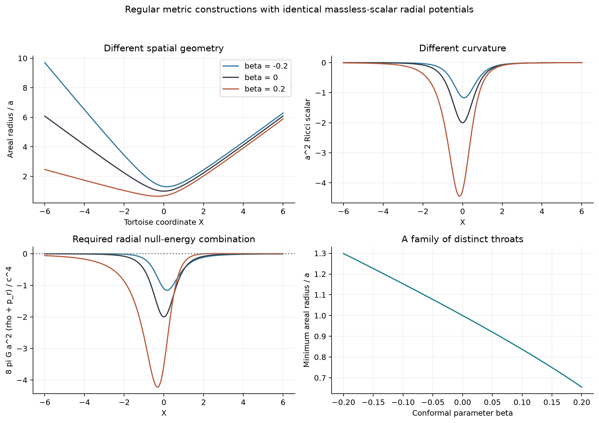
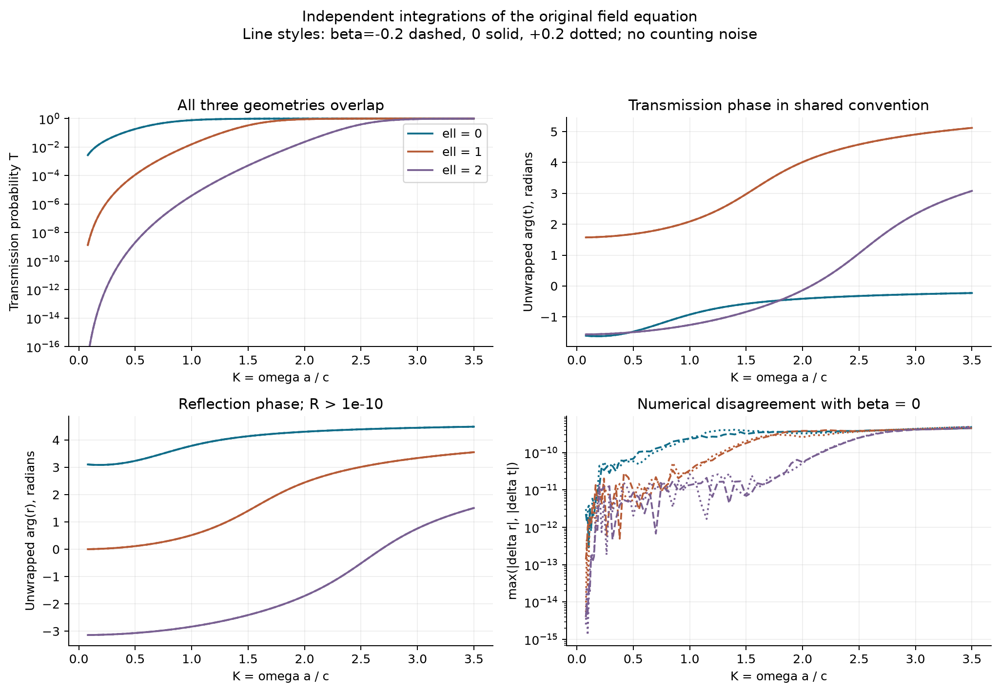
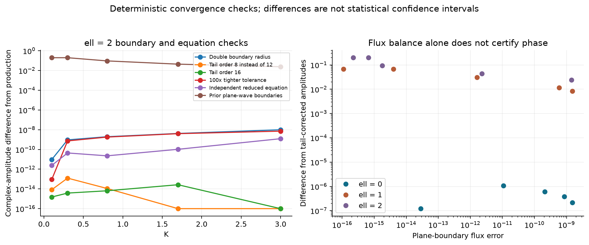
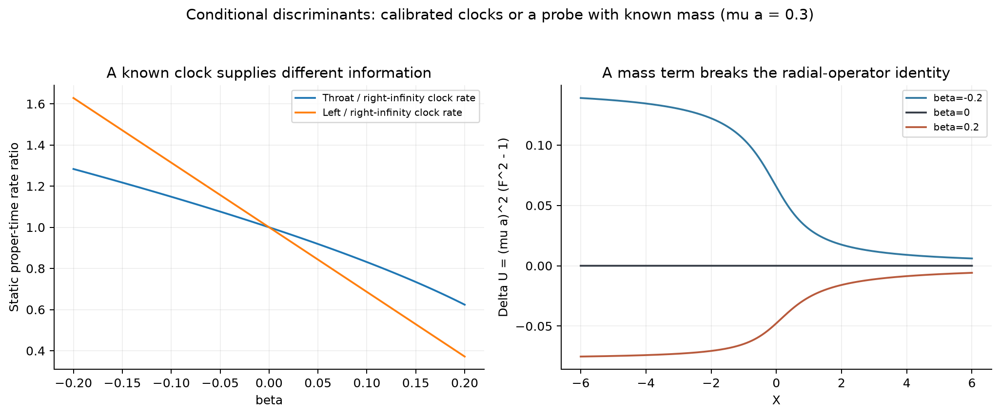

# Study 009: distinct wormhole metrics with identical massless-scalar scattering

**Author: Biswajit Jana**

**Date: 22 November 2026**

**Status: analytic construction and reproducible fixed-background computation; independent specialist review pending.**

## Abstract

I ask whether measuring additional angular modes and complex scattering phases necessarily identifies the geometry of a prescribed wormhole. Within the static, spherical metric class examined here, the answer is no. A continuous family of regular conformal rescalings of the Ellis metric has exactly the same massless-scalar radial potential for every angular mode and every fixed curvature coupling. Throat areas, curvature and static clock ratios nevertheless change. Equality of complex scattering amplitudes uses a shared tortoise coordinate, right-asymptotic time and radiative-field normalization; independently calibrated areal positions introduce information outside that convention. The construction is an application of harmonic conformal rescaling, whose antecedents are explicitly credited. It neither establishes a new fundamental symmetry nor supplies physically viable supporting matter.

I independently integrate the original scalar-field equation for 729 combinations of frequency, angular mode and metric. The largest complex-amplitude difference between sampled geometries is approximately 4.93 × 10⁻¹⁰. A separate 165-comparison audit finds a largest non-plane-boundary convergence difference of 1.02 × 10⁻⁸. These are deterministic numerical diagnostics, not statistical confidence limits. The result identifies an exact limitation of the selected observables and motivates calibrated clocks, known massive probes and an explicit supporting-matter model.

## 1. Physical question and assumptions

[Study 008](010-validation-restores-identification.md) showed how independent detector validation can restore discrimination between two specified spectral families. It did not show that a measured spectrum uniquely determines a spacetime. Here I investigate that stronger inverse problem before forecasting another counting experiment.

Use signature (−,+,+,+), a fixed length scale a, dimensionless time τ = ct/a, dimensionless tortoise coordinate X, and areal radius r = a q(X). Write

$$
\frac{ds^2}{a^2}=A(X)(-d\tau^2+dX^2)+q(X)^2d\Omega^2.
$$

The probe obeys $(\Box-\xi\mathcal R)\phi=0$ with fixed real coupling ξ. For $\phi=e^{-iK\tau}Y_{\ell m}u(X)/q(X)$, where $K=\omega a/c$, its radial equation is

$$
u''+[K^2-U_\ell]u=0,\qquad
U_\ell=\frac{A\ell(\ell+1)}{q^2}+\frac{q''}{q}+\xi A a^2\mathcal R.
$$

Primes denote X derivatives. This is a test field on a prescribed metric. It is not the coupled gravitational-wave perturbation equation. The numerical spectral survey uses ξ = 0; the identity below is analytic for any fixed ξ. No stability claim for all such couplings follows.

Even granting exact knowledge of two minimally coupled radial potentials gives only

$$
W=\frac{U_1-U_0}{2}=\frac{A}{q^2},\qquad q''=U_0q.
$$

The second equation retains integration constants unless geometrical boundary data fix them. Higher angular modes give $U_\ell=U_0+\ell(\ell+1)W$ and do not automatically supply another independent geometry function. This argument grants more information than a finite scattering experiment; no potential-reconstruction algorithm is assumed or implemented.

## 2. Explicit family and exact identity

For the Ellis potentials, choose

$$
F_\beta(X)=1+\beta(\arctan X-\pi/2),\quad
q_\beta=F_\beta\sqrt{1+X^2},\quad A_\beta=F_\beta^2,
\qquad -\infty<\beta<1/\pi.
$$

Thus $g_\beta=F_\beta^2g_{\rm Ellis}$. The general solution of $q''=q/(1+X^2)^2$ is $\sqrt{1+X^2}(c_1+c_2\arctan X)$. Normalizing the right asymptotic lapse to one fixes $c_1+c_2\pi/2=1$, leaving β = c₂.

Direct differentiation gives

$$
F_\beta'=\frac{\beta}{1+X^2},\qquad
q_\beta''=\frac{F_\beta}{(1+X^2)^{3/2}},\qquad
a^2\mathcal R_\beta=-\frac{2}{F_\beta^2(1+X^2)^2}.
$$

Substitution therefore yields the exact cancellation

$$
\boxed{U_\ell(X)=\frac{\ell(\ell+1)}{1+X^2}+\frac{1-2\xi}{(1+X^2)^2}},
$$

independent of β. This is stronger than a fit to a transmission curve: the radial differential operators themselves coincide.

The mechanism is explicit. For a radial static function on the Ellis background,

$$
a^2\Box_{\rm Ellis}F_\beta=
\frac{1}{1+X^2}\partial_X[(1+X^2)F_\beta']=0.
$$

In four dimensions,

$$
\Box_{F^2g}(\phi/F)=F^{-3}\Box_g\phi-F^{-4}\phi\Box_gF,
\quad
\mathcal R_{F^2g}=F^{-2}(\mathcal R_g-6F^{-1}\Box_gF).
$$

Consequently the fixed-background massless equation maps for arbitrary fixed ξ when $\Box_gF=0$. Harmonic restrictions on conformal rescaling are established in [Edery and Nakayama (2014)](https://arxiv.org/abs/1406.0060). The [2024 critical reassessment by Glavan, Noris and Zlosnik](https://journals.aps.org/prd/abstract/10.1103/PhysRevD.110.125011) makes it especially important not to infer a symmetry of a full scalar-tensor gravitational system from such a restriction. The argument here is a direct wave-operator identity on specified backgrounds.

## 3. Regularity, different throats and required stress

For finite β < 1/π, F is smooth, positive and bounded away from zero:

$$
F(+\infty)=1,\qquad F(-\infty)=1-\pi\beta>0.
$$

Both ends are asymptotically flat after their respective constant rescalings. The lapse never vanishes; no lapse horizon is introduced. Since $q''>0$ and $q'$ has opposite signs at the two ends, the radius has exactly one minimum. The metric is a regular two-ended wormhole construction. This statement concerns its geometry, not the availability of matter that can sustain it.

Let dλ = F dX be dimensionless proper radial distance and Φ = ln F. In units $8\pi Ga^2/c^4$ for energy density and pressures, Einstein's equation would require

$$
\widehat\rho=\frac{1-q_\lambda^2-2q q_{\lambda\lambda}}{q^2},\quad
\widehat p_r=\frac{-1+q_\lambda^2+2q q_\lambda\Phi_\lambda}{q^2},
$$

$$
\widehat p_t=\Phi_{\lambda\lambda}+\Phi_\lambda^2+
\frac{\Phi_\lambda q_\lambda+q_{\lambda\lambda}}{q}.
$$

At the throat, $q'=q_\lambda=0$, so

$$
(\widehat\rho+\widehat p_r)_{\rm th}=
-\frac{2}{F_{\rm th}^2(1+X_{\rm th}^2)^2}<0.
$$

| β | X at throat | r at throat / a | Throat/right clock ratio | Left/right clock ratio | Required radial NEC combination at throat |
|---:|---:|---:|---:|---:|---:|
| −0.2 | 0.155856 | 1.298729 | 1.283237 | 1.628319 | −1.157629 |
| 0 | 0 | 1 | 1 | 1 | −2 |
| 0.2 | −0.320622 | 0.655065 | 0.623787 | 0.371681 | −4.226341 |

The metrics are not distinguished merely by comparing curvature at an arbitrary coordinate value. Their throat areas and clock ratios differ with the scale and right-end normalization held fixed. The dimensionless throat invariant $r_{\rm th}^2\mathcal R_{\rm th}=-2/(1+X_{\rm th}^2)$ also differs between these three examples, excluding an explanation by uniform rescaling alone.

*Figure 1. Exact model profiles on 1,201 X positions per geometry; the throat curve uses 101 β values. Required Einstein stresses have not been realized by a specified matter action. Negative throat null-energy density remains an unresolved physical obstacle.*

## 4. Precisely which scattering data coincide?

For incidence from the right, define the asymptotic radiative field by

$$
u\sim e^{-iKX}+\mathfrak r_X e^{iKX}\quad(X\to+\infty),
\qquad u\sim\mathfrak t_X e^{-iKX}\quad(X\to-\infty).
$$

The common real radial operator gives the same complex $\mathfrak r_X$ and $\mathfrak t_X$ for all β, with $R=|\mathfrak r_X|^2$, $T=|\mathfrak t_X|^2$ and R + T = 1. This statement uses the same X origin, right-normalized frequency and u normalization. It also applies to left incidence after matching the same conventions.

An observer's phase convention matters. At the right end,

$$
Y=r/a=X-\beta+O(X^{-1}).
$$

Re-expressing the right-incident asymptotic waves relative to $e^{\mp iKY}$ changes the reflection coefficient to

$$
\mathfrak r_Y=\mathfrak r_X e^{2iK\beta}.
$$

This linear phase can be absorbed into an unknown reference distance or propagation delay. An experiment that independently fixes areal distances and clocks need not share that ambiguity. At finite radius, the measured field φ also differs from u through q; a source and detector model is required. Thus I do not claim equality of every operationally defined scattering measurement.

All members have the same optical spatial metric,

$$
\frac{g_{ij}dx^idx^j}{-g_{\tau\tau}}=dX^2+(1+X^2)d\Omega^2.
$$

Null paths in this description therefore provide no new β dependence. Source luminosities, redshifts, calibrated image scales and measured brightness require separate treatment. This result does not establish wormhole-versus-black-hole indistinguishability: every metric constructed here is a wormhole.

## 5. Numerical method and independent checks

To avoid obtaining identical answers simply by passing the common potential to one solver, the production runs integrate the original field equation separately for each metric:

$$
\phi''+2(q'/q)\phi'+[K^2-A\ell(\ell+1)/q^2-\xi Aa^2\mathcal R]\phi=0.
$$

The boundary and output fields are converted between φ and u = qφ. I use DOP853, relative tolerance 2 × 10⁻¹⁰, absolute tolerance 2 × 10⁻¹², and boundaries at $X=\pm L$, $L=\max(80,30/K)$. The frequency grid has 81 points from K = 0.08 to 3.5; ℓ = 0, 1, 2 and β = −0.2, 0, 0.2 give 729 integrations. Raw complex amplitudes are saved.

For ℓ > 0 the angular potential decays as $X^{-2}$, so plain finite-boundary waves can introduce a substantial phase error. I use outgoing asymptotic solutions

$$
J_+(X)=e^{iKX}\sum_{n=0}^{P}a_nX^{-n},\quad a_0=1,\quad P=12.
$$

Writing $U=\sum_s U_sX^{-s}$, its even coefficients are $U_{2j+2}=(-1)^j[\ell(\ell+1)-(1-2\xi)j]$. Matching the differential equation gives

$$
a_{m+1}=\frac{m(m+1)a_m-\sum_{s=2,\;s\;\mathrm{even}}^{m+2}U_s a_{m+2-s}}
{2iK(m+1)}.
$$

This is a truncated asymptotic series; convergence of its infinite continuation is not assumed. Five alternative settings on 30 audit problems give 150 comparisons: double L, tail order 8, tail order 16, tolerances 100 times tighter, and independent integration of the reduced u equation. Fifteen further cases compare the earlier plane-boundary solver at the same L.

| Diagnostic | Recorded result |
|---|---:|
| Largest inter-geometry difference in complex r or t | 4.931 × 10⁻¹⁰ |
| Largest production flux imbalance | 2.426 × 10⁻⁹ |
| Largest difference across the 150 non-plane audit comparisons | 1.022 × 10⁻⁸ |
| Largest plane-boundary amplitude difference | 0.19825 |
| Independent 4-dimensional tensor checks at 70-digit precision | 12 |
| High-precision potential checks, 4 modes and 3 couplings at each tensor point | 144 |
| Largest high-precision potential-identity residual | 8.70 × 10⁻⁷⁰ or less |

The verifier constructs Christoffel symbols and Ricci tensors directly from the diagonal four-metric, independently differentiates the radius, replays 41 production integrations and 30 audit baselines, and checks saved derived quantities. This guards against several implementation errors but is not interval certification over the entire domain. All 50 repository unit tests pass, including seven new geometry/scattering tests and the exactly transparent ℓ = 0, ξ = 1/2 limit.

*Figure 2. Independent original-field integrations agree across the three geometries. Reflection phase is displayed only where R > 10⁻¹⁰. Curves connect deterministic samples; they contain no observed photon counts or measurement noise.*

*Figure 3. Boundary, tolerance and equation checks. Small flux imbalance alone does not validate complex phase. The 0.19825 maximum concerns this sampled angular-mode boundary comparison; it does not imply that all earlier spherical-mode calculations have that error.*

There are no statistical error bars in these figures because there is no random sampling experiment. Numerical discrepancies are shown explicitly and are neither 95% intervals nor rigorous upper bounds on all solver error. [The data guide](../results/study-009/README.md) describes every artifact and reproduction command.

## 6. Measurements that supply different information

A static clock supplies $d\tau_{\rm proper}/d\tau=F(X)$. A known proper-frequency source with an independently identified location could therefore constrain β through redshift. The left/right asymptotic clock ratio is $1-\pi\beta$; specifying both endpoint normalizations to be one would force β = 0 in this family. That is added geometrical information, not a consequence of the massless radial spectrum.

A probe with a known nonzero inverse Compton length μ obeys a different radial equation:

$$
U_\ell^{\rm massive}=U_\ell+(\mu a)^2F_\beta^2,
\qquad
\Delta U_\ell^{\rm massive}=(\mu a)^2(F_\beta^2-1).
$$

*Figure 4. Conditional ways to break the operator identity. The massive-probe panel shows a potential difference at μa = 0.3, not a scattering prediction or detection forecast.*

Massive scattering needs its own solver. The asymptotic thresholds become $K^2>(\mu a)^2$ on the right and $K^2>(\mu a)^2(1-\pi\beta)^2$ on the left. The asymptotic mass term also has a long-range tail, so reusing the massless boundary series would be incorrect. Unknown source mass, clock frequency, travel distance and environmental response could reintroduce degeneracies; none has been marginalized in this study.

## 7. Scope, literature and next decisions

The established harmonic-rescaling mechanism prevents a claim of a newly discovered symmetry. The scoped [literature review](../references/conformal-identification-2026-11-22.md) records reading depth and related inverse problems. It does not certify that this particular family or argument is absent from prior literature. The geometry reconstruction discussed by [Antonini et al. (2022)](https://arxiv.org/abs/2207.02225) uses different AdS settings and boundary information; this counterexample does not contradict that work. The recent [transformation-optics preprint](https://arxiv.org/abs/2611.15662v2) concerns Maxwell fields and constrained devices, and is context rather than a benchmark for these scalar calculations.

The present contribution to this repository is an explicit conditional nonuniqueness construction, an auditable independent forward calculation, and a boundary-phase diagnostic. It is not an astronomical observation, a stable wormhole construction, a solution to quantum gravity, or proof that supporting exotic stress can be realized.

The next physical study should specify a matter action and check its full field equations, rather than calling the inferred Einstein stress a matter model. A separate observability study should implement either calibrated clock/distance data or correctly normalized massive-field scattering, with explicit nuisance parameters. Coupled metric-and-matter stability must be assessed before a candidate is described as viable. Increasing massless counts or adding more angular modes within the same assumptions cannot remove the exact operator ambiguity shown here.

## Methodological provenance

Biswajit Jana is the sole listed author. AI assistance was used in drafting derivations, implementation, literature triage and verification design. Primary sources retain their attribution. The saved tests and audits document computational checks; they do not imply that the author has personally completed an independent specialist review. Data are generated model outputs, and all plotted values come from saved CSV files or their documented transformations.
