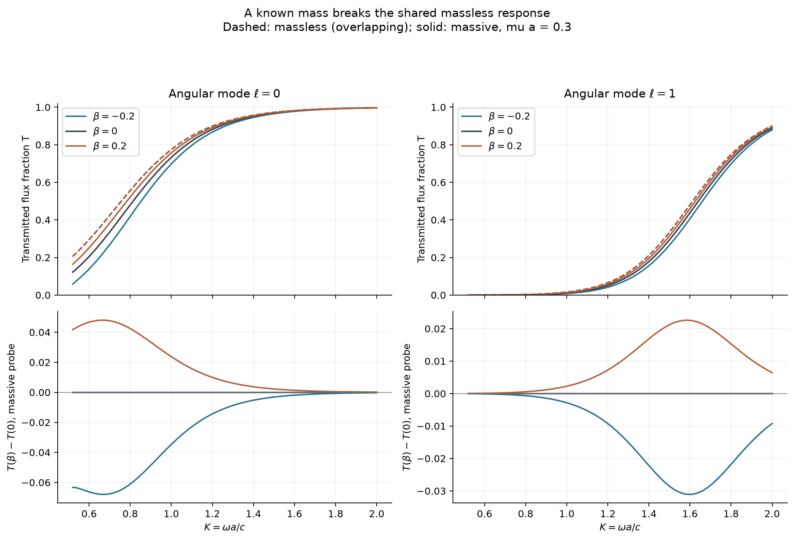
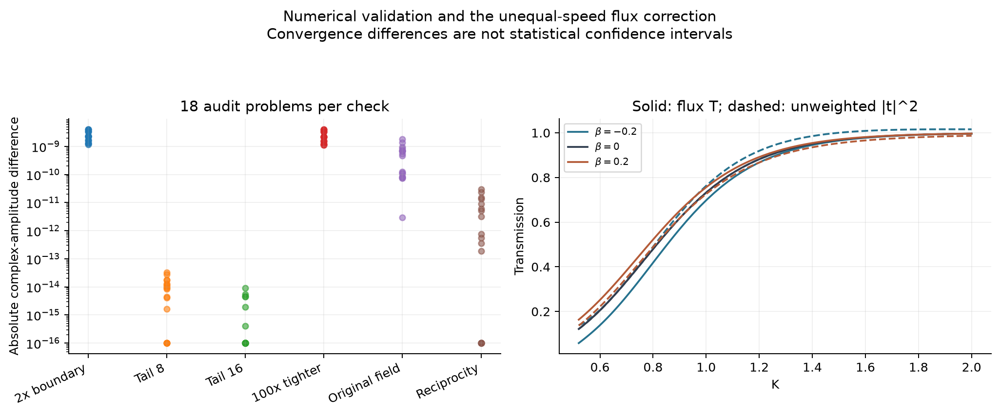
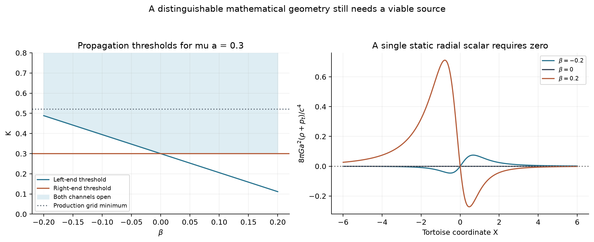
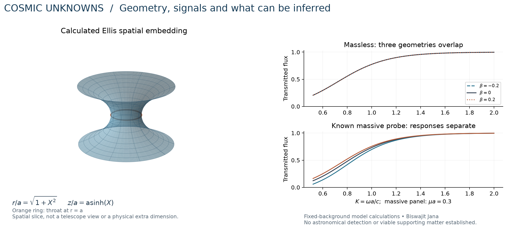

# Study 010: massive probes distinguish a massless-scattering degeneracy

**Author: Biswajit Jana**

**22 November 2026 · Working research report · Independent specialist review pending**

## Abstract

I extend the conformal metric construction of Study 009 in two directions: a massive scalar probe and an explicit test of a possible supporting-matter class. The mass term breaks the previous massless radial-operator identity. A new solver includes unequal asymptotic propagation speeds and the logarithmic phases required by the long-range potential. Across 972 deterministic spectra, the largest sampled massive transmission difference from the β = 0 reference is 0.06794, or 6.79 percentage points, at β = −0.2, K = 0.67 and angular mode ℓ = 0. A separate audit gives complex-amplitude differences below 4.09 × 10⁻⁹ on its sampled problems. This is a conditional distinction between prescribed metrics, not proof of unique geometric reconstruction or detectability with a real instrument.

A second calculation gives an exact source restriction: for every nonzero β in this family, the required stress violates the algebraic identity of a single static, minimally coupled radial scalar with a general Lagrangian P(χ,Z). The result excludes that supporting-matter class. It does not exclude nonminimal couplings, other fields or quantum stress, and it does not establish a stable replacement source. New README graphics show a calculated spatial embedding, the response separation and the physical limitations.

## 1. Question, conventions and established context

[Study 009](011-conformal-scattering-nonuniqueness.md) constructs

$$
\frac{ds^2}{a^2}=F_\beta(X)^2[-d\tau^2+dX^2+(1+X^2)d\Omega^2],\qquad
F_\beta=1+\beta(\arctan X-\pi/2),\quad\beta<1/\pi.
$$

Here τ = ct/a, K = ωa/c, and the right asymptotic lapse is one. For a minimally coupled massless scalar, all members have

$$
U_\ell^{(0)}=\frac{\ell(\ell+1)}{1+X^2}+\frac{1}{(1+X^2)^2}.
$$

Their common radial operator explains the earlier equality of scattering amplitudes in the stated phase convention. I now ask whether a probe with an independently known nonzero mass produces different flux spectra.

Massive scalar scattering through wormholes is established prior work. [Azad, Loran and Mostafazadeh (2020)](https://arxiv.org/html/2010.15023v2) derive the scalar reduction and its ultrastatic specialization; their equations supply a limiting-case check here. The present calculation applies it to the repository's non-ultrastatic conformal family with different endpoint lapse normalizations. It does not claim that using massive probes is itself a discovery. See the [reading-depth record](../references/massive-probes-2026-11-22.md).

## 2. Massive radial equation and open channels

Let μ = m_phys c/ℏ be inverse Compton length and ν = μa. The probe satisfies $(\Box-\mu^2)\phi=0$. With $\phi=e^{-iK\tau}Y_{\ell m}u/q$ and $q=F_\beta\sqrt{1+X^2}$,

$$
u''+[K^2-U_\ell^{(\nu)}]u=0,\qquad
U_\ell^{(\nu)}=U_\ell^{(0)}+\nu^2F_\beta^2.
$$

Consequently $\Delta U=\nu^2(F_\beta^2-1)$ is geometry dependent. Equality of operators is broken, although that fact alone does not quantify the difference in measured scattering.

At the two ends, define

$$
f_R=1,\qquad f_L=1-\pi\beta,\qquad
q_R=\sqrt{K^2-\nu^2},\qquad q_L=\sqrt{K^2-\nu^2f_L^2}.
$$

The solver requires both q values to be real and positive. In the chosen ν = 0.3 experiment, the largest channel threshold for β = −0.2, 0, 0.2 is approximately 0.48850. The common production grid starts at K = 0.52. Exact thresholds and closed channels are outside this implementation; the plotted threshold boundaries are analytical, not computed near-threshold scattering curves.

For β = 0, $F=1$, and massive scattering is exactly the old massless problem evaluated at $q=\sqrt{K^2-\nu^2}$. For ν = 0, the full massless degeneracy returns. Both limits are checked numerically.

## 3. Long-range boundaries and flux normalization

On each end take the outward coordinate y = |X| and side s = +1 on the right, −1 on the left. Then

$$
F_s(y)=f_s-s\beta\arctan(1/y),\qquad
U(y)=V_0+\frac{V_1}{y}+\frac{V_2}{y^2}+\cdots,
$$

where $V_0=\nu^2 f_s^2$ and $V_1=-2s\nu^2 f_s\beta$. The $1/y$ term produces a logarithmic phase. Define

$$
\eta_s=\frac{V_1}{2q_s},\qquad
J_s(y)=e^{i[q_s y-\eta_s\ln(2q_s y)]}\sum_{n=0}^{P}a_n y^{-n},\quad a_0=1.
$$

The logarithm has the standard Coulomb-wave form documented in [NIST DLMF §33.2](https://dlmf.nist.gov/33.2). An arbitrary constant phase is a convention; no Coulomb angular or gamma-function phase is added here. The full potential includes higher inverse powers and is not assumed to be an exact Coulomb potential. The series is asymptotic, in keeping with [DLMF §33.11 and its errata](https://dlmf.nist.gov/33.11), and is truncated at P = 12.

Substituting the ansatz directly into the differential equation, with α = −iη, gives the implemented recurrence

$$
a_{n+1}=\frac{[n(n+1)-2\alpha n+\alpha^2-\alpha]a_n-
\sum_{j=2}^{n+2}V_j a_{n+2-j}}{2iq(n+1)}.
$$

I generate V_j from the local inverse-radius expansion of the exact potential and independently check those coefficients by high-precision Taylor differentiation. This avoids transplanting a pure Coulomb series into a different potential without justification.

For incidence from the right, impose an outgoing solution at the left end, integrate across the metric, and decompose at the right into incoming $J_R^*$ and outgoing $J_R$. If the resulting coefficients are A_in and A_out, define $t=1/A_{\rm in}$ and $r=A_{\rm out}/A_{\rm in}$. The conserved radial current is $j=\operatorname{Im}(u^*u')$, hence

$$
R=|r|^2,\qquad T=\frac{q_L}{q_R}|t|^2,\qquad
t_{\rm flux}=\sqrt{q_L/q_R}\,t,\qquad R+T=1.
$$

Using |t|² alone as a transmission probability would be wrong when the asymptotic wave numbers differ. The same global frequency appears at both ends, so the ratio also describes the flux of conserved Killing energy. Local energy readings require their respective clocks. Reciprocity is checked by reversing incidence and comparing the flux-normalized complex transmission; reflection phases need not coincide for an asymmetric potential.

## 4. Numerical design and findings

The grid contains 81 K values: 39 samples from 0.52 to 0.90 and 43 from 0.90 to 2.00 with the duplicate endpoint removed. Three β values, two modes ℓ = 0, 1 and two masses ν = 0, 0.3 give 972 integrations. DOP853 uses relative tolerance 2 × 10⁻¹⁰ and absolute tolerance 2 × 10⁻¹², boundaries $L=\max(100,40/\min(q_L,q_R))$, and an oscillation-aware maximum step.

Production runs solve for u. Independent original-field checks instead integrate

$$
\phi''+2(q'/q)\phi'+[K^2-F^2\ell(\ell+1)/q^2-\nu^2F^2]\phi=0,
$$

where q in this equation denotes areal radius/a, not an asymptotic wave number. Boundary conversion and final extraction use u = qφ. This check probes both the field reduction and its implementation.

*Figure 1. Three prescribed geometries, two modes and two probe masses. Solid massive curves separate; dashed massless curves overlap. Lower panels subtract the β = 0 massive result at the same K. These are model predictions, not measured spectra.*

The largest sampled massive difference from β = 0 is −0.0679397421 at β = −0.2, K = 0.67, ℓ = 0. This is a 6.79 percentage-point difference in transmitted flux, not a 6.79% relative difference or a detection significance. No global optimum over K, β or mass is certified. The positive-β and angular-mode comparisons are also recorded in the complete CSV.

The production massless results are numerically identical across β because that solver uses the common reduced potential. This is a regression check, not independent numerical evidence for the cancellation; the original-field integrations and analytic argument in Study 009 provide that separate evidence.

| Check | Result |
|---|---:|
| Production spectra | 972 |
| Alternative-setting comparisons, six per audit problem | 108 |
| Largest production flux imbalance | 1.248 × 10⁻⁹ or less |
| Largest sampled complex-amplitude audit difference | 4.082 × 10⁻⁹ |
| Largest flux-normalized transmission reciprocity difference | 2.943 × 10⁻¹¹ or less |
| Largest normalized tail-current error | 8.882 × 10⁻¹⁶ |
| Largest ultrastatic limiting-case amplitude difference, 12 checks | 8.259 × 10⁻¹⁰ or less |
| Repository unit tests | 57 passed |

The 18 audit problems cover K = 0.54, 0.85, 1.6, both modes and all three geometries. Alternatives double L, change tail order to 8 or 16, tighten both tolerances by 100, integrate the original field, or reverse incidence. The verifier replays 36 production runs and 18 audit baselines, checks 12 independent Taylor expansions, and reconstructs saved summary quantities.

*Figure 2. Deterministic convergence diagnostics and the physical difference between flux transmission and an unweighted amplitude square. The audit compares r and flux-normalized t except for reciprocity, which compares t only. Values below 10⁻¹⁶ are displayed at that plotting floor.*

These differences are not statistical confidence intervals or certified bounds on every numerical error. No Monte Carlo errors, observation noise or detector uncertainty are simulated in this study. The previous statistical reports remain relevant when a physical measurement model is specified.

## 5. A restriction on supporting matter

The signal calculation treats the metric as given. To test one possible source, take Einstein gravity minimally coupled to a single scalar with action

$$
S_\chi=\int d^4x\sqrt{-g}\,P(\chi,Z),\qquad
Z=-\tfrac12g^{\mu\nu}\partial_\mu\chi\partial_\nu\chi.
$$

Variation gives $T_{\mu\nu}=P_Z\partial_\mu\chi\partial_\nu\chi+Pg_{\mu\nu}$. For a static radial profile χ = χ(X), both time and angular derivatives vanish. Therefore $T^t{}_t=T^\theta{}_\theta=P$, and necessarily

$$
\rho+p_t=0.
$$

This identity holds regardless of the function P, including the canonical and phantom kinetic signs. It is a necessary condition, not a sufficient existence or stability criterion.

Direct substitution of the conformal metric into the Einstein tensor instead gives

$$
\boxed{\frac{8\pi G a^2}{c^4}(\rho+p_t)=
-\frac{2\beta X}{F_\beta^3(1+X^2)^2}.}
$$

For any β ≠ 0 this is nonzero away from X = 0. Thus **a single static, minimally coupled radial scalar of the stated P(χ,Z) form cannot be the sole source of any nonzero-β member**. This obstruction is checked against a directly constructed four-dimensional Ricci tensor at 12 points and 70-digit precision, and across 1,803 double-precision profile points. Its full-domain statement follows from the displayed algebra, not from the finite sampling.

*Figure 3. The massive propagation channels are open over the production grid. The nonzero required ρ+p_t excludes a specified source class. A sign-changing curve is not evidence that an admissible material source has been found.*

This excludes neither arbitrary matter nor every scalar theory. Nonminimal curvature couplings, additional stresses, time-dependent fields with static stress tensors and quantum expectation values require different analyses. The β = 0 case passes this algebraic condition but remains subject to its known separate supporting-matter stability problem. The massive probe is not proposed as the supporting field.

## 6. Scientific image: what the README surface represents

At β = 0, an equatorial constant-time slice has $d\ell^2/a^2=dX^2+(1+X^2)d\varphi^2$. Embed it as a surface of revolution in Euclidean three-space with cylindrical radius r/a and auxiliary height z/a. Matching the radial line element gives

$$
\left[\frac{d(r/a)}{dX}\right]^2+\left[\frac{d(z/a)}{dX}\right]^2=1,
\qquad r/a=\sqrt{1+X^2},\quad z/a=\operatorname{asinh}X.
$$

*Figure 4. A calculated illustration of the Ellis spatial slice beside the ℓ = 0 spectra from this study. The spatial drawing depicts β = 0 only. It is not a camera image, a whole spacetime diagram, or evidence of a physical extra dimension. The meridian coordinates are saved and the rendering uses equal spatial units before perspective projection.*

For an optical appearance, use the separate [ray-traced camera calculation](006-what-a-wormhole-could-look-like.md), including its synthetic sky and observer assumptions. Neither visualization is an astronomical photograph.

## 7. What is resolved, and what remains open?

Two limited questions now have explicit answers. In this family and with fixed parameters, a massive scalar can separate spectra that coincide for a massless scalar. The nonzero-β geometries also fail a necessary condition for a specified simple source class. These findings sharpen the research direction; they do not demonstrate physical wormhole existence or certify first-in-literature novelty.

The next inference calculation must allow uncertainty in ν, the throat scale a, frequency calibration and response transfer. A nonzero fixed-parameter gap does not establish uniqueness after those nuisance parameters vary. A real massive scalar source and its detection channel must be identified before proposing an astronomical experiment; a scalar proxy is not automatically a model of neutrinos or electromagnetic radiation.

The next supporting-matter calculation should choose a concrete action outside the excluded class, verify every background equation, and then analyze the coupled perturbations. Merely adding an arbitrary anisotropic stress to match Einstein's tensor is not an explanation of that stress. Near-threshold and closed-channel scattering require additional boundary treatment and remain uncomputed. Formation, backreaction, energy constraints and observational alternatives are also open.

## Reproducibility and provenance

[Data guide and commands](../results/study-010/README.md) · [Numerical source](../scripts/massive_conformal.py) · [Independent verifier](../scripts/verify_massive_study.py) · [Literature](../references/massive-probes-2026-11-22.md).

Biswajit Jana is the sole listed author. AI assistance supported derivation drafting, implementation, source triage and verification design. Earlier scientific results retain their credit. The data are generated model outputs and the figures are reproducible mathematical renderings; no AI-generated raster is used as scientific evidence. Independent specialist review and a broader originality audit remain pending.
