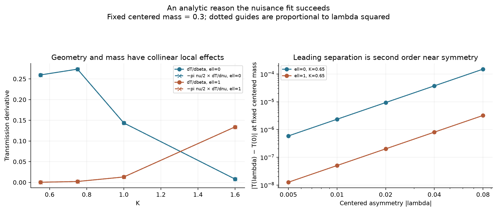
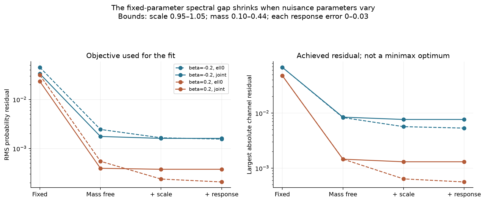
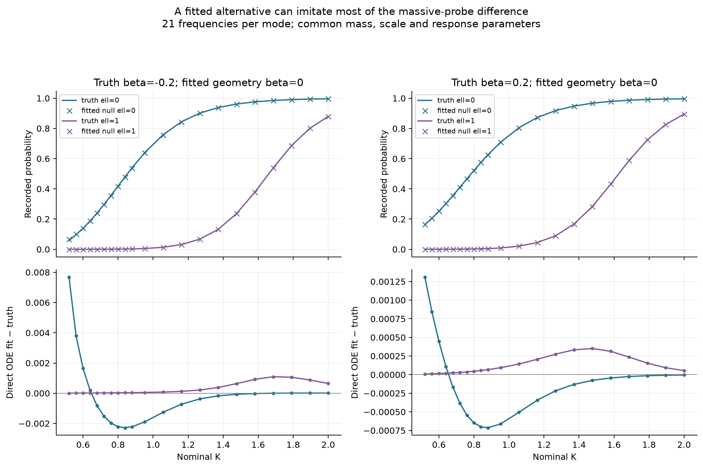

# Study 011: mass uncertainty absorbs much of the geometric signal

**Author: Biswajit Jana · 23 November 2026**

**Status: conditional analytic result and numerical fitting study; independent specialist review pending.**

## Abstract

Study 010 found a fixed-parameter massive-scalar transmission difference of up to 6.79 percentage points between selected conformal wormhole geometries. I now allow an alternative β = 0 geometry to adjust its mass-scale product, frequency scale and a shared detector response. On a 21-frequency subset, joint fits to modes ℓ = 0 and 1 reduce the largest channel difference from 6.790 to 0.767 percentage points for β = −0.2, and from 4.797 to 0.131 percentage points for β = +0.2. These are achievable fits, not certified global minima or detection thresholds. Residuals remain nonzero.

An exact centered parametrization explains the strong confounding. Reversing a centered asymmetry reverses the radial potential, leaving flux transmission unchanged. Wherever the scattering response is differentiable, its first-order geometry derivative at the symmetric member is proportional to its mass derivative. Thus additional transmission modes do not remove this particular first-order degeneracy when the mass-scale product is unknown. I verify parity, finite-difference sensitivity and the fitted spectra with direct ODE calculations. No observational counts or statistical confidence intervals are generated.

## 1. What is being tested?

The geometry and massive operator are inherited from [Study 010](012-massive-probes-and-source-obstruction.md):

$$
F_\beta=1+\beta(\arctan X-\pi/2),\quad
U_\ell=\frac{\ell(\ell+1)}{1+X^2}+\frac{1}{(1+X^2)^2}+\nu^2F_\beta^2,
\qquad \nu=\mu a.
$$

The previous comparison kept ν = 0.3 and the frequency scale fixed. That is appropriate for known parameters, but a measurement need not independently determine the mass, throat scale or calibration. I compare noise-free truth probabilities at β = ±0.2 with a β = 0 alternative. This assesses robustness of a signal, not physical existence or astrophysical detection.

For the ultrastatic β = 0 alternative, the exact massive response is the massless Ellis response $E_\ell(q)$ at

$$
q=\sqrt{(sK)^2-\nu_0^2},\qquad
p_\ell(K)=b+(1-b-c)E_\ell(q).
$$

The parameters are a multiplicative frequency/length scale s, an effective mass-scale product ν₀, a false-positive classification probability b and a false-negative probability c. All are common across the frequencies and any retained modes. This deliberately restrictive response model does not permit an independent correction in each channel.

The selected bounds are s ∈ [0.95,1.05], ν₀ ∈ [0.10,0.44] and b,c ∈ [0,0.03]. These are numerical stress-test assumptions, not measured instrument specifications or empirical priors. Treating s and ν₀ independently permits both mass/scale uncertainty and frequency calibration uncertainty; if external physics links them, that constraint must be imposed in a different fit. Both null channels remain open over the design.

## 2. Exact centered parity

Set

$$
C=1-\pi\beta/2,\qquad \lambda=\beta/C,\qquad \bar\nu=\nu C.
$$

Then $F=C(1+\lambda\arctan X)$ and

$$
U_\ell(X;\bar\nu,\lambda)=U_\ell^{(0)}(X)+\bar\nu^2(1+\lambda\arctan X)^2.
$$

The regular two-ended family corresponds to |λ| < 2/π, with

$$
\beta=\frac{\lambda}{1+\pi\lambda/2},\qquad
\nu=\bar\nu(1+\pi\lambda/2).
$$

Because $U_\ell^{(0)}$ is even, $U_\ell(-X;\bar\nu,\lambda)=U_\ell(X;\bar\nu,-\lambda)$. Reversing a real one-dimensional potential exchanges its incident ends. The Wronskian and flux normalization give equal left/right transmitted flux, including when the asymptotic wave numbers differ. Therefore

$$
\boxed{T_\ell(K;\bar\nu,\lambda)=T_\ell(K;\bar\nu,-\lambda).}
$$

This is a statement about flux probabilities; it does not assert equality of independently distance-referenced reflection phases. The established one-dimensional reciprocity principle is discussed in [Loran and Mostafazadeh (2016)](https://pmc.ncbi.nlm.nih.gov/articles/PMC4971248/). The unequal-speed normalization and logarithmic boundaries used here were derived and tested in Study 010.

Equivalently, replacing $(\beta,\nu)$ by $(-\beta/(1-\pi\beta),\nu(1-\pi\beta))$ reverses the potential. Geometrically, this includes exchanging the two ends and changing the length normalization. It is not evidence for two new physically inequivalent spacetimes with a known orientation and scale.

## 3. Local geometry–mass confounding

At λ = 0, differentiability and evenness imply $\partial_\lambda T=0$. At β = 0, $\partial_\beta\bar\nu=-\pi\nu/2$, so

$$
\boxed{\left.\partial_\beta T_\ell\right|_{\beta=0,\nu}
=-\frac{\pi\nu}{2}\left.\partial_\nu T_\ell\right|_{\beta=0}.}
$$

This identity holds separately at every frequency and angular mode under these assumptions. Stacking more such transmission channels retains proportional sensitivity columns. Any local information matrix formed from that Jacobian and positive measurement weights remains rank deficient in those two directions at symmetry. This is a first-order statement: higher-order information can still distinguish an asymmetry magnitude, and independent mass/scale measurements can remove the nuisance direction.

If the centered response is twice differentiable, its first correction is of order λ² rather than λ. The finite numerical sweep below supports that behavior on its tested range; it does not establish a universal measurement-budget law or a global identifiability theorem.

*Figure 1. Central finite differences with step 0.0005 check the derivative identity. The centered sweep holds bar-nu = 0.3 fixed while changing both β and ν according to the displayed transformation. Dotted curves are λ² guides, not fitted uncertainty bands.*

Across 30 positive/negative centered pairs, the largest flux-probability disagreement is 1.23 × 10⁻¹¹ or less. The largest derivative-identity residual at the smaller finite-difference step is 1.72 × 10⁻⁷ or less. These residuals contain truncation and integration error; the exact identity follows from parity and the chain rule.

## 4. Bounded fits and direct evaluation

I retain every fourth frequency from Study 010's 81-point grid, giving 21 frequencies between K = 0.52 and 2.00. The one-mode case has 21 probabilities and the joint case 42. Four nested alternatives are evaluated: fixed parameters, free mass alone, free mass and scale, and all four nuisance parameters free.

The objective is the unweighted mean squared probability residual. It is not a likelihood: no sample size, counting noise or observational covariance is specified. Multistart bounded least squares uses three starts for mass-only fitting and nine starts for each larger model. The smallest recorded objective is retained. The optimizer is local, and the saved solution is an achievable witness, not a certified global optimum. This distinction separates numerical profiling from a statistical profile-likelihood confidence interval; see the [literature note](../references/identification-and-source-2026-11-23.md).

For efficient fitting, I compute 2,002 massless template values on 1,001 q positions for each of two modes and use shape-preserving interpolation without extrapolation. I then evaluate every fitted channel directly with the wave equation: 504 direct integrations. Thus the reported final residuals are not surrogate-only results. A further 242 midpoint calculations audit the interpolation. The maximum tested interpolation discrepancy is 1.25 × 10⁻⁹ or less on those held-out points and 2.99 × 10⁻⁹ or less at the fitted evaluation points.

*Figure 2. Left: achieved RMS, the fitted objective. Right: the maximum absolute channel residual of that same fit. Minimizing RMS does not necessarily minimize the maximum, and no minimax optimum is claimed.*

| Truth β | Observables | Fixed maximum, percentage points | All-free maximum, percentage points | All-free RMS, probability units |
|---:|---|---:|---:|---:|
| −0.2 | ℓ = 0 | 6.78968 | 0.53473 | 0.00155602 |
| −0.2 | ℓ = 0 and 1 | 6.78968 | 0.76746 | 0.00161053 |
| +0.2 | ℓ = 0 | 4.79666 | 0.05622 | 0.00020825 |
| +0.2 | ℓ = 0 and 1 | 4.79666 | 0.13076 | 0.00037783 |

The joint β = −0.2 all-free fit has ν₀ ≈ 0.39912 and s ≈ 1.001117. The β = +0.2 joint fit has ν₀ ≈ 0.20637 and s ≈ 1.000187. Both shared response errors settle numerically at zero, so the response allowance does not further improve these joint fits appreciably. This is evidence about this bounded response model, not a general conclusion that calibration is irrelevant.

Mass-only adjustment already absorbs much of the change: the first-order centered values ν(1−πβ/2) are approximately 0.39425 and 0.20575. The fitted masses lie near those predictions, with finite-asymmetry corrections. Adding a mode constrains some of the finite differences, as seen in the larger maximum joint residuals compared with the one-mode fits, but it does not defeat the analytic first-order degeneracy.

*Figure 3. Solid lines are prescribed truth probabilities, crosses are direct evaluations of the fitted β = 0 alternative, and lower panels expose the remaining discrepancy. A close visual overlap is not exact equality. There are no statistical error bars because these are noise-free model probabilities.*

## 5. Verification, interpretation and open work

The runner performs 2,878 new ODE integrations: 2,002 templates, 242 held-out checks, 504 fitted-channel evaluations, 66 centered-parity cases and 64 sensitivity evaluations. Truth probabilities are reused from a hash-recorded Study 010 input. The verifier checks all saved predictions, replays 32 fitted channels and 11 parity cases, reconstructs derivatives, and refits the two flexible joint cases from their deterministic starts. The local fit RMS values are nonincreasing across the nested alternatives. See the [data guide](../results/study-011/README.md).

The result revises how the previous 6.79-point separation should be used: it is a fixed-parameter benchmark, not a robust identification guarantee. The remaining nonzero residual could still matter with adequate calibration and data. This study neither determines the required observing time nor proves exact overlap with the β = 0 null.

Next steps require explicit measurement assumptions: an independent mass/scale constraint, finite counting statistics, a physical source/detector model and justified response bounds. A global optimization certificate would be needed before calling a residual the smallest possible under its parameter bounds. Additional phase or clock data require their own calibrated forward model. Originality remains unverified beyond the targeted review.

## Provenance

Biswajit Jana is the sole listed author. AI assistance supported derivation drafting, numerical implementation, literature triage and verification design. Generated spectra are not astronomical observations. Known reciprocity, interpolation and identifiability concepts are credited. The analytic arguments, numerical checks and remaining specialist-review requirement are kept separate.
