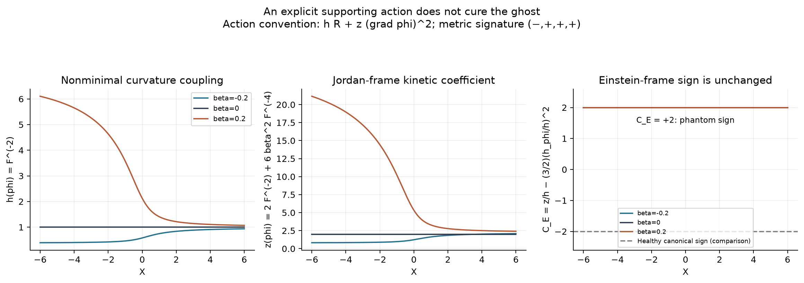
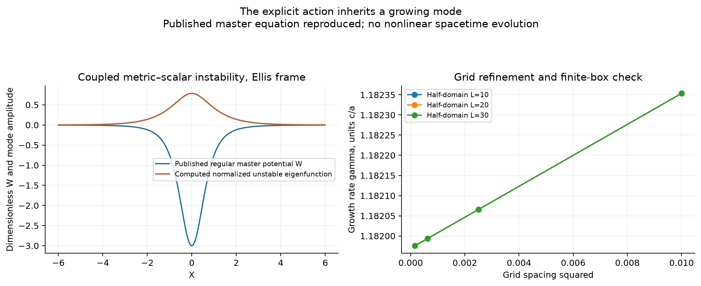

# Study 012: an explicit supporting action that retains the Ellis instability

**Author: Biswajit Jana · 23 November 2026**

**Classification: application of an established field redefinition and reproduction of a published instability; not a new viable wormhole.**

## Abstract

The conformal metrics used in the scattering studies have so far been prescribed backgrounds. I now construct an explicit nonminimally coupled scalar action supporting each metric, derive its field equations and check all diagonal metric equations plus the scalar equation at 35 points using 70-digit arithmetic. The construction is an invertible conformal rewriting of the known Ellis phantom-scalar theory. Its Einstein-frame kinetic coefficient remains +2 in the stated action convention, so the phantom sign is not removed.

I also reproduce the published regular coupled metric–scalar master operator for the symmetric Ellis background. Twelve finite-box/grid calculations give a growth rate approaching γ ≈ 1.18197 in units c/a. A simple variational trial function independently proves a negative eigenvalue. The regular field redefinition maps that physical instability into the constructed scalar–tensor theory. Thus this particular completion supplies field equations but fails the viability test. It does not settle the status of other supporting actions or physical wormholes generally.

## 1. Starting action and conformal transformation

Use signature (−,+,+,+), natural units in the action and a dimensionless scalar φ. The Ellis solution follows from

$$
S_E=\frac{1}{16\pi G}\int d^4x\sqrt{-g_E}
\left[R_E+2g_E^{\mu\nu}\partial_\mu\phi\partial_\nu\phi\right].
$$

Its field equations are $R^E_{\mu\nu}=-2\partial_\mu\phi\partial_\nu\phi$ and $\Box_E\phi=0$. The solution is

$$
ds_E^2/a^2=-d\tau^2+dX^2+(1+X^2)d\Omega^2,\qquad \phi=\arctan X.
$$

The positive scalar kinetic coefficient is the phantom sign with this metric convention; the healthy canonical sign would be negative. The known source and coupled instability are treated in [González, Guzmán and Sarbach](https://arxiv.org/html/0806.0608v2). The scalar normalization here is rescaled relative to theirs, and an overall action-sign convention does not change the classical field equations.

Define a field-dependent, positive conformal factor and Jordan metric

$$
F(\phi)=1+\beta(\phi-\pi/2),\qquad
g^J_{\mu\nu}=F^2g^E_{\mu\nu}.
$$

For β < 1/π, F stays positive and bounded away from zero on the background range $-\pi/2<\phi<\pi/2$. Substituting $g_E=F^{-2}g_J$ into the action and integrating a total divergence gives

$$
S_J=\frac{1}{16\pi G}\int d^4x\sqrt{-g_J}
\left[h(\phi)R_J+z(\phi)(\nabla\phi)^2_J\right],
$$

$$
\boxed{h=F^{-2},\qquad z=2F^{-2}+6\beta^2F^{-4}.}
$$

The total-divergence step concerns the local bulk equations; consistent gravitational boundary terms must be included if formulating a boundary variational problem. Conformal frame transformations are established techniques, reviewed by [Faraoni, Gunzig and Nardone (1999)](https://arxiv.org/abs/gr-qc/9811047). This report derives its particular coefficients rather than claiming a new general transformation.

For each fixed β, these functions specify an action. Varying β changes the functions in that action: this is not a one-parameter set of independently established solutions to one fixed Jordan action. In the source sector alone these actions are field-redefined descriptions of the same underlying phantom theory.

## 2. Full background equations

Variation with respect to the metric and scalar yields

$$
hG_{\mu\nu}+(g_{\mu\nu}\Box h-\nabla_\mu\nabla_\nu h)
+z\partial_\mu\phi\partial_\nu\phi-\tfrac12zg_{\mu\nu}(\nabla\phi)^2=0,
$$

$$
h_\phi R-z_\phi(\nabla\phi)^2-2z\Box\phi=0.
$$

On the proposed background,

$$
a^2R_J=-\frac{2}{F^2(1+X^2)^2},\quad
a^2(\nabla\phi)^2_J=\frac{1}{F^2(1+X^2)^2},\quad
a^2\Box_J\phi=\frac{2\beta}{F^3(1+X^2)^2}.
$$

These expressions cancel in the scalar equation. The metric equations follow from the invertible change of fields and are independently checked using Christoffel symbols and a directly constructed four-dimensional Ricci tensor. The audit differentiates the action couplings independently rather than substituting a zero residual by construction.

The grid has five β values (−0.2, 0, 0.1, 0.2, 0.3) and seven X positions from −8 to 8. All 140 diagonal metric checks have residual magnitude below 3.71 × 10⁻⁶⁸, and all 35 scalar checks below 5.20 × 10⁻⁶⁷, using 70-digit arithmetic. Static spherical symmetry makes the off-diagonal equations vanish identically. Finite point checks support the analytic transformation; they are not a computer-certified full-domain proof.

This evades the earlier single-static-*minimally*-coupled-scalar obstruction because h is not constant when β ≠ 0. It does not refute that obstruction. The nonminimal curvature term changes the field equations.

## 3. The phantom sign survives

Transforming back to an Einstein curvature term gives the kinetic coefficient

$$
C_E=\frac{z}{h}-\frac32\left(\frac{h_\phi}{h}\right)^2
=2+\frac{6\beta^2}{F^2}-\frac{6\beta^2}{F^2}=\boxed{2}.
$$

Thus the positive Jordan functions have not produced a healthy canonical scalar. The kinetic-sign check and the classical instability check below are distinct: a ghost sign alone is not used as a proof of an exponential classical mode.

*Figure 1. Calculated action coefficients along three backgrounds. The comparison line at −2 indicates a healthy canonical sign in this convention, not an alternative solution. All 1,803 plotted rows are saved.*

## 4. Reproducing the coupled growing mode

The regular master equation in the cited stability analysis specializes, for the symmetric Ellis solution, to

$$
\partial_\tau^2\Psi+H\Psi=0,\qquad
H=-\frac{d^2}{dX^2}-\frac{3}{(1+X^2)^2}.
$$

This is the published *coupled metric–supporting-scalar* operator, not the extra test-field potential in the earlier scattering work. Its derivation and reconstruction of a physical perturbation are taken from that source; I reproduce the resulting eigenproblem, not their entire gauge-invariant derivation.

For the trial function $v(X)=(1+X^2)^{-1/2}$,

$$
\|v\|^2=\pi,\qquad
\langle v,Hv\rangle=
\int_{-\infty}^{\infty}\frac{X^2-3}{(1+X^2)^3}\,dX=-\pi.
$$

The Rayleigh quotient is −1, so the bottom of the spectrum is at most −1. Since the potential decays and the essential spectrum starts at zero, there is a negative bound-state eigenvalue. A mode with $H\psi=-\gamma^2\psi$ grows as $e^{\gamma\tau}$, with γ ≥ 1. This simple variational calculation supplies an independent check of the existence of a growing mode in this master equation.

I discretize H with centered second-order differences and zero endpoint values, using half-domains L = 10, 20, 30 and spacings 0.1, 0.05, 0.025, 0.0125. The finest calculation gives γ = 1.18197571; second-order Richardson extrapolation from the finest two spacings at L = 30 gives approximately 1.18196973. The extrapolation is an estimate, not an interval-certified bound. The maximum discrete eigen-equation residual across the twelve calculations is 1.71 × 10⁻¹¹ or less.

*Figure 2. Reproduction of the regular master eigenproblem. The left eigenfunction is normalized by the discrete approximation to its squared integral. The right panel varies both box size and grid spacing. No nonlinear spacetime evolution or statistical uncertainty is simulated.*

For a fixed regular β, the linearized field map is

$$
\delta g_J=F^2\delta g_E+2FF_\phi g_E\delta\phi,\qquad
\delta\phi_J=\delta\phi_E.
$$

It is time independent and invertible on this background. With boundary/regularity conditions mapped consistently, a nontrivial exponentially growing source-sector perturbation cannot be erased by this change of variables. Right-asymptotic time is unchanged because F(+∞) = 1. Thus this completion inherits the instability; it does not provide a stable new source. The associated linear e-folding time is about 0.846 a/c, not a physical number of seconds until a is independently specified. This does not predict nonlinear collapse or expansion outcomes.

## 5. Probe coupling and physical interpretation

Earlier scattering calculations took the probe to be minimally coupled to g_J. If all matter and measurement apparatus were transformed together from an Einstein-frame theory, their masses and couplings would generally transform too. Holding the probe action fixed while changing the source-sector frame is an additional physical model choice. Therefore source-sector field equivalence must not be promoted to an equivalence of all experiments with unchanged instruments.

The present result closes one specific gap: an explicit action can reproduce the prescribed geometry outside the excluded minimal-scalar class. It also supplies a reason to reject this particular action as a viable stable completion. No new ghost-free or quantum-consistent material mechanism has been established. Other actions need their own equations and coupled stability analysis; the failure of this one is not a universal no-go theorem.

## Reproduction and provenance

[Data and commands](../results/study-012/README.md) · [Script](../scripts/scalar_tensor_completion.py) · [Sources and reading depth](../references/identification-and-source-2026-11-23.md).

Biswajit Jana is the sole listed author. AI assistance supported algebra drafting, implementation, source inspection and checks. The action transformation, cited instability operator, reproduced eigenvalue and conditional implications are distinguished explicitly. Independent specialist review and a comprehensive priority audit remain pending.
