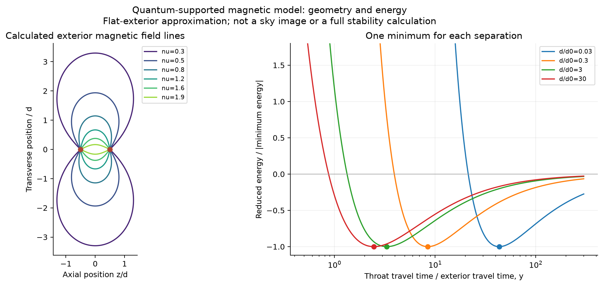
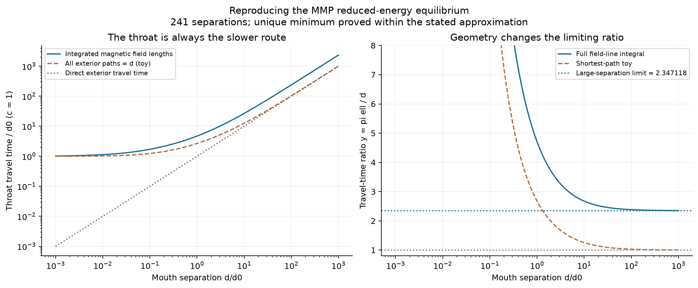
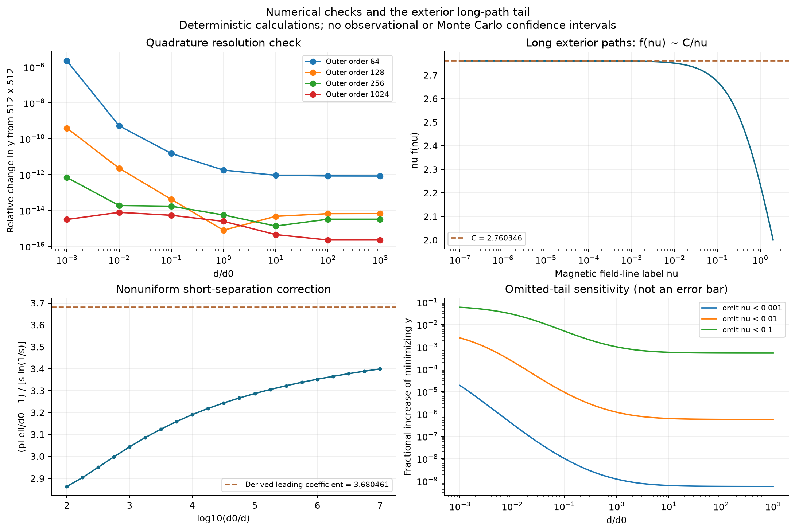
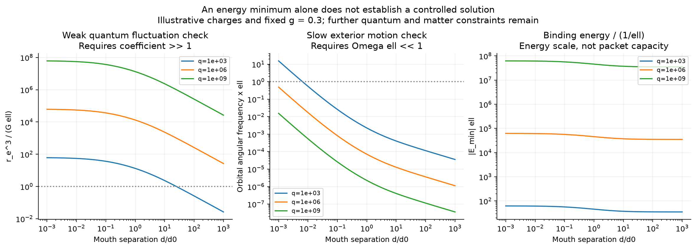

# Magnetic quantum support: equilibrium, long paths and limits

**Author: Biswajit Jana**

**Study 013 · 23 November 2026 · Working research report**

## Purpose and status

The explicit source in Study 012 inherited the Ellis phantom instability. I therefore examine a different published construction, rather than transform that action again. The question here is narrow: **what does the magnetic model's reduced energy actually establish, and how sensitive is its minimum to exterior path lengths?**

I reproduce the finite-separation energy of Maldacena, Milekhin and Popov (MMP), derive a unique-minimum argument, and examine the long-path tail. The numerical sweep contains 241 separations and four figures with raw data. This is a theoretical calculation; no astronomical measurements enter it. The energy minimum is not a demonstration of complete dynamical stability, formation or observed existence. The published construction and its approximate 2.35 travel-time ratio are prior results. The additional derivations below are supplied for scrutiny, without a priority claim.



*Exterior field lines in a meridional plane, with point mouths at z/d = ±1/2; signed transverse position shows both sides of the axis. The interior handle is not drawn. Every energy curve is divided by its own absolute minimum, so their depths cannot be compared on this plot. These are calculated model figures, not a sky image.*

## 1. Published input and what is reproduced

MMP uses Einstein–Maxwell theory with charged massless fermions. Its negative quantum energy differs from the classical phantom source. I take the finite-separation reduced energy, magnetic field-line relation and scale definitions from [MMP v3, Eqs. (2.3), (5.44)–(5.47), Appendix D](https://arxiv.org/html/1807.04726v3). This study reproduces that variational sector, not the complete semiclassical Einstein equations. Use natural units ℏ = c = 1:

$$
r_e^2=\frac{\pi q^2G}{g^2},\qquad
\ell_0=\frac{16r_e^3}{qG},\qquad d_0=\pi\ell_0,
\qquad s=\frac{d}{d_0},\quad y=\frac{\pi\ell}{d}.
$$

Here q is the positive integer magnetic flux, g the gauge coupling, d the exterior mouth separation, and ℓ an asymptotic-time throat scale. The leading throat crossing time is πℓ, not its spatial proper length. Define the dimensionless exterior line length f(ν) = L_ext(ν)/d and the normalized continuum average ⟨h⟩ = (1/2)∫₀²h(ν)dν. The input energy becomes

$$
E=\frac{\pi q}{6d}e(y;s),\qquad
e(y;s)=\frac{3}{8sy^2}+\frac{1}{4y}
-\left\langle\frac{1}{y+f}\right\rangle. \tag{1}
$$

The positive terms are the classical cost and anomaly contribution; the negative term depends on the complete magnetic loop. Setting f = 1 is the paper's shortest-exterior-path toy approximation. The actual point-monopole field lines satisfy f > 1 except for the straight limiting line. My code integrates them instead of making that substitution.

The continuum and flat-exterior approximations, weak coupling, large charge, well-separated mouths, appropriate fermion state and small quantum fluctuations are prerequisites. They are not consequences of minimizing (1).

## 2. Independent field-line coordinates

For mouth centers at z/d = ±1/2, introduce dimensionless prolate coordinates ξ ≥ 1 and −1 ≤ η ≤ 1:

$$
\frac zd=\frac{\xi\eta}{2},\qquad
\frac{\varrho}{d}=\frac{\sqrt{(\xi^2-1)(1-\eta^2)}}2.
$$

The difference of the two polar-angle cosines is the line label ν. Substituting the positions gives

$$
\nu=\frac{2\xi(1-\eta^2)}{\xi^2-\eta^2},\qquad
\xi(\eta;\nu)=\frac{1-\eta^2+
\sqrt{(1-\eta^2)^2+\nu^2\eta^2}}{\nu}. \tag{2}
$$

It follows by implicit differentiation that

$$
\xi'=\frac{\eta(\nu-2\xi)}{\nu\xi-(1-\eta^2)},\qquad
f(\nu)=\frac12\int_{-1}^{1}
\sqrt{(\xi^2-\eta^2)
\left[\frac{(\xi')^2}{\xi^2-1}+\frac{1}{1-\eta^2}\right]}\,d\eta. \tag{3}
$$

The straight ν = 2 line is evaluated as f = 1 separately. Algebraic rationalization of ξ − 1 avoids subtracting nearly equal floating-point numbers. Gaussian nodes avoid the coordinate endpoints. I also integrate arc length in the independent polar-angle parameterization at 45-digit arithmetic and check polygonal lengths directly. The saved positions satisfy the original cosine-difference relation to 1.83 × 10⁻¹⁴ in the sampled interior.

## 3. A unique global minimum within the reduced model

Define

$$
H(y;s)=\left\langle\left(\frac{y}{y+f}\right)^2\right\rangle
-\frac14-\frac{3}{4sy}.
$$

Differentiating (1) gives e′ = H/y², and

$$
H'=\left\langle\frac{2yf}{(y+f)^3}\right\rangle
+\frac{3}{4sy^2}>0. \tag{4}
$$

For finite s > 0, H tends to −∞ at y → 0 and to 3/4 at y → ∞. Dominated convergence applies to the bounded ratio in H despite the divergent mean of f. Hence H has exactly one zero. The energy decreases before that zero and increases afterward: it is the unique global minimum over y > 0. At the minimum e″ = H′/y² > 0. This argument removes an optimizer ambiguity for this one-variable functional; it says nothing about independent gravitational, matter or nonspherical perturbations.

Two useful bounds follow directly. Since f ≥ 1, H(1;s) < 0. Since the average squared ratio is strictly below one at finite y, H(1/s;s) < 0. Therefore

$$
y_* > \max(1,1/s),\qquad \pi\ell_* > d,
\qquad \ell_* > \ell_0. \tag{5}
$$

These are statements about the leading throat time and the exterior approximation. They are not a general causality theorem for arbitrary wormholes. The minimum has negative energy: as y → ∞, e approaches zero from below because y⟨1/(y+f)⟩ → 1.



| d/d₀ | Minimizing y = πℓ/d | πℓ/d₀ |
|---:|---:|---:|
| 0.001 | 1021.022220 | 1.021022 |
| 0.01 | 113.183389 | 1.131834 |
| 0.1 | 17.063676 | 1.706368 |
| 1 | 4.710376 | 4.710376 |
| 10 | 2.673834 | 26.738339 |
| 100 | 2.382368 | 238.236798 |
| 1000 | 2.350675 | 2350.674864 |

The formal s → ∞ root satisfies ⟨[y/(y+f)]²⟩ = 1/4 and is **2.347117859998** numerically. This reproduces MMP's approximately 2.35 result. For f = 1 the limiting root is instead one. The large-s limit at fixed charge eventually violates control assumptions; the decimal is a property of the reduced functional, not an arbitrarily long physical solution.

## 4. A nonuniform small-separation expansion

The f = 1 shortcut also hides a subtle short-separation effect. From (2)–(3), the long-line tail obeys

$$
f(\nu)\sim\frac C\nu,\qquad
C=\int_{-1}^{1}\sqrt{1+3\eta^2}\,d\eta
=2+\frac{\operatorname{asinh}\sqrt3}{\sqrt3}
=2.760345996301. \tag{6}
$$

In the bulk of the η interval, ξ ∼ 2(1−η²)/ν gives the displayed integrand after multiplying arc length by ν; the endpoint regions have vanishing contribution to that scaled limit. Consequently ⟨f⟩ diverges logarithmically. Expanding the integrand term by term as if ⟨f⟩ were finite is invalid, although the energy itself is finite.

Use instead the bounded loss

$$
J(y)=\frac12\int_0^2
\left[1-\left(\frac{y}{y+f(\nu)}\right)^2\right]d\nu.
$$

Splitting the ν integral at a fixed small cutoff and using f(ν) ∼ C/ν in the lower interval gives

$$
J(y)\sim\frac{C\ln y}{y}\quad(y\to\infty).
$$

For clarity, this is a leading equivalence: sandwich f between (C−ε)/ν and (C+ε)/ν near zero, integrate the monotone loss, and then let ε → 0. The remainder over the fixed upper interval is O(1/y) and cannot alter the logarithmic coefficient. The stationary equation is exactly

$$
\frac34\left(y-\frac1s\right)=yJ(y).
$$

It first implies y ∼ 1/s and then gives the leading nonanalytic correction

$$
\boxed{\frac{\pi\ell_*}{d_0}
=1+\frac{4C}{3}s\ln(1/s)
+o\!\left(s\ln(1/s)\right)},\qquad
\frac{4C}{3}=3.680461328401. \tag{7}
$$

This is a derivation for the idealized continuum energy, not a certified new result in the literature. The numerical coefficient approaches its limit slowly: at s = 10⁻⁷ the normalized correction is about 3.39913, still roughly 7.6% below 3.68046. The plot does not claim that the asymptotic regime is already exact there. Adaptive integration splits around ν ∼ 1/y, and solving for y − 1/s avoids cancellation. Refining its inner quadrature changes the sampled normalized coefficient by up to 2.30 × 10⁻⁶; this is separate from physical approximation error.

This formal limit also does not license overlapping mouths: d ≫ r_e must remain true, potentially requiring a joint large-charge limit. At finite charge, escape of the most extended lines can change the tail and the ordering of limits.



## 5. Sensitivity to removing poorly confined exterior paths

I repeat the minimization after deleting 0 < ν < ε from the negative energy integral, retaining the original measure dν/2 and leaving the other terms fixed. This is deliberately a sensitivity model, **not a calculated finite-charge correction or self-consistent quantum state**. The deleted interval has measure ε/2; the remaining weights are not renormalized.

At any fixed y, its contribution to H lies between zero and ε/2. Write H_cut = H − ΔH. For ε < 3/2, H_cut still increases to a positive value, so the truncated model also has a unique minimum. Since H_cut(y_full) ≤ 0, deletion increases the minimizing y. An analytic bracket is

$$
y_{\rm full}\le y_{\rm cut}\le y_{\rm upper},
\qquad H(y_{\rm upper};s)=\varepsilon/2. \tag{8}
$$

All 183 numerical omission cases lie in this bracket. The effect depends on separation and cutoff, which is why a universal finite-charge error bar would be unjustified. Missing modes may alter more than the Casimir term; that physics is not modeled here.

## 6. Necessary scale checks, not a viability certificate

The saved scale plot follows by substitution into the published definitions:

$$
\frac{\ell}{r_e}=\frac{16\pi q}{g^2}sy,\qquad
\frac d{r_e}=\frac{16\pi^2q}{g^2}s,\qquad
\frac{r_e^3}{G\ell}=\frac{q}{16sy},
$$

$$
\Omega\ell=\frac{2(\ell/r_e)}{(d/r_e)^{3/2}},\qquad
|E_{\min}|\ell=-\frac{qy e_*}{6}. \tag{9}
$$

The orbital expression uses the leading opposite-charge circular-orbit model. Weak throat fluctuations require the third ratio to be large; slow exterior motion requires Ωℓ to be small. The horizontal unit lines are reference scales, not sharp confidence boundaries. The binding ratio compares two energy scales; it is not a number of safely transmitted particles.



I use illustrative q = 10³, 10⁶, 10⁹ and fixed g = 0.3. No running-coupling calculation or Standard Model parameter fit is performed. These necessary diagnostics omit the stronger large-distance stress-fluctuation restriction in MMP v3 §5.5, finite fermion masses, interacting quantum corrections, radiative evolution and decay channels. The model can possess a mathematical energy minimum where a controlled semiclassical solution has not been established. A full stability claim cannot be inferred from e″ > 0.

## 7. Verification and data meaning

| Check | Result |
|---|---:|
| Equilibria independently replayed at 1024 × 1024 Gaussian order | 241 |
| Largest relative change in y in that replay | 8.00 × 10⁻¹⁵ or less |
| Independent bounded energy minimizations | 13 |
| Largest relative root/optimizer disagreement | 4.29 × 10⁻⁸ or less |
| Independent polar-angle length integrals, 45-digit arithmetic | 9 |
| Largest relative angle/prolate length discrepancy | 1.63 × 10⁻¹⁴ or less |
| Largest sampled stationarity residual | 2.80 × 10⁻¹⁴ or less |
| Omission-bound checks | 183 |
| Scale rows independently recalculated | 723 |

The quadrature agreement is an empirical numerical diagnostic, not a rigorous interval enclosure or estimate of omitted physics. No statistical error bars are appropriate for these deterministic curves. The earlier synthetic counting studies retain their own confidence intervals. The small-separation adaptive audit has its own, larger numerical differences, reported in §4 and the data files. All 74 repository tests pass at this revision.

Reproduce from the repository root:

```powershell
.venv\Scripts\python.exe scripts/run_magnetic_study.py
.venv\Scripts\python.exe scripts/verify_magnetic_study.py
.venv\Scripts\python.exe -m unittest discover -s tests -v
```

[Raw data, units and file map](../results/study-013/README.md) · [Verification record](../results/study-013/verification.json) · [Reading record](../references/magnetic-support-2026-11-23.md).

## 8. Consequences and next falsifiable work

The calculation supplies a different source mechanism and a checked equilibrium sector. It does not rescue the previous phantom completion, nor transfer its spectra to a magnetic geometry. It also makes the next research step more precise:

1. Reproduce the **actual magnetic-background** finite-bandwidth scattering calculation, with explicit incident energy, observation duration and boundary treatment. The current [Freivogel–Fumagalli–Tomašević v2](https://arxiv.org/html/2606.12528v2) makes probe type and collection time essential; its abstract/introduction were reviewed, not its full scattering derivation reproduced here.
2. Compute the finite-charge escape correction and corresponding quantum stress consistently, rather than identify the deletion experiment with physical error bars. Test the order of the large-charge and small-separation limits in (7).
3. Add the stronger stress-fluctuation bound and interacting/massive-fermion effects before selecting a physical parameter set. Verify the complete background and coupled perturbations for that set.
4. Assess plausible formation and competing compact-object responses before fitting astronomical data. A narrow signal model without an identified target or detector does not constitute a search for an observed wormhole.

The contribution is a reproducible extension of an established theoretical construction. A comprehensive novelty search and independent specialist review remain pending. Wormhole existence has not been established by this report.

## Methodological provenance

Biswajit Jana is the sole listed author. AI assistance was used to explore derivations, implement calculations and prepare prose; this is not a substitute for the author's subsequent verification or independent specialist review. Prior theoretical results retain their authors' credit. Original figures were generated from the saved equations and tables, with no AI-generated depiction used as scientific evidence.
