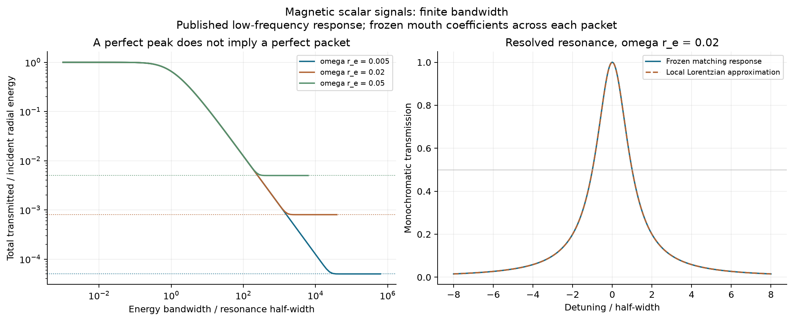
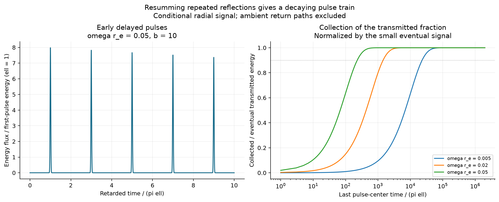
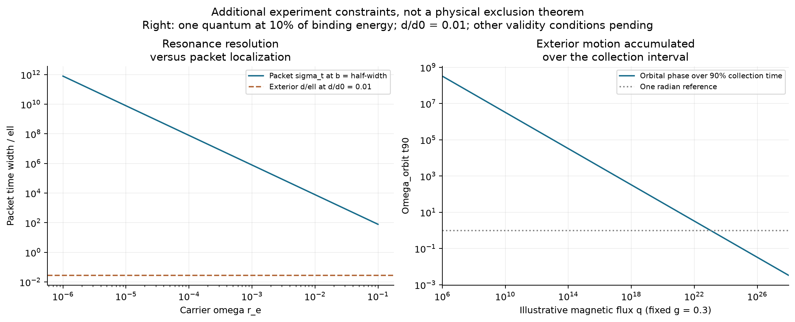

# Magnetic wormholes: finite bandwidth and collection time

**Author: Biswajit Jana**

**Study 014 · 25 November 2026 · Working research report**

## Purpose and result

Study 013 reproduced the magnetic model's reduced support energy. Here I ask what a finite signal can transmit through that model, and whether resonant transmission fits a localized launch experiment. I implement the published neutral, massless scalar matching response, factor it into delayed pulses, and perform 303 Gaussian bandwidth calculations. All data are theoretical; no observational dataset or physical scalar detector is assumed.

Within the stated low-frequency, frozen-response approximation, a monochromatic resonance transmits perfectly, but a packet spanning many resonances transmits the much smaller fraction 2(ωr_e)²/[1+(ωr_e)⁴] of its incident **radial energy**. Resolving a single resonance requires a packet too long for the localized exterior-launch hierarchy considered here. Collection can require billions of pulses in an illustrative energy-limited parameter choice. These results refine an established mechanism; they do not establish a new wormhole discovery, prove full stability, or exclude other experiments.



## 1. Published input and conventions

The input is [Freivogel, Fumagalli and Tomašević, v2, Eqs. (20)–(22)](https://arxiv.org/html/2606.12528v2). Its neutral scalar response uses low-frequency matching on the MMP magnetic geometry. I reproduce those algebraic matching equations independently below; I do not solve a complete finite-charge background or the full radial differential equation.

Use ℏ = c = 1 and define x = ωr_e, z = ωℓ, a = x². The symbol x here is **not** the paper's temporary squared-frequency variable in its finite-time discussion. The reflected and transmitted amplitudes are

$$
\mathcal R=\frac{(a^2-1)\sin\pi z}
{2ia\cos\pi z+(1+a^2)\sin\pi z},\qquad
\mathcal T=\frac{-2ia}{2ia\cos\pi z+(1+a^2)\sin\pi z}. \tag{1}
$$

For real frequency, |R|² + |T|² = 1. The calculation is conditional on the specified incoming radial channel and excludes ambient propagation between mouths. It is not a complete astronomical scattering experiment. The retained rational terms in (1) do not imply that all corresponding higher-order corrections to the spacetime matching have been controlled.

The independent four-equation check equates constant and inverse-radius coefficients at each end. With e_± = exp(±iπz/2), unit incoming amplitude, and unknowns (c_in,c_out,R,T), the equations are

$$
\begin{aligned}
e_-c_{in}+e_+c_{out}&=i(R-1),\\
ia(e_-c_{in}-e_+c_{out})&=1+R,\\
e_+c_{in}+e_-c_{out}&=iT,\\
ia(e_-c_{out}-e_+c_{in})&=T.
\end{aligned} \tag{2}
$$

Solving this linear system at 24 points agrees with (1) to 7.60 × 10⁻¹⁵ or better. This checks the matching algebra and conventions, not the neglected terms in the low-frequency approximation.

## 2. Factorization and delayed pulses

Introduce p = 4a/(1+a)² and R_c = 1−p. The subscript distinguishes the positive round-trip amplitude factor from the complex reflected amplitude in (1). Algebra gives

$$
\mathcal T=-\frac{p e^{i\pi z}}{1-R_c e^{2i\pi z}}
=-p\sum_{m=0}^{\infty}R_c^m e^{i(2m+1)\pi z}. \tag{3}
$$

Equation (3) is pointwise valid with the frequency-dependent p. To interpret it as identical delayed envelopes, I additionally freeze p at the carrier frequency, requiring a small fractional bandwidth. This is not a model of dissipation or an assumption of infinite detectable echo energy: successive amplitudes decay as R_c^m.

Let u = (t−r₀−r_obs)/ℓ. Define an incident **energy amplitude** whose squared spectral norm is the radial incident energy. For a positive-frequency scalar field this corresponds to using ω times the field amplitude. Its carrier-removed Gaussian is

$$
F(u)=\left(\frac{2b^2}{\pi}\right)^{1/4}e^{-b^2u^2},
\quad\int |F|^2du=1,\quad
\sigma_u=\frac1{2b},
$$

where b is the standard deviation of the incident energy spectrum in z. The extension of the envelope integral to negative detunings assumes the carrier z₀ ≫ b, so negative absolute frequencies carry negligible weight. At an integer carrier, after removing an irrelevant overall phase,

$$
F_{tr}(u)=-p\sum_{m\ge0}R_c^m F\big(u-(2m+1)\pi\big). \tag{4}
$$

Gaussian tails are noncompact, so the plotted first pulse has no mathematically sharp turn-on. For well-separated packets, overlap is exponentially suppressed. A direct coherent time integral is also tested in overlapping cases; energy is not computed by summing intensities when interference matters.

## 3. Finite collection and bandwidth

For separated pulses, the energy in pulse m is p²R_c^(2m). Thus after N complete transmitted pulses,

$$
P_N=\frac{p}{2-p}\left[1-R_c^{2N}\right],\qquad
P_\infty=\frac{p}{2-p}=\frac{2a}{1+a^2}. \tag{5}
$$

P∞ is the fraction of **incident radial energy**, not half of all incoming energy. The paper's half-horizon-area statement concerns a cross-section with a different normalization. I retain radial energy fractions throughout to prevent conflating them.

To collect fraction f of the eventual transmitted energy, the continuous pulse-count threshold is

$$
N_f=\frac{\ln(1-f)}{2\ln(1-p)}.
$$

Round upward for the number of complete pulses. The center of the last counted pulse occurs at u = (2⌈N_f⌉−1)π. This is a nominal collection-time scale, not the exact finite-width quantile; allowing several packet widths collects that pulse's Gaussian tails. In the small-x limit,

$$
N_{90}\sim\frac{\ln10}{8x^2},\qquad
\frac{t_{90}}{\ell}\sim\frac{\pi\ln10}{4x^2}. \tag{6}
$$

The delayed-pulse decay resums effects that matter at m of order 1/p. A leading fixed-m approximation with apparently equal odd pulses cannot be extended indefinitely to infer divergent energy.



For general bandwidth, the frozen-response energy average is

$$
P_b=\int_{-\infty}^{\infty}\frac{e^{-(\delta-\delta_0)^2/(2b^2)}}{\sqrt{2\pi}b}
\frac{p^2}{p^2+4R_c\sin^2\pi\delta}\,d\delta. \tag{7}
$$

The half-width of a peak in z is

$$
h=\frac1\pi\arcsin\frac{p}{2\sqrt{R_c}}
\simeq\frac{2x^2}{\pi}. \tag{8}
$$

A centered packet with b ≪ h approaches unit transmission. At b ≫ 1 the spectrum averages over many resonances and approaches (5). These are different limits, not contradictory predictions. For a single narrow peak, the Lorentzian–Gaussian approximation provides another check, but it is not used as the full multi-resonance answer.

I avoid uniform-grid peak sampling by periodizing the Gaussian and changing variables within one period:

$$
\tan\pi\delta=k\tan\theta,\qquad k=\frac{p}{2-p},
\qquad |\mathcal T|^2d\delta=\frac{k}{\pi}d\theta.
$$

An independent Fourier identity is

$$
P_b=k\left[1+2\sum_{j\ge1}R_c^j
e^{-2\pi^2b^2j^2}\cos(2\pi j\delta_0)\right]. \tag{9}
$$

Forty-five centered and detuned cases compare these different numerical routes. A packet at a phase-cell boundary has two wrapped pieces; both must be explicitly resolved. Adaptive quadrature's internal error estimate alone proved insufficient for this edge case during development. The corrected implementation includes it in regression tests.

## 4. Beyond Gaussian packets: a support and coherence result

There is a stronger statement within the frozen-response model. Let F be any normalized complex energy envelope, with autocorrelation

$$
C(\tau)=\int F^*(u)F(u-\tau)\,du,\qquad C(0)=1.
$$

Expanding the norm of the full delayed train (4), grouping pairs by their pulse-index difference, and summing the geometric weights gives

$$
P_\infty=\frac{p}{2-p}
\left[1+2\operatorname{Re}\sum_{j\ge1}R_c^j C(2\pi j)\right]. \tag{9a}
$$

The series converges absolutely because |C| ≤ 1 and R_c < 1. If F is supported in an interval of duration D < 2π in u units, distinct delayed copies have disjoint supports. Every displayed nonzero-lag autocorrelation vanishes. Therefore **all such normalized pulse shapes have exactly the same eventual transmitted energy p/(2−p)** in this effective model, and (5) holds for complete collected pulses. Chirping a compact pulse does not change this conclusion. This is not peculiar to a Gaussian envelope or an isolated numerical example.

For noncompact pulses, the error made by discarding interference obeys

$$
\left|\frac{P_\infty}{p/(2-p)}-1\right|
\le2\sum_{j\ge1}R_c^j|C(2\pi j)|. \tag{9b}
$$

The Gaussian case has |C(2πj)| = exp(−2π²b²j²), recovering (9). Six additional cases compare direct coherent integration with a finite autocorrelation sum: compact cos-squared envelopes with durations 0.4, 1.4 and 8 in ℓ units, each with and without quadratic phase. The two shorter durations obey the shape-independent result; the duration-8 cases include overlap explicitly.

Strict time support implies nonzero spectral tails. Thus this is an exact theorem for the **frozen-coefficient effective response**, not an exact all-frequency theorem for the physical low-frequency scalar problem. Applying it to a real packet also requires bounding spectral tails and frequency variation of the mouth coefficients. Pulse shaping cannot remove the separated-copy suppression within this model, but the result does not prohibit other preparations or different channels. Its priority in the wider scattering literature has not been established.

## 5. A localization obstruction for this launch setup

The localized exterior launch requires a packet size much smaller than the mouth separation, with a launch radius between the mouth scale and that separation. At minimum it needs σ_t ≪ d. Since σ_t = ℓ/(2b) and d/ℓ = π/y,

$$
b\gg\frac{y}{2\pi}. \tag{10}
$$

Study 013 gives y > 1 for the reduced support model; the localized configuration used in the scattering discussion takes d < ℓ, imposing an even stronger hierarchy. By contrast, efficient single-resonance transmission requires b of order h or smaller, with h ≪ 1 at low frequency. These hierarchies cannot both be parametrically satisfied. A narrowly resonant wave is a long-duration, spatially extended preparation, rather than the localized pulse assumed by this experiment.

This is an obstruction for a specified Gaussian, low-frequency, local-launch setup. It does not exclude continuous driving, extended preparation, feedback, different probes or a different source geometry. A resonance is also generic to suitable double-barrier systems; it does not identify wormhole topology uniquely.

## 6. Energy and collection-time example

To connect the signal algebra to support scales, take Study 013's reduced equilibrium at s = d/d₀ = 0.01, g = 0.3 and q = 10⁹. These are illustrative theory parameters, not fitted astrophysical quantities. Substitution gives ℓ/r_e = 6.32135 × 10¹¹ and |E_min|r_e = 9.73383 × 10⁻⁵. Choose a carrier quantum energy equal to 10% of this binding scale, so x = 9.73383 × 10⁻⁶, and b = 1000.

| Quantity | Calculated value | Meaning |
|---|---:|---|
| σ_t/d | 0.0180 | Necessary packet-localization ratio; not a complete launch configuration. |
| b/z₀ | 1.6252 × 10⁻⁴ | Small relative bandwidth for freezing mouth coefficients. |
| First-pulse energy fraction | 1.4363 × 10⁻¹⁹ | Relative to incident radial energy. |
| Eventual transmitted fraction | 1.89495 × 10⁻¹⁰ | Formal static conditional model. |
| Continuous N₉₀ | 3.03779 × 10⁹ pulses | Collects 90% of the tiny eventual fraction, not 90% of incident energy. |
| σ_t/d if b = resonance half-width | 2.98645 × 10¹¹ | The narrow resonant packet is not localized near one mouth. |
| Ω_orbitℓ | 5.43969 × 10⁻⁴ | Slow motion over one throat scale. |
| Ω_orbit t₉₀ | 1.03827 × 10⁷ | Large exterior motion over the nominal collection interval. |

The 10% energy allocation is an assumed conservative comparison, not a proven collapse threshold. It uses the carrier quantum; total packet energy, spectral tails, trapping and the quantum state require separate treatment. The normalized classical fractions can be rescaled in amplitude, but that does not solve the quantum detection problem.

I compare Gaussian frequency-dependent mouth probabilities with frozen coefficients in four q scenarios. At q = 10⁹ the eventual fraction changes by 2.65 × 10⁻⁸ or less relatively, and first-pulse energy by 1.59 × 10⁻⁷ or less. The collected energy at the nominal N₉₀ is checked as well. These small approximation differences do not constrain errors in the physical background.



The last ratio in the table is a warning against using an untracked, static-exterior observation model for the entire collection interval. **It is not proof of decoherence, instability or signal destruction**: a rotating-frame treatment, tracked observers or a time-dependent solution might change the experiment. A larger charge reduces the orbital rate in this fixed-g scaling, but the scan does not establish that such parameters satisfy all physical constraints.

Unimplemented conditions include the stronger quantum stress-fluctuation restriction, interacting and massive fermions, radiation and lifetime, running coupling, complete source stability, and the effect of any proposed shielding on the state supporting the throat. Long-time ambient returns cannot be silently discarded in a full physical experiment. No prediction in seconds, sky flux or detection significance is justified here.

## 7. Verification and interpretation

The checks include 24 independent matching systems, 45 Gaussian/Fourier comparisons, three Gaussian time-integral/overlap-sum comparisons, six compact-pulse cases, 31 tighter-tolerance bandwidth replays, and four parameter scenarios. The largest matching difference is below 7.60 × 10⁻¹⁵, flux error below 4.45 × 10⁻¹⁶, Gaussian/Fourier absolute difference below 5.56 × 10⁻¹⁷, and Gaussian time-integral difference below 8.68 × 10⁻¹⁸ in the sampled cases. These are floating-point diagnostics, not rigorous or physical uncertainty bounds. All 84 repository tests pass at this revision.

Three figures and twelve CSV tables preserve spectra, resolved peaks, bandwidth averages, time profiles, collection curves, audits and parameter choices. Deterministic curves do not have fabricated observational error bars. Reproduce with:

```powershell
.venv\Scripts\python.exe scripts/run_magnetic_signals.py
.venv\Scripts\python.exe scripts/verify_magnetic_signals.py
.venv\Scripts\python.exe -m unittest discover -s tests
```

[Data and column guide](../results/study-014/README.md) · [Verification](../results/study-014/verification.json) · [Source reading record](../references/magnetic-signals-2026-11-24.md).

The next useful work is a time-dependent experiment model that includes exterior returns and the evolution of the supporting state, followed by a probe with a justified source and detector. Merely plotting finer resonances will not settle these requirements. The source construction and probe dependence are established prior work; the local algebraic extensions and joint parameter checks are supplied for scrutiny, without a novelty claim. Physical wormholes remain unestablished by this project.

## Methodological provenance

Biswajit Jana is the sole listed author. AI assistance was used for derivation exploration, implementation and prose. The report does not imply that the author has personally completed an independent audit. Specialist review and a comprehensive priority assessment remain pending. Scientific sources retain credit; figures are generated from saved mathematical calculations.
